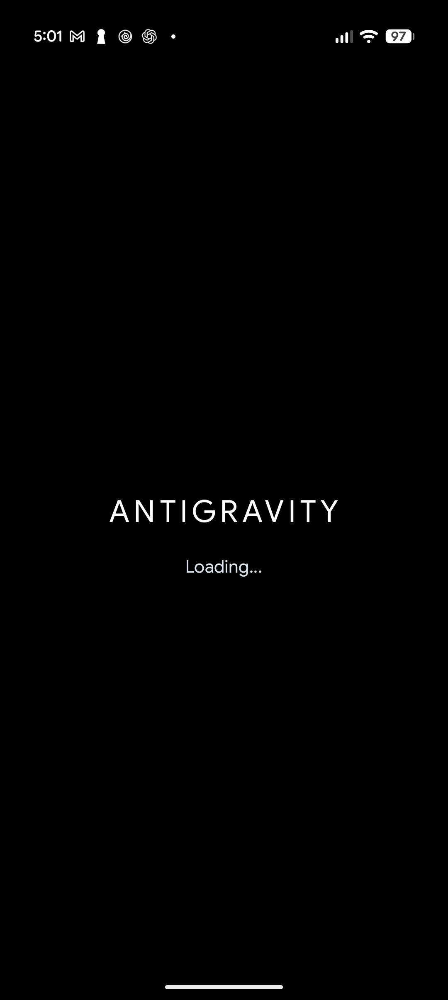
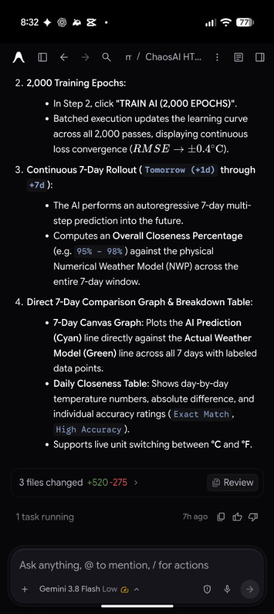
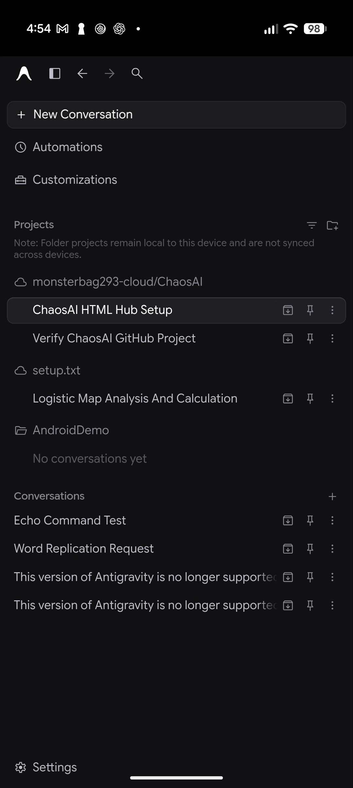
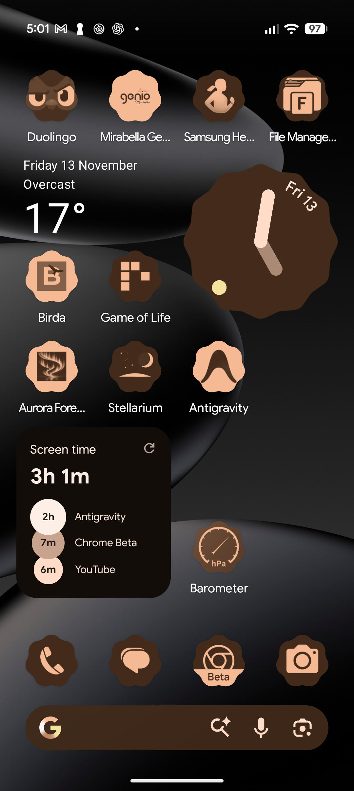

# Google Antigravity for Android (Unofficial Port)

[](https://www.android.com/)
[](https://developer.android.com/jetpack/compose)
[](#quick-download)
[](https://github.com/monsterbag293-cloud/Antigravity-Android/releases/latest)
[](https://github.com/monsterbag293-cloud/Antigravity-Android/stargazers)

An unofficial native Android port and mobile compatibility runtime for **Google Antigravity**, allowing developers to run Antigravity's autonomous agent environment and workspace directly on Android phones and tablets without requiring a desktop tether.

---

> [!IMPORTANT]
> ### Legal Disclaimer & Trademark Notice
> This project is an **independent, community-maintained compatibility layer** and is **not** created, endorsed, sponsored, or affiliated with Google LLC or Alphabet Inc.
> 
> * **Google Antigravity**, **Gemini**, and related trademarks, logos, and service assets are the exclusive intellectual property of **Google LLC**.
> * This repository **does NOT claim any ownership or license** over Google's proprietary binaries, assets, or trademarks.
> * This repository does not contain a broad permissive license (such as MIT or Apache 2.0) claiming rights over the software. All rights to the underlying Antigravity software remain reserved by their respective copyright holders.

---

## 📥 Quick Download

**Get the latest build in one click:**

[](https://github.com/monsterbag293-cloud/Antigravity-Android/releases/latest)
[](dist/antigravity-android-preview.apk)

| Source | What you get | Recommended for |
|--------|--------------|-----------------|
| **[GitHub Releases](https://github.com/monsterbag293-cloud/Antigravity-Android/releases/latest)** | Versioned APKs + release notes + checksums | Most users |
| **[Direct preview APK](dist/antigravity-android-preview.apk)** (~46.7 MB) | Current committed preview build | Quick testing |

> Prefer the **Releases** page for the newest tagged builds and changelogs.

---

## Table of Contents

- [Screenshots](#screenshots)
- [Features](#features)
- [Installation](#installation)
- [Project Structure](#project-structure)
- [Building from Source](#building-from-source)
- [Community, Issues & Feedback](#community-issues--feedback)

---

## Screenshots

| Google Sans Splash / Loading | Single-Conversation Chat | Interactive Sidebar Drawer | Pixel Launcher Icon |
| :---: | :---: | :---: | :---: |
|  |  |  |  |

---

## Features

- **Native Language Server Bridge**: Connects in-app WebViews to local language servers and gRPC-Web proxy streams natively on Android.
- **Mobile Touch Drawer**: Fluid, GPU-accelerated left panel with live finger tracking and horizontal swipe-to-open / swipe-to-close gestures.
- **Strict Single-Conversation Layout**: Removes desktop split-view anomalies on narrow viewports; sequential conversation clicks load cleanly within the viewport.
- **Customization & Plugin OAuth Support**: External authentication flows (e.g. Google Drive, GitHub) open via Chrome Custom Tabs and return cleanly to the app upon sign-in.
- **Stationary 2-Second Long-Press Drag**: Prevents accidental item grabbing while scrolling lists; drag-and-drop triggers only after holding stationary for 2 seconds.
- **Adaptive Vector Launcher Icon**: Official Antigravity gradient glyph accurately centered inside Android's adaptive icon safe zone with dynamic color support.
- **Native Typography**: Styled with Google Sans and Material 3 design tokens.

---

## Installation

### Method 1: Direct Install on Android Phone / Tablet (Recommended)
1. Download the latest APK from the [Releases](https://github.com/monsterbag293-cloud/Antigravity-Android/releases/latest) page (or use the [direct preview link](dist/antigravity-android-preview.apk)).
2. Tap the downloaded file in your browser or File Manager.
3. If prompted, allow “Install from unknown sources” for your browser / file manager.
4. Tap **Install** and open the app.

### Method 2: Via ADB (Android Debug Bridge)
If your device is connected to a computer with USB debugging enabled:

```bash
# Download the APK first, then:
adb install -r path/to/antigravity-android-preview.apk

# Or, if you have the file in dist/:
adb install -r dist/antigravity-android-preview.apk
```

To launch the app directly via command line:
```bash
adb shell am start -n dev.agentic.workspace/.MainActivity
```

---

## Project Structure

```text
Antigravity-Port/
├── app/                        # Android application module (Compose UI, MainActivity)
│   ├── src/main/kotlin/        # App navigation, WebView host, native bridges
│   └── src/main/res/           # Adaptive launcher icons, drawables, themes
├── core/
│   ├── data/                   # Local storage, key-value repositories
│   ├── designsystem/           # Themes, colors, typography (Google Sans)
│   ├── model/                  # Domain models (Conversations, Projects, Agents)
│   └── network/                # Jetski bundle loader, gRPC-Web frame codec, HTTP interceptor
├── feature/
│   ├── agentmanager/           # Custom agent creation and runtime controller
│   ├── browser/                # Integrated web browser pane
│   ├── conversations/          # Chat history and thread management
│   ├── files/                  # Workspace file browser and editor
│   ├── projects/               # Local folder projects and workspace manager
│   ├── settings/               # App configuration and connection settings
│   └── terminal/               # Local command runner and terminal shell
├── docs/screenshots/           # Screenshots shown in this README
├── dist/                       # Compiled preview APK binaries
└── .github/                    # Issue forms, discussions templates, CI/CD release workflows
```

---

## Building from Source

### Prerequisites
- JDK 17 or higher
- Android SDK (API 35 / Build-Tools 35.0.0)
- Android device or emulator running Android 10 (API 29) or higher

### Build Steps
```bash
# Debug build
./gradlew :app:assembleDebug

# The built APK will be located at:
# app/build/outputs/apk/debug/app-debug.apk
```

---

## Community, Issues & Feedback

- **Bug Reports**: Encountered a visual glitch or gesture conflict? Open a [Bug Report](.github/ISSUE_TEMPLATE/bug_report.yml) with your device model and steps to reproduce.
- **Feature Requests**: Have an idea for mobile UI improvements? Submit a [Feature Request](.github/ISSUE_TEMPLATE/feature_request.yml).
- **Discussions & Ideas**: Share mobile workflows and suggest ideas in [GitHub Discussions](https://github.com/monsterbag293-cloud/Antigravity-Android/discussions).
