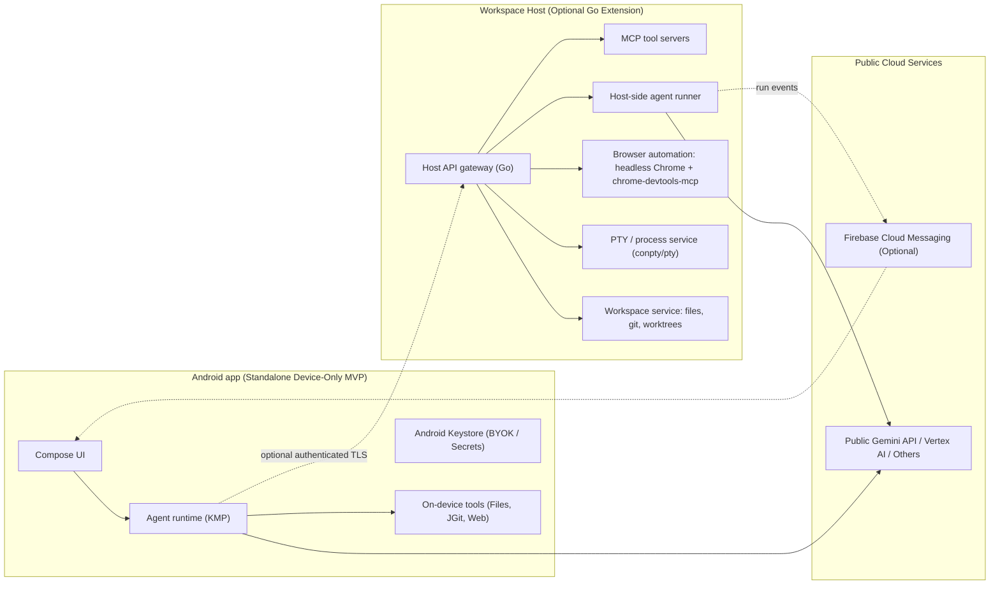

# Backend Requirements — Independent Android Implementation

**Project:** Antigravity Mobile Port · **Phase:** 2 — Mobile Architecture Planning
**Companion documents:** [mobile-architecture.md](mobile-architecture.md) · [feature-compatibility.md](feature-compatibility.md) · [architecture-decisions.md](architecture-decisions.md) · [webview-port-feasibility.md](webview-port-feasibility.md) · [webview-poc-validation.md](webview-poc-validation.md)

> [!IMPORTANT]
> **P0.5 Option C Update (`LanguageServerGrpcWebHandler` Compatibility Layer):** Decoding the 96 `FileDescriptorProto` descriptors embedded inside `main.js` (**V**) provided the exact Protobuf schema for `exa.language_server_pb.LanguageServerService`. Under **ADR-05 (Option C)**, the Android backend implements an in-process gRPC-Web+JSON compatibility handler (`LanguageServerGrpcWebHandler` + `GrpcWebFrameCodec`) intercepted via `WebViewClient.shouldInterceptRequest` so that the original `Jetski Web` frontend communicates seamlessly with our native Android repositories (`ConversationRepository`, `WorkspaceRepository`, `AgentOrchestrator`, and `GeminiModelProvider`), while keeping API credentials strictly inside native Android storage and never calling internal `daily-cloudcode-pa.googleapis.com/v1internal:*` endpoints.

Evidence grades follow [feature-compatibility.md §1](feature-compatibility.md#1-evidence-grades): **V** verified, **S** string marker, **D** public docs, **H** hypothesis. The requirements below are **design decisions** for our implementation, not findings about Antigravity.

---

## 1. Guiding principle: no dependency on proprietary internals

Phase 1 showed that the desktop app's capabilities sit in a closed-source Go binary (`language_server.exe`). That binary talks to:

| Desktop interface (V) | Documented? | Use in the mobile port |
| :--- | :--- | :--- |
| `https://generativelanguage.googleapis.com` (passed as `--api_server_url`) | **Yes.** This is the public Gemini API host. | ✅ Usable through its **public, documented** API surface with the user's own credential. |
| `https://daily-cloudcode-pa.googleapis.com/v1internal:loadCodeAssist`, `…:fetchAvailableModels` | **No.** `v1internal` is an internal surface. | ⛔ Do not call. |
| `LanguageServerService` / `ExtensionServerService` RPC (S) | **No.** | ⛔ Do not implement clients for it or reverse-engineer it. |
| Antigravity OAuth client / sign-in flow (V, `accounts.google.com/o/oauth2/auth` pattern in `languageServer.js`) | Client identity belongs to Google | ⛔ Do not reuse. Register our own OAuth client if Google sign-in is needed. |
| Auto-update endpoint (`antigravity-hub-auto-updater-…run.app`) | No | ⛔ Do not contact. |

> [!IMPORTANT]
> A Phase 1 note suggested the Go backend could be "ported" to Android because Go cross-compiles. **That is wrong without source code.** The binary is closed-source, built for Windows, and not licensed for redistribution. The mobile port therefore needs its **own** backend components, described below.

---

## 2. Backend components & Architecture Topology



| # | Component | Status in Architecture | Hosting | Build vs. adopt |
| :--- | :--- | :--- | :--- | :--- |
| B1 | **LLM inference** | **Core Requirement (MVP)** | Public cloud | **Adopt:** Public Gemini API (user-supplied API key stored in Android Keystore). Pluggable `ModelProvider` SPI for adding Vertex AI, OpenAI, or Anthropic. |
| B2 | **Workspace Host** | **Optional Extension (Post-MVP)** | User's PC, server or cloud VM | **Build:** Independent Go daemon (`workspace-host`). Required only for remote PTY, arbitrary shell commands, and remote builds. |
| B3 | **Browser automation tier** | **Optional Extension (Post-MVP)** | Same host as B2 | **Adopt:** Headless Chrome + `chrome-devtools-mcp` (open source). Controlled by the Go Workspace Host. |
| B4 | **Host-side agent runner** | **Optional Extension (Post-MVP)** | Same host as B2 | **Build:** Background execution engine inside Go Workspace Host for surviving phone disconnection. |
| B5 | **Push / event relay** | **Optional Extension (Post-MVP)** | Firebase | **Adopt:** FCM for background run wakeup alerts. Payloads carry run IDs only. |
| B6 | **Sync service** | **Deferred** | Optional user host | Defer to future phases. |

### Operational modes: First-Class Standalone vs. Optional Extended

1. **Mode M1 — Device-Only (Standalone MVP):**
   - **Host Requirement:** **Zero.** The app functions completely without any server or host.
   - **Components:** B1 only.
   - **Capabilities:** Chat conversations, planning, code browsing, file editing, diff review/patching on local storage and SAF directories, pure JGit operations, local HTTP fetches, and in-app WebView page inspection.
   - **Credentials:** Bring-Your-Own-Key (BYOK). The user enters their API key in Settings, which is stored exclusively in Android Keystore. Zero credentials are embedded in the APK.

2. **Mode M2 — Paired Host (Optional Extended Mode):**
   - **Host Requirement:** User pairs the mobile app with an instance of the independent Go Workspace Host daemon.
   - **Components:** B1 + B2 + B3 (+ B4, B5).
   - **Capabilities:** Unlocks interactive PTY terminal, remote compilers/build tools, headless Chrome subagent browsing, and durable background tasks.

---

## 3. Functional requirements

### B1 — LLM inference (ModelProvider SPI)

- **FR-1.1** Implement a strictly provider-agnostic interface (`ModelProvider`) in `:agent-runtime`. The agent loop must not reference Google, Gemini, or any specific vendor classes.
- **FR-1.2** Provide initial `GeminiModelProvider` using the official Google Gen AI SDK / REST API.
- **FR-1.3** Design the SPI to support adding `AnthropicModelProvider`, `OpenAIModelProvider`, `VertexModelProvider`, and `OllamaModelProvider` as modular plugins.
- **FR-1.4** Support streaming tokens, structured tool/function calling, system instructions, and multimodal image attachments.
- **FR-1.5** **Zero Bundled Credentials:** Never package or embed API keys, OAuth client secrets, or private tokens in the application binary or source code. Keys are input by the user at runtime and held in Android Keystore.
- **FR-1.6** Handle rate limits, quota exhaustion, and transient network errors gracefully with exponential backoff and actionable user feedback.

### B2 — Workspace Host API (Go Daemon)

All operations are scoped to an explicitly registered workspace root on the host. Paths are normalized, validated against directory traversal (`..`), and verified against symlink escapes.

| Area | Operations | Transport |
| :--- | :--- | :--- |
| Workspaces | `ListWorkspaces`, `RegisterWorkspace`, `CreateWorktree(base, branch)`, `RemoveWorktree` | Unary RPC (Connect-RPC over TLS) |
| Files | `Stat`, `List(dir, page)`, `Read(path, range)`, `Write(path, content, expectedHash)`, `Delete`, `Move`, `Search(glob/regex)`, `Watch` | Unary RPC + Server stream (Watch) |
| Git | `Status`, `Diff`, `Log`, `Commit`, `Checkout`, `Push/Pull` (Host credentials) | Unary RPC |
| Processes | `RunCommand(argv, cwd, env, timeout)` → streamed stdout/stderr + exit code | Server stream |
| Terminal | `OpenPty(cols, rows, shell)`, input/output frames, `Resize`, `Close` | Bidirectional stream (WebSocket over TLS) |
| Policy | `GetPolicy`, `ProposeCommand` → `RequiresApproval` / `Allowed` / `Denied` | Unary RPC |

- **FR-2.1** Writes use optimistic concurrency (`expectedHash`) to prevent race conditions with host-side edits.
- **FR-2.2** Host independently evaluates every command against an explicit security policy (allow-list, deny-list, interactive confirmation). The mobile UI is purely an approval client; **the host enforces**.
- **FR-2.3** PTY sessions are stateful and survive network reconnects (circular replay buffer on the host).
- **FR-2.4** The protocol is defined via standard Protocol Buffers (`.proto`) and served using Connect-RPC over HTTP/2 with TLS.

### B3 — Browser automation tier (Optional Extension)

- **FR-3.1** Spawn isolated headless Chrome instances on the host per browser task.
- **FR-3.2** Drive actions using standard Model Context Protocol (MCP) via `chrome-devtools-mcp`.
- **FR-3.3** Host enforces strict domain allow/deny lists and execution limits (adopting the fail-closed principles observed in desktop `scriptJail.js`).
- **FR-3.4** Stream viewport frames as compressed WebP snapshots to the phone; persist full WebM video captures as task artifacts.
- **FR-3.5** Strictly adhere to standard browser headers; do not spoof or conceal automation flags.

### B4 — Host-side agent runner (Optional Extension)

- **FR-4.1** Background agent executor running on the host that persists across mobile disconnection.
- **FR-4.2** Mobile client can detach, background, and re-attach to live runs.
- **FR-4.3** Runs pause when requiring approval, emitting notification triggers to the phone.

---

## 4. Security, Pairing & Encrypted Communication

The connection between the Android app and the optional Go Workspace Host is designed with zero-trust principles:

```
[ Go Workspace Host ]                                [ Android App ]
        │                                                   │
   1. Generate ephemeral pairing session                   │
      (Host UUID, IP:Port, TLS cert SHA-256 fingerprint,   │
       short-lived 256-bit pairing secret)                 │
        │                                                   │
   2. Display QR Code on terminal / desktop GUI            │
        │ ── Scan QR Code via Camera ────────────────────── │
        │                                                   │
        │                                              3. Generate Client Keypair
        │                                                 in Android Keystore
        │                                                 (EC P-256, hardware-backed)
        │                                                   │
        │ ── 4. Mutual Handshake (over TLS with pinned cert) ─│
        │    Client presents: pairing secret + client pubkey│
        │                                                   │
   5. Host verifies pairing secret,                         │
      stores client pubkey in trusted_clients table,        │
      issues long-lived ClientID + device token             │
        │ ── 5. Handshake Complete ──────────────────────── │
        │                                                   │
   ═════════════════ Authenticated Normal Operation ═════════════════
        │                                                   │
        │ ── 6. Signed RPC Request ──────────────────────── │
        │    Headers: X-Client-ID, X-Signature              │
        │    (Signed by Android Keystore private key)       │
        │                                                   │
   7. Host verifies signature against stored client pubkey  │
      and enforces scoped permissions                       │
```

### Protocol Specifications:

| Requirement ID | Security Control | Technical Specification |
| :--- | :--- | :--- |
| **SR-1** | **Authenticated Pairing** | Pairing initiated via QR code scan containing `{host_id, endpoints: [ip:port], cert_fingerprint: "sha256:...", pairing_secret: "<nonce>", expires_at: <timestamp>}`. Handshake exchange verifies the secret and registers the client's public key. |
| **SR-2** | **Strict TLS Pinning** | App connects via TLS 1.3, validating the host certificate directly against the SHA-256 fingerprint extracted from the QR code. **Never** use accept-all certificate validators. (Resolves Phase 1 Erratum E2). |
| **SR-3** | **Hardware-Backed Device Keys** | Client keys are generated inside the Android Keystore (`KeyGenParameterSpec` with `PURPOSE_SIGN`, EC curve secp256r1, biometric/device-lock protection where configured). Private keys never leave the secure hardware enclave. |
| **SR-4** | **Mutual Authentication & Per-Request Signatures** | Every RPC call and WebSocket upgrade carries an `Authorization` header containing an HMAC/ECDSA signature over `(method, path, timestamp, body_hash)`. Host validates timestamp freshness (±30s) to prevent replay attacks. |
| **SR-5** | **Revocation & Least Privilege** | Host allows revoking paired devices instantly via CLI (`workspace-host revoke <client-id>`). Tokens support granular permission scopes: `files:read`, `files:write`, `pty:attach`, `exec:run`, `browser:control`. |
| **SR-6** | **Network Boundary & Non-Exposure** | Host binds to loopback (`127.0.0.1`) or private LAN interface by default. Remote connections over the public internet require user-managed WireGuard/Tailscale VPN overlays or authenticated reverse tunnels. |
| **SR-7** | **Host-Side Policy Enforcement** | Path sandboxing, command deny-lists, and execution allowances are enforced on the host. An attacker modifying the mobile client cannot bypass host filesystem restrictions. |
| **SR-8** | **Zero Hardcoded Secrets** | Mobile APK contains no API keys, client secrets, or embedded credentials. All keys are entered by the user and encrypted via Android Keystore / EncryptedDataStore. |

---

## 5. Non-functional requirements

| Metric / Attribute | Specification |
| :--- | :--- |
| **Standalone Performance** | Zero network calls needed for app launch, workspace navigation, code reading, and diff viewing. |
| **Streaming Latency** | First token rendered < 800ms over broadband. PTY echo < 100ms on local LAN. |
| **Battery & Background** | Zero persistent sockets maintained when app is backgrounded. Host tasks notify via FCM data messages (payloads contain run ID only). |
| **Memory Budget** | Android app max heap < 128MB in baseline operation; large files paged via chunked streaming. |
| **Host Binary Footprint** | Go Workspace Host compiled as a single self-contained static binary (Windows, Linux, macOS) without Node.js or runtime dependencies. |

---

## 6. Resolved Decisions

1. **Deployment Model:** **Mode M1 (Device-Only MVP) is the primary baseline.** The application must be 100% functional standalone. Mode M2 (Paired Host) is an **optional extension**.
2. **Credential Model:** **Public Gemini API (BYOK) initially.** Credentials provided by user at runtime and secured in Android Keystore. The agent loop communicates via a generic `ModelProvider` SPI, allowing modular addition of Vertex AI, OpenAI, Anthropic, or local LLMs.
3. **Workspace Host Implementation:** **Go.** Developed independently as a small, high-performance static binary utilizing native PTY packages (`creack/pty` on Unix, Windows ConPTY) and headless Chrome automation.
4. **Desktop Interoperability:** **Strictly independent.** No reverse-engineering or integration with the proprietary `language_server.exe` or internal Google `v1internal` endpoints.
5. **Branding:** Independent product name and package identifier.
