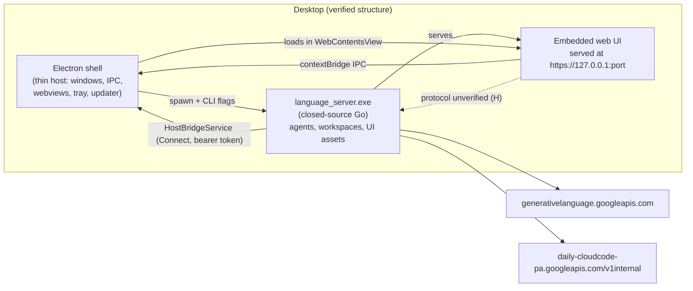
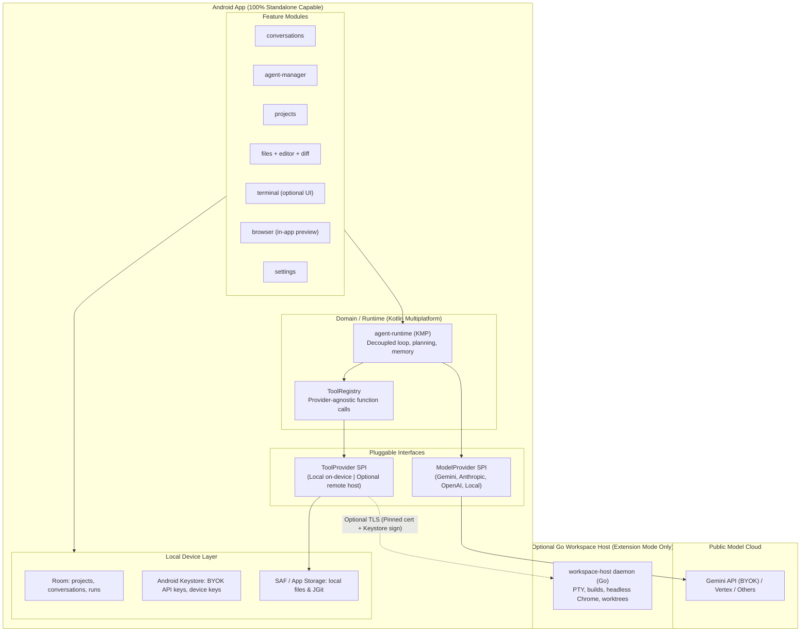
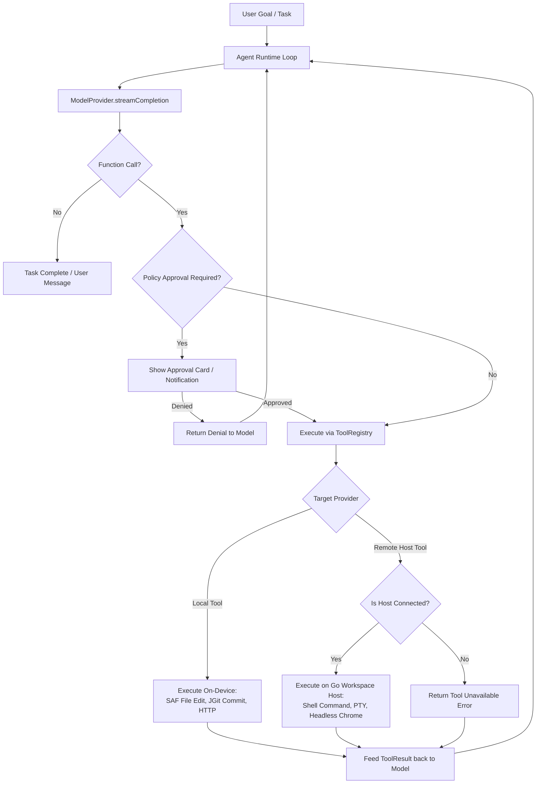
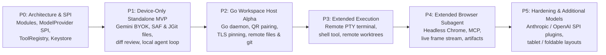

# Mobile Architecture Proposal — Independent Android Implementation

**Project:** Antigravity Mobile Port · **Phase:** 2 — Mobile Architecture Planning
**Companion documents:** [feature-compatibility.md](feature-compatibility.md) · [backend-requirements.md](backend-requirements.md) · [architecture-decisions.md](architecture-decisions.md) · [port-fidelity-audit.md](port-fidelity-audit.md) · [webview-port-feasibility.md](webview-port-feasibility.md) · [webview-poc-validation.md](webview-poc-validation.md) · Phase 1: [initial-investigation.md](initial-investigation.md)

> [!NOTE]
> **Option C Hybrid Port Update (P0.5):** Following the P0 Port-Fidelity Audit and WebView Proof-of-Concept validation ([webview-poc-validation.md](webview-poc-validation.md)), this architecture hosts the **actual original Antigravity (`Jetski Web`) React 19 frontend** inside an Android `WebView` (`JetskiWebViewHost`) using a user-supplied runtime bundle (`JetskiBundleLoader`) or remote desktop host connection, backed by an in-process Kotlin `LanguageServerService` Connect-RPC engine (`LanguageServerGrpcWebHandler`) and a clean-room Jetbox fallback (`#101010` / `#007acc`) when no proprietary bundle has been imported. Zero proprietary Google assets are redistributed inside the APK. Findings about the desktop app remain graded **V / S / D / H** as defined in [feature-compatibility.md §1](feature-compatibility.md#1-evidence-grades).

> [!IMPORTANT]
> **Product Naming & Identity:** "Google Antigravity" is a Google trademark. This project will use an independent product name, package identifier (e.g. `dev.agentic.workspace`), and visual branding, with no claim of Google affiliation. "Antigravity" is used herein strictly as a project codename.

---

## 1. What the desktop app actually is (recap with corrections)



**Architectural takeaway (V):** The Electron shell is a thin wrapper, while the core agent intelligence and workspace operations reside in the closed-source Go binary. A mobile port cannot reuse or recompile that binary. It must **re-implement the capabilities independently** on documented interfaces:
- Public cloud model APIs (Gemini API initially, with a pluggable provider SPI) for intelligence;
- An on-device Kotlin agent runtime for local execution;
- An optional, independent Go Workspace Host for remote execution;
- Standard open tooling (JGit, MCP, chrome-devtools-mcp).

---

## 2. Architecture Overview & Operational Modes

The Android application is designed around two operating modes:



### Operational Modes:

1. **Standalone Mode (Device-Only MVP):**
   - **Zero Host Requirement:** Operates completely self-contained without needing any desktop or server.
   - **Capabilities:** Chat conversations, autonomous task planning, code reading, editing, diff generation/patching, JGit commit/branch/status, local search, and in-app WebView inspection.
   - **Execution:** Pure Kotlin tools in `:tools:local` execute directly against Android storage (SAF / app-private).
   - **Credentials:** Bring-Your-Own-Key (BYOK). User enters their Gemini API key, stored exclusively in the Android Keystore. No credentials packaged in the APK.

2. **Extended Mode (Paired Go Workspace Host):**
   - **Optional Extension:** User pairs the mobile app with their PC, Mac, or server running the lightweight, independent Go daemon (`workspace-host`).
   - **Capabilities Unlocked:** Remote PTY terminal sessions, arbitrary shell execution (compilers, linters, package managers), host git worktrees, and automated headless Chrome web browsing.
   - **Seamless Degradation:** If the host disconnects or is never paired, host-specific tools are cleanly disabled, and the agent runtime transparently continues in standalone device mode.

---

## 3. Module Structure & Layering

```
:app                             // Application entry point, Hilt DI, adaptive scaffold
├── :core:model                  // Domain models (Project, Workspace, Run, ToolCall, Diff)
├── :core:data                   // Room databases, Repositories, DataStore, Keystore wrapper
├── :core:designsystem           // Theme, Material 3 components, Markdown & Diff viewers
├── :core:network                // Networking: HTTP client, TLS pinning, Connect-RPC, WebSockets
├── :agent-runtime (KMP)         // Core agent loop, context assembly, policy engine, subagents
├── :model-provider              // ModelProvider SPI contract
│   ├── :provider:gemini         // Gemini API implementation (initial)
│   └── :provider:openai-compat  // Future: Anthropic, OpenAI, Ollama
├── :tools:spi                   // ToolDefinition & ToolProvider contracts
│   ├── :tools:local             // Pure on-device tools: SAF files, JGit, HTTP fetch
│   └── :tools:remote            // Remote host proxy tools (shell, host PTY, CDP browser)
├── :feature:conversations       // Chat interface, streaming markdown, tool-call cards
├── :feature:agentmanager        // Run timeline, background tasks, approvals inbox
├── :feature:projects            // Project and workspace management, search
├── :feature:files               // Tree explorer, syntax viewer, hunk-by-hunk diff review
├── :feature:terminal            // Terminal emulator screen (active only when host paired)
├── :feature:browser             // User-facing in-app WebView preview & DOM tools
└── :feature:settings            // BYOK keys, host pairing, autonomy rules, themes
```

### Dependency Rules:
- `:agent-runtime` is pure Kotlin Multiplatform with **zero Android UI and zero vendor model dependencies**. It interacts exclusively with `:model-provider` and `:tools:spi`.
- Feature modules communicate with each other exclusively via navigation contracts in `:core:navigation`.
- All host networking code is encapsulated in `:tools:remote` and `:core:network`. The app compiles and operates fully even if `:tools:remote` is stubbed out.

---

## 4. Subsystem Architectures

### 4.1 Pluggable Model Integration (ModelProvider SPI)

The agent runtime is completely agnostic of Google Gemini or any specific LLM provider:

```kotlin
interface ModelProvider {
    val providerId: String
    suspend fun streamCompletion(
        request: ModelRequest,
        tools: List<ToolDefinition>,
        onTokenDelta: (String) -> Unit
    ): ModelResponse
}

data class ModelRequest(
    val messages: List<Message>,
    val systemInstruction: String?,
    val modelId: String,
    val temperature: Float = 0.2f
)

sealed interface ContentBlock {
    data class Text(val text: String) : ContentBlock
    data class Image(val mimeType: String, val bytes: ByteArray) : ContentBlock
    data class ToolCall(val callId: String, val name: String, val argumentsJson: String) : ContentBlock
    data class ToolResult(val callId: String, val resultJson: String) : ContentBlock
}
```

- **Initial Implementation:** `GeminiModelProvider` calling the official public Google Gemini API (`https://generativelanguage.googleapis.com/v1beta`).
- **Credential Storage (BYOK):** The user provides their API key in Settings. The key is encrypted via `EncryptedSharedPreferences` backed by a hardware master key in the Android Keystore (`MasterKeys.AES256_GCM_SPEC`). **No API keys or Google client credentials exist in the distributable APK.**
- **Extensibility:** Adding Anthropic Claude, OpenAI, or local Ollama requires only implementing `ModelProvider` in a separate module without touching the agent runtime or UI.

### 4.2 Standalone Agent Task Execution vs. Optional Host Tools

The agent loop executes identically whether connected to a host or not:



1. **Local Tool Provider (`:tools:local`):**
   - `file_read`, `file_write`, `file_list`, `search_files` (via SAF or app storage).
   - `apply_patch` (unified diff parser and applicator in pure Kotlin).
   - `git_status`, `git_commit`, `git_diff` (via pure Java JGit library).
   - `http_fetch` (standard OkHttp client for fetching documentation/APIs).
2. **Remote Tool Provider (`:tools:remote` - Optional Host Extension):**
   - `run_command` (arbitrary shell command on host machine).
   - `terminal_pty` (interactive terminal session).
   - `browser_navigate`, `browser_click`, `browser_screenshot` (headless Chrome on host).

### 4.3 Authenticated Pairing & Encrypted Host Communication

When a user elects to pair an optional Go Workspace Host, communication is secured using mutual cryptographic identity and pinned TLS:

1. **Pairing Initiation (Out-of-Band):**
   - The Go Workspace Host generates a self-signed TLS 1.3 certificate, an ephemeral 256-bit pairing secret, and displays a QR code in the terminal or GUI:
     ```json
     {
       "host_id": "wh_7f8a9b1c",
       "addresses": ["192.168.1.50:8443", "my-desktop.local:8443"],
       "cert_fingerprint": "SHA256:7e8a9f...c3b4",
       "pairing_secret": "3f9a...8b1c",
       "expires_at": 1794500000
     }
     ```
2. **Key Generation & Handshake:**
   - The Android app scans the QR code.
   - App generates a dedicated client keypair in hardware-backed Android Keystore (ECDSA P-256).
   - App connects to the host over TLS, enforcing **strict certificate pinning** against `cert_fingerprint` (rejecting any other certificate).
   - App sends an authenticated registration payload: `{pairing_secret, client_pubkey, device_name}`.
   - Host validates the secret, registers the `client_pubkey`, and returns an assigned `client_id` and signed device token.
3. **Encrypted Operation:**
   - All subsequent RPCs and WebSocket connections use HTTP/2 with TLS 1.3.
   - Every request is authenticated by signing the request payload and timestamp with the Android Keystore private key (`X-Client-Signature`).
   - Host verifies the signature against the stored public key, guaranteeing that only the paired Android hardware can execute commands.
   - The host provides a simple CLI command (`workspace-host revoke <client_id>`) to immediately revoke any paired device.

### 4.4 File Explorer & Touch-Friendly Diff Review

- **File Tree:** Fast, virtualized tree over `WorkspaceFileSystem` with search caching.
- **Diff Review Engine:** Agent-generated code changes are presented as interactive diffs.
- **Hunk-by-Hunk Control:** Users can review changes hunk-by-hunk, with dedicated buttons to **Accept**, **Reject**, or manually **Edit** a patch before it touches the workspace files.
- **Safety:** All writes enforce optimistic concurrency (`expectedHash`), ensuring the agent never silently overwrites user modifications.

### 4.5 Agent Manager & Background Execution

- **Standalone Mode:** Short agent tasks execute in an Android **Foreground Service** with an ongoing notification showing current task status and step progress.
- **Extended Mode:** Long-running builds or autonomous tasks are offloaded to the Go Workspace Host. When the phone goes to sleep or changes networks, the host execution continues uninterrupted. The host triggers an FCM push notification (containing run ID only) when human approval is required.
- **Timeline & Artifacts:** Users can review step logs, token usage, tool parameters, and generated deliverables (patches, images, web screenshots).

---

## 5. Security & Privacy Architecture

| Principle | Mobile Implementation |
| :--- | :--- |
| **Zero Hardcoded Secrets** | No API keys, OAuth client secrets, or private tokens exist in source code or APK assets. User supplies their own keys, held in hardware Android Keystore. |
| **Strict TLS Pinning** | Host connection pins the exact certificate SHA-256 fingerprint verified during QR pairing. Blanket certificate acceptance (`setupLocalCertTrust` from Phase 1 Erratum E2) is strictly forbidden. |
| **Hardware-Backed Device Keys** | Client identity uses an EC P-256 key generated in the Android Keystore with `PURPOSE_SIGN`. The private key is non-exportable and protected by hardware enclave. |
| **Host-Side Policy Enforcement** | Host independently checks all file paths against directory traversal and checks all shell commands against allow/deny lists. The mobile app cannot bypass host security rules. |
| **WebView Isolation** | In-app browser preview disables JavaScript interfaces (`addJavascriptInterface` is never called), enables Android Safe Browsing, and restricts file URL access. |
| **Private Data Protection** | FCM notifications never carry code snippets, file contents, prompts, or sensitive tokens. Payloads contain only `{run_id, status, event_type}`. |

---

## 6. Delivery Roadmap



### Milestone Exit Criteria:

- **P1 (Device-Only MVP — Primary Focus):**
  - Standalone Android app operates 100% on-device.
  - User can enter their Gemini API key in Settings (saved in Android Keystore).
  - User can open a local directory (SAF or app storage) and clone repositories via JGit.
  - Agent can stream conversation, inspect files, generate diffs, apply patches, and commit changes.
  - User can inspect and approve/reject file modifications via touch diff viewer.
  - **Zero requirement for any host or server.**
- **P2 (Optional Host Pairing Alpha):**
  - Standalone Go binary compiled for Windows, macOS, and Linux.
  - Mobile app pairs with Go host via QR code with hardware-backed key exchange and TLS pinning.
  - Remote workspace file browsing and git status.
- **P3 (Extended Remote Execution):**
  - Interactive terminal emulator in Android app connecting to host PTY over WebSocket.
  - Agent can execute approved shell commands on the host.
- **P4 (Extended Browser Subagent):**
  - Go host launches headless Chrome via `chrome-devtools-mcp`.
  - Agent performs autonomous web actions; phone displays live screenshots.
- **P5 (Multi-Model & Ecosystem Hardening):**
  - Anthropic, OpenAI, and local Ollama plugins added to `ModelProvider` SPI.
  - Adaptive layouts for foldables and tablets.

---

## 7. Approved Architecture Decisions

The following key architecture decisions have been finalized and approved (detailed in [architecture-decisions.md](architecture-decisions.md)):

| Decision ID | Decision Title | Summary of Architectural Choice |
| :--- | :--- | :--- |
| **ADR-01** | **Standalone Device-Only MVP** | Primary delivery is a 100% self-contained Android application. Operates without any desktop host or server. |
| **ADR-02** | **Pluggable Model SPI with BYOK** | Agent runtime is strictly decoupled from model providers. Initial provider is public Gemini API. Zero credentials in APK; user provides keys via Android Keystore. |
| **ADR-03** | **Go-Based Workspace Host as Optional Extension** | Remote execution (PTY, shell, headless browser) is encapsulated in an independent Go daemon. Host is completely optional; app degrades gracefully when absent. |
| **ADR-04** | **Cryptographic QR Pairing & Pinned TLS** | Host-to-device communication uses out-of-band QR pairing, hardware-backed Android Keystore keys (EC P-256), mutual authentication, and strict TLS 1.3 certificate pinning. |
| **ADR-05** | **Option C Hybrid Port Architecture** | Primary UI is the original `Jetski Web` React 19 frontend loaded at runtime (`JetskiBundleLoader` / `JetskiWebViewHost`) over an in-process Kotlin `LanguageServerGrpcWebHandler` Connect-RPC engine, with a clean-room Jetbox fallback (`#101010` / `#007acc`) and zero redistributed proprietary assets in the APK. |
