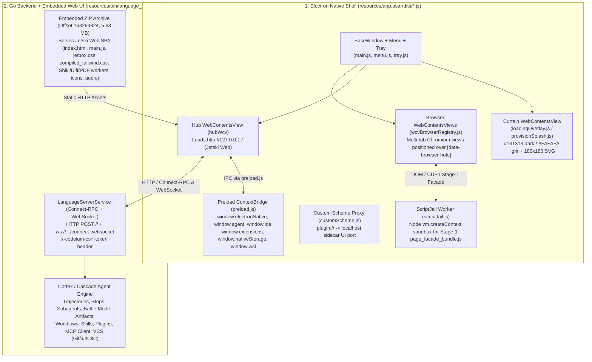

# Port Fidelity Audit — Google Antigravity Android Port

**Status:** Phase 3 Reassessment — Read-Only Port Fidelity Audit  
**Target Desktop Build Audited:** Google Antigravity `1.107.0` (`2.1.0-dev` / commit `522fbde9b4d7c10fbabfbbe9ddb3fd2f9ececf72`)  
**Evidence Legend:**
- **`[V]` Verified Fact** — Directly confirmed via static inspection of extracted Electron shell files (`app.asar/dist/*.js`) or the embedded frontend ZIP archive inside `resources/bin/language_server.exe` (Byte Offset `163294824`, Length `5628057`).
- **`[I]` High-Confidence Inference** — Derived directly from verified code paths, protobuf descriptors, and symbol tables.
- **`[H]` Hypothesis** — Unverified runtime behavior requiring future confirmation.

---

## Executive Summary

A critical reassessment of our current Phase 3 (P0) Android implementation against the installed Google Antigravity desktop application reveals two major conclusions:

1. **Breakthrough Reverse-Engineering Discovery (`[V]`):**  
   In Phases 1 and 2, the frontend UI bundle inside `language_server.exe` was believed to be opaque because plain ASCII string scans did not match Deflate-compressed assets (recorded as Errata E1, E6, and E8 in [initial-investigation.md](file:///c:/Users/NEW0033/Downloads/Antigravity%20Port/research/architecture/initial-investigation.md)). During this audit, we located and inspected the **complete embedded Web UI ZIP archive** inside `resources/bin/language_server.exe` at **Byte Offset `163294824` (Length `5,628,057` bytes; 99 entries, ~15 MB uncompressed)** (`[V]`).
   - We now have 100% visibility into the original application's UI: `index.html` (`Jetski Web` / `agent_ui_toolkit`), `main.js` (11.18 MB React 19 SPA), `jetbox.css` (95.4 KB), `compiled_tailwind.css` (294.4 KB), `diff_worker.js`, `workers/shiki_worker.js`, `prism_bundle.js`, `page_agent_bundle.js`, `page_facade_bundle.js`, `audio_processor.js`, sound assets, and the 61 KB `symbol-icon-theme.json` SVG icon set (`[V]`).
   - Crucially, **`main.js` already contains first-class mobile and remote-control support (`[V]`)**: it defines host variants `Xi.Web.Mobile`, `Xi.Web.Mobile.RemoteControl`, `Xi.Web.Mobile.Pwa`, and `Xi.Electron.AndroidDesktop` (`hostVariant=android-desktop`), a responsive `mobileLayout` mode (`HE()` used in 45 layout branches for bottom sheets, swipeable drawers, and compact toolbars), touch input handlers (`touchInput`), and a `getRemoteControlInfo` / QR-code companion pairing flow (`[V]`).

2. **Candid Assessment of Current P0 Implementation (`[V]`):**  
   Following Phase 2's architectural decisions ([architecture-decisions.md](file:///c:/Users/NEW0033/Downloads/Antigravity%20Port/research/architecture/architecture-decisions.md), specifically ADR-05), our P0 implementation was built as an **independently branded Material 3 generic coding assistant** (`"Agentic Workspace"`, package `com.agentic.workspace`) rather than an authentic port of Google Antigravity.
   - **UI & Styling Divergence:** P0 uses standard Material 3 (`NavigationBar` with 6 bottom tabs, Material `TopAppBar`, `ElevatedCard`, and an invented Material blue-slate palette `#0F172A` / `#38BDF8`) instead of Antigravity's actual **Jetbox / Tailwind CSS** design system (`#101010` / `#131313` carbon dark surfaces, `#007acc` primary accent, `#151515` sidebar, `Google Sans Flex` / `Inter` / `JetBrains Mono` typography, and the 3-pane collapsible Sidebar + Main Stage + Tabbed Side Panel layout) (`[V]`).
   - **Data & Protocol Divergence:** P0 uses simplified, invented Room/domain models (`Conversation`, `ConversationTurn`, `Project`, `SubAgentTask`) instead of Antigravity's actual **`exa.cortex_pb` / `LanguageServerService` Connect-RPC schema** (`Cascade`, `Trajectory`, `CortexStep`, `Artifact`, `WorkflowSpec`, `Sidecar`, `McpServerState`, `BrowserPage`) (`[V]`).
   - **Feature Placeholders:** All 7 P0 feature screens ([ConversationsScreen.kt](file:///c:/Users/NEW0033/Downloads/Antigravity%20Port/feature/conversations/src/main/kotlin/com/agentic/workspace/feature/conversations/ConversationsScreen.kt), [ProjectsScreen.kt](file:///c:/Users/NEW0033/Downloads/Antigravity%20Port/feature/projects/src/main/kotlin/com/agentic/workspace/feature/projects/ProjectsScreen.kt), [FilesScreen.kt](file:///c:/Users/NEW0033/Downloads/Antigravity%20Port/feature/files/src/main/kotlin/com/agentic/workspace/feature/files/FilesScreen.kt), [AgentManagerScreen.kt](file:///c:/Users/NEW0033/Downloads/Antigravity%20Port/feature/agentmanager/src/main/kotlin/com/agentic/workspace/feature/agentmanager/AgentManagerScreen.kt), [SettingsScreen.kt](file:///c:/Users/NEW0033/Downloads/Antigravity%20Port/feature/settings/src/main/kotlin/com/agentic/workspace/feature/settings/SettingsScreen.kt), [TerminalScreen.kt](file:///c:/Users/NEW0033/Downloads/Antigravity%20Port/feature/terminal/src/main/kotlin/com/agentic/workspace/feature/terminal/TerminalScreen.kt), [BrowserScreen.kt](file:///c:/Users/NEW0033/Downloads/Antigravity%20Port/feature/browser/src/main/kotlin/com/agentic/workspace/feature/browser/BrowserScreen.kt)) are currently static or in-memory Material 3 placeholders that do not reproduce Antigravity's actual UI components or workflows (`[V]`).

---

## 1. Original Antigravity Architecture (Verified via REA & Binary Extraction)

### 1.1 Multi-Layer Application Architecture (`[V]`)

The installed Google Antigravity desktop application (`C:\Users\NEW0033\AppData\Local\Programs\antigravity\`) consists of two tightly coupled layers:

### 1.2 Original UI Architecture & Renderer (`[V]`)

Inspection of the embedded ZIP archive inside `language_server.exe` (`offset 163294824`) confirms every detail of the frontend renderer:

| Aspect | Verified Original Implementation (`[V]`) | Evidence Source |
|---|---|---|
| **Internal Name** | `Jetski Web` / `agent_ui_toolkit` (`//depot/google3/third_party/gemini_coder/agent_ui_toolkit/...`) | `index.html`, `jetbox.css`, `main.js` |
| **UI Framework** | **React 19** (`createElement`, hooks, portals, `useSyncExternalStore`) | `main.js` |
| **State Management** | **Redux Toolkit** (`store.getState()`, `store.dispatch`, slice selectors `Ql()`, actions `Pl()`) | `main.js` |
| **Routing** | **TanStack Router** (`createFileRoute`, `createLazyFileRoute`, route tree rooted at `manager-landing-layout` `zJc`) | `main.js:3571086`, `main.js:8676900` |
| **Virtualization & Layout** | **TanStack Virtual** (`window.process` polyfilled specifically for TanStack Virtual in `index.html`), custom split-pane tiling manager (`NJc`, `CJc`, `o3`, `UT`), **Eclipse ELK (`org.eclipse.elk`)** graph layout engine for node/pipeline diagrams | `index.html`, `main.js:8555000`, `main.js:9042955` |
| **Rich Text Prompt Input** | **Lexical Editor** (`getLexicalEditor`, `lexicalRef`, `MentionBlock`, `PendingMentionGuardPlugin`, `DriveLinkPlugin`) | `main.js:3351900`, `main.js` displayNames |
| **Markdown & Math** | `CustomMarkdown` with **KaTeX** (`.katex`) and GitHub-style tables (`.md-table-scroll`) | `compiled_tailwind.css`, `main.js` |
| **Syntax Highlighting & Code Viewer** | **CATCH File Viewer** (`jetbox.css`) + **Shiki Web Worker** (`workers/shiki_worker.js`, 2.76 MB) + **PrismJS** (`prism_bundle.js` + 35 language packs in `prism/components/*.min.js`) | `jetbox.css`, embedded ZIP directory |
| **Diff Engine** | **`diff_worker.js`** (9.95 KB Web Worker computing line-level diffs via `computeDiffArrays` and `computeDiffStats`) + `DiffRowRenderer` (unified & split diff views) | `diff_worker.js`, `main.js` |
| **Terminal Emulator** | **Xterm.js** (`.xterm`, `TerminalStyles`, split terminal panes `terminal-split-container`, `sendToAgent` selection action) | `compiled_tailwind.css`, `main.js:7548760` |
| **PDF Viewer** | **PDF.js Worker** (`workers/pdf.min.mjs`, `workers/pdf.worker.mjs`, `workers/pdfjs_loader.mjs`) | Embedded ZIP directory |
| **Audio & Voice** | **Web Audio API AudioWorklet** (`audio_processor.js` capturing 16 kHz Float32 PCM chunks), 9 voice personas (`voices/arlo.mp3` .. `tari.mp3`), action/completion cues (`antigravityActionRequired.mp3`, `antigravityCascadeDone.mp3`) | Embedded ZIP directory, `audio_processor.js` |

### 1.3 Original Styling, Theme & Typography (`[V]`)

Contrary to Phase 2's assumption that Material 3 could approximate the UI, Antigravity uses a bespoke **Tailwind CSS + Jetbox CSS custom property design system** (`compiled_tailwind.css` and `jetbox.css`):

1. **Core Color Tokens (`compiled_tailwind.css` `:root` & `main.js` `K9` presets) (`[V]`):**
   - **Default Dark (`:root` / `Default Dark`):**
     - `--background`: `#101010` (Onyx variant `UOb`: `#070709`; Electron shell curtain: `#131313`)
     - `--foreground`: `#cccccc` (Onyx: `#FFFFFF`; Electron shell: `#FAFAFA`)
     - `--primary` / `--cta`: `#007acc` (Onyx: `#2F71E3`)
     - `--primary-foreground` / `--cta-foreground`: `#ffffff`
     - `--sidebar`: `#151515`, `--sidebar-secondary`: `#1b1b1b`, `--shell`: `#101010`
     - `--card`: `#191919`, `--card-border`: `#222222`, `--border`: `#191919`
     - `--muted`: `#151515`, `--muted-foreground`: `#6e6e6e`
     - `--secondary`: `#272727`, `--secondary-foreground`: `#9d9d9d`
     - `--placeholder`: `#484848`
     - `--error`: `#de5555`, `--warning`: `#e8975f`, `--success`: `#7aae66`, `--link`: `#6a9fcb`
     - `--code-foreground`: `#d7ba7d`
   - **Default Light (`K9.light["Default Light"]`):**
     - `--background`: `#F9F9F9` (Onyx `TOb`: `#FFFFFF`; Electron shell: `#FAFAFA`)
     - `--foreground`: `#101010` (Electron shell: `#383A42`)
     - `--primary`: `#007acc`
   - **Built-in Theme Presets (`main.js:10445318` `K9`) (`[V]`):**
     - **Dark Presets (9):** `Default Dark`, `Catppuccin` (`#24273A`), `Dracula` (`#282A36`), `Gruvbox Material` (`#141617`), `Monokai` (`#272822`), `One Dark Pro` (`#282C34`), `Tokyo Night` (`#1A1B26`), `Solarized Dark` (`#002B36`), `Vesper` (`#101010`).
     - **Light Presets (5):** `Default Light`, `Catppuccin`, `Gruvbox Material`, `One Light`, `Solarized Light`.
     - Plus an interactive HSV color picker (`CYc` / `KYc`) allowing custom seed overrides for Background, Foreground, and Primary colors with a live TypeScript syntax preview (`JYc`)!

2. **Typography & Iconography (`compiled_tailwind.css`, `symbols-icons/symbol-icon-theme.json`) (`[V]`):**
   - **UI Typefaces (`data-agy-font`):** Switchable between `Google Sans Flex` / `Google Sans` (`data-agy-font="google-sans"` with custom variable font axes `--agy-gsf-rond`, `--agy-gsf-wdth`, `--agy-gsf-slnt`), `Inter` (`data-agy-font="inter"`), and `system-ui`.
   - **Monospace Typeface:** JetBrains Mono / Fira Code / Consolas for `.font-mono`, `.code-block`, `.xterm`, and CATCH viewer.
   - **Icons:** Google Symbols ligature font (`.google-symbols`), VS Code Codicons (`.codicon`), custom Antigravity/Jetski SVG marks (`AntigravityIcon`, `JetskiIcon`, `AntigravityBrowserIcon`), and 200+ file/folder SVG icons in `symbols-icons/icons/files/*.svg` and `folders/*.svg`.

### 1.4 Original Navigation & Workspace Structure (`[V]`)

Antigravity **does not** use a 6-tab bottom bar. Its root layout (`zJc` in `main.js:8543706`, route id `manager-landing-layout`) is a **3-zone workspace shell** with built-in responsive mobile adaptation (`HE()`):

1. **Left Sidebar (`mGc` / `qGc` in `main.js:8395037`, width `256px` resizable on desktop; slide-over modal drawer `.surface-opaque` with `bg-black/40` backdrop on mobile `HE()`) (`[V]`):**
   - **Top Header (`40px`):** Sidebar toggle (`dock_to_left`), New Conversation button (`+` / Antigravity icon), Search Conversations button (`CmdOrCtrl+K`).
   - **Primary Navigation Items (`sidebar-navigation-items`):**
     - `New Conversation` (`to: "/"`)
     - `Conversation History` (`to: "/history"`)
     - `Automations / Scheduled Tasks` (`to: "/sidecars"` / triggers)
     - `Customizations` (`to: "/customizations"` — Plugins, Skills, Rules, MCP Servers, Marketplace)
     - `Chief of Staff` (`concierge-button`, when enabled)
   - **Scrollable Middle Sections:**
     - **Running / Attention Items** (`rFc`)
     - **Pinned Conversations** (`oGc`)
     - **Projects / Workspaces & Grouped Conversations Tree** (`kGc` / `hGc` / `Roc` — grouped by Project, Repo, or Recency, with Git/JJ branch pills and worktree indicators)
   - **Bottom Footer (`pGc`):** User profile/account status, quota indicator, and Settings trigger (`?settingsOpen=true`).

2. **Center Main Stage (TanStack Router `<Outlet />` + Multi-Conversation Split Tiling `QJc` / `NJc`) (`[V]`):**
   - **Hub / Landing View (`/` -> `uGc`):** Centered prompt composer (`AgentInputCard` / `AgentInputBox`), project/workspace selector, branch/worktree selector, model selector (`ModelSelectorButton`), and quick-start cards.
   - **Cascade / Conversation View (`/c/$cascadeId` -> `PJc` -> `ConversationView` `y5`):**
     - Supports **Multi-Pane Split Tiling** (`NJc` — horizontal/vertical splits of multiple active conversations simultaneously on desktop, single pane on mobile `HE()`).
     - Renders **Trajectory Turns & Cortex Steps** (`CascadeStepItem`, `CortexStep`, `CortexStepBody`), **Artifact Cards** (`artifact-card` with `Proceed` split-button), **Ask Question Cards** (`ask-question-option`, write-in + mic), **Changed Files List** (`ChangedFilesList`), **Running Subagents & Background Tasks Bar** (`nEc` above the input box), **Battle Mode** (`/battle/$battleId` side-by-side model comparison), and the bottom **Lexical Composer** (`AgentInputBox` with `@` context mentions, `/` workflows/slash commands, file/image attachment, and voice mode).

3. **Right / Auxiliary Tabbed Side Panel (`pIc` / `Wnc` / `jIc`, width `360px+` or `40-50%` split on desktop; full-screen sheet/view on mobile `HE()`) (`[V]`):**
   - Managed by the **`f4` Aux Pane Tab Registry (`main.js:7563765`)**, which hosts **13 distinct tab types** scoped to the active conversation or workspace:
     1. `overview` — Conversation Overview (`ihc`)
     2. `fileView` — CATCH File Viewer (`gmc`) & Single-File Diff Viewer (`hmc`) with collapsible File Tree sidebar (`b4`)
     3. `directoryView` — Directory Viewer (`Hlc`)
     4. `virtualFileView` — Virtual File Viewer (`fmc`)
     5. `artifactView` — Artifact / Brain Markdown & PDF Viewer (`Y2` + `artifact-pdf-view`)
     6. `reviewChangesView` — Multi-File Diff & VCS Review Changes (`ymc` / `Blc`)
     7. `browserSubagentView` — Browser Subagent Live/Recorded Viewer (`Wkc` with `[data-browser-hole]` on Electron or screenshot/DOM playback)
     8. `backgroundTaskView` — Background Command Task Output (`thc`)
     9. `customView` — Custom Side Panels (e.g., `notebook` `.ipynb` viewer, `trajectoryDebug`)
     10. `sidecarView` — Plugin Sidecar UI iframe (`lnc` via `plugin://`)
     11. `mcpAppView` — Interactive MCP App View (`f3`)
     12. `fileExplorerView` — Workspace File Explorer (`xgc`)
     13. `terminalView` — Integrated Xterm.js Multi-Tab / Split Terminal (`enc` / `cnc`)

### 1.5 Original Agent Interaction & RPC Mechanisms (`[V]`)

In `main.js:10430800` (`zYc`) and `main.js:3353500` (`$0a`), the frontend communicates with `LanguageServerService` (`Fi = ri.services[0]`) over **Connect-RPC** (`HTTP POST /<Service>/<Method>` and `ws://<host>/connect-websocket` with header `x-codeium-csrf-token`):

- **Core Cascade Lifecycle RPCs:** `startCascade`, `sendUserCascadeMessage`, `streamAgentStateUpdates`, `requestAgentStatePageUpdate`, `cancelCascadeInvocation`, `forceStopCascadeTree`, `cancelCascadeSteps`, `handleCascadeUserInteraction`, `revertToCascadeStep`, `getRevertPreview`, `sendAllQueuedMessages`, `deleteQueuedUserInputStep`, `forkConversation`.
- **Trajectories & Diffs:** `getAllCascadeTrajectories`, `getCascadeTrajectory`, `getTrajectoryTurns`, `getTurnDiff`, `getTrajectoryFileDiffs`, `getCodeActionDiff`, `getChapterTitles`, `searchConversations`, `convertTrajectoryToMarkdown`, `createTrajectoryShare`.
- **Projects, Workspaces & Files:** `listProjects`, `readProject`, `readProjects`, `createProject`, `updateProject`, `deleteProject`, `validateProject`, `projectUpdatesStream`, `readFile`, `writeFile`, `readDir`, `statUri`, `createDirectory`, `watchDirectory`, `searchFiles`, `searchCode`, `runCommand`.
- **Version Control (Git / JJ / CitC / Gerrit / GitHub):** `getRepoInfos`, `createWorktree`, `deleteWorktree`, `checkoutWorktree`, `getJJWorktrees`, `watchVersionControlState`, `getVersionControlFileContent`, `getCommitDetails`, `checkoutCommit`, `getWorkspaceChangelists`, `getWorkspaceGitHubPullRequests`, plus `cog*`, `repo*`, `fig*`, `jj*` operations.
- **Customizations, Skills, Plugins & MCP:** `getAllWorkflows`, `getSlashCommands`, `getAllRules`, `getAllSkills`, `getAllPlugins`, `getCustomizationStates`, `searchMarketplace`, `getMarketplaceFeatured`, `installCustomization`, `getMcpServerStates`, `refreshMcpServers`, `toggleMcpServer`, `listMcpPrompts`, `listMcpResources`, `launchMcpApp`, `callMcpAppTool`, `subscribeToSidecars`, `manageSidecar`.
- **Browser Subagent:** `listPages`, `focusUserPage`, `captureScreenshot`, `captureConsoleLogs`, `openUrl`, `subscribeToAgentBrowserRequests`, `updateAgentBrowserSubscription`, `fulfillAgentBrowserRequest`, `skipBrowserSubagent`.
- **Remote Control / Companion Mode (`[V]`):** `getRemoteControlInfo` returns `{ enabled, instanceId, companionOrigin }` and `Cqb` (`main.js:4527506`) renders a Reed-Solomon **QR code** (`Open in Remote Control` modal `VBc`) pointing to `${companionOrigin}/r/${instanceId}?p=c/${cascadeId}` so a mobile device can control the desktop agent session!

---

## 2. Current P0 Implementation Assessment

We audited all source files in our current P0 Android repository (`c:\Users\NEW0033\Downloads\Antigravity Port`). Below is the file-by-file comparison against the original Antigravity application:

### 2.1 Summary Assessment Table

| P0 Module / File | Current Implementation | Fidelity Classification | Assessment vs. Original Antigravity |
|---|---|---|---|
| [MainActivity.kt](file:///c:/Users/NEW0033/Downloads/Antigravity%20Port/app/src/main/kotlin/com/agentic/workspace/MainActivity.kt) & [AppNavigation.kt](file:///c:/Users/NEW0033/Downloads/Antigravity%20Port/app/src/main/kotlin/com/agentic/workspace/ui/AppNavigation.kt) | Material 3 `Scaffold` with `TopAppBar` ("Agentic Workspace") and 6-item bottom `NavigationBar` | **Independently recreated without justification** | Original app uses a 3-pane Workspace Shell (Left Drawer/Sidebar + Main Stage + Right Aux Panel) with no bottom tab bar and no "Agentic Workspace" branding. |
| [Color.kt](file:///c:/Users/NEW0033/Downloads/Antigravity%20Port/core/designsystem/src/main/kotlin/com/agentic/workspace/core/designsystem/Color.kt) & [Theme.kt](file:///c:/Users/NEW0033/Downloads/Antigravity%20Port/core/designsystem/src/main/kotlin/com/agentic/workspace/core/designsystem/Theme.kt) | Material 3 `darkColorScheme` with slate-blue `#0F172A` background and `#38BDF8` sky-blue primary | **Material 3 styling mismatch** | Does not match Antigravity's Jetbox/Tailwind palette (`#101010` / `#131313` carbon dark background, `#151515` sidebar, `#191919` card, `#007acc` primary, `#cccccc` foreground) or its 14 built-in theme presets (`K9`). |
| [Models.kt](file:///c:/Users/NEW0033/Downloads/Antigravity%20Port/core/model/src/main/kotlin/com/agentic/workspace/core/model/Models.kt) | Invented Kotlin data classes (`Project`, `Conversation`, `ConversationTurn`, `TurnRole`, `ToolCallRequest`, `SubAgentTask`, `WorkspaceMode`) | **Independently recreated / incompatible schema** | Does not match Antigravity's `exa.cortex_pb` / `LanguageServerService` domain model (`Cascade`, `Trajectory`, `CortexStep`, `Artifact`, `WorkflowSpec`, `Sidecar`, `McpServerState`, `BrowserPage`). |
| [WorkspaceDatabase.kt](file:///c:/Users/NEW0033/Downloads/Antigravity%20Port/core/data/src/main/kotlin/com/agentic/workspace/core/data/local/WorkspaceDatabase.kt), [Entities.kt](file:///c:/Users/NEW0033/Downloads/Antigravity%20Port/core/data/src/main/kotlin/com/agentic/workspace/core/data/local/Entities.kt), [Daos.kt](file:///c:/Users/NEW0033/Downloads/Antigravity%20Port/core/data/src/main/kotlin/com/agentic/workspace/core/data/local/Daos.kt) | Room SQLite tables `projects`, `conversations`, `conversation_turns` | **Requires adaptation** | Useful local persistence foundation, but schema must store or cache actual `Cascade` trajectories, steps, artifacts, and `nativeStorage` / `jetboxWriteState` key-values. |
| [PreferencesDataStore.kt](file:///c:/Users/NEW0033/Downloads/Antigravity%20Port/core/data/src/main/kotlin/com/agentic/workspace/core/data/prefs/PreferencesDataStore.kt) | Stores `activeWorkspaceMode`, `selectedModelId`, `remoteHostUrl` | **Requires adaptation** | Missing Antigravity's actual preferences (`theme-preset-dark`, `theme-preset-light`, `jetski.typeface`, `enterToSendOnMobile`, `remoteControlEnabled`, permission policies). |
| [NetworkModule.kt](file:///c:/Users/NEW0033/Downloads/Antigravity%20Port/core/network/src/main/kotlin/com/agentic/workspace/core/network/NetworkModule.kt) | Basic `OkHttpClient` singleton | **Genuinely useful foundation (incomplete)** | Provides HTTP/WebSocket transport foundation, but lacks Connect-RPC framing, `x-codeium-csrf-token` interceptor, and `LanguageServerService` client stubs. |
| [AgentRuntime.kt](file:///c:/Users/NEW0033/Downloads/Antigravity%20Port/agent-runtime/src/main/kotlin/com/agentic/workspace/agent/runtime/AgentRuntime.kt) | Simple interface + stub returning `"P0 Foundation: Agent runtime loop will be implemented in P1."` | **Placeholder** | Lacks Cascade trajectory state streaming (`streamAgentStateUpdates`), step pagination (`requestAgentStatePageUpdate`), tool/interaction handling (`handleCascadeUserInteraction`), and queued messages. |
| [ModelProvider.kt](file:///c:/Users/NEW0033/Downloads/Antigravity%20Port/model-provider/src/main/kotlin/com/agentic/workspace/model/provider/ModelProvider.kt) | `ModelProvider` SPI for direct LLM streaming | **Useful for standalone device-only mode** | Valid for standalone on-device execution when no `language_server` backend is connected, though Antigravity's UI talks to `LanguageServerService` rather than raw LLM APIs directly. |
| [ToolSpi.kt](file:///c:/Users/NEW0033/Downloads/Antigravity%20Port/tools/spi/src/main/kotlin/com/agentic/workspace/tools/spi/ToolSpi.kt) & [LocalWorkspaceFileSystem.kt](file:///c:/Users/NEW0033/Downloads/Antigravity%20Port/tools/local/src/main/kotlin/com/agentic/workspace/tools/local/LocalWorkspaceFileSystem.kt) | Path-traversal-safe local file read/write/list in app storage | **Genuinely reproduces local file I/O foundation** | Good security boundary for on-device workspace storage; needs to map directly to `readFile`, `writeFile`, `readDir`, `statUri`, and `searchFiles` RPC semantics. |
| [ConversationsScreen.kt](file:///c:/Users/NEW0033/Downloads/Antigravity%20Port/feature/conversations/src/main/kotlin/com/agentic/workspace/feature/conversations/ConversationsScreen.kt) | Material 3 `ElevatedCard` list + `OutlinedTextField` + `Button("Send")` | **Placeholder** | Missing Cascade step rendering (`CortexStep`), Markdown/KaTeX, code diffs, Artifact cards, Ask Question cards, `/slash` & `@mention` Lexical composer, model/branch selectors, and voice mode. |
| [ProjectsScreen.kt](file:///c:/Users/NEW0033/Downloads/Antigravity%20Port/feature/projects/src/main/kotlin/com/agentic/workspace/feature/projects/ProjectsScreen.kt) | Material 3 list of projects + `Button("New")` | **Placeholder** | In original Antigravity, Projects/Workspaces are not a separate bottom tab; they live in the Left Sidebar (`kGc`) and Hub Workspace picker with Git/JJ branch & worktree controls. |
| [FilesScreen.kt](file:///c:/Users/NEW0033/Downloads/Antigravity%20Port/feature/files/src/main/kotlin/com/agentic/workspace/feature/files/FilesScreen.kt) | Hardcoded 4-item list (`README.md`, `src/main.kt`, etc.) | **Placeholder** | In original Antigravity, the File Explorer (`xgc`), CATCH File Viewer (`gmc`), and Diff Viewer (`hmc` / `ymc`) live inside the Right Auxiliary Side Panel (`f4`) with Shiki/Prism syntax highlighting and 200+ file SVG icons. |
| [AgentManagerScreen.kt](file:///c:/Users/NEW0033/Downloads/Antigravity%20Port/feature/agentmanager/src/main/kotlin/com/agentic/workspace/feature/agentmanager/AgentManagerScreen.kt) | Hardcoded 2-item list (`Primary Orchestrator — IDLE`, `Codebase Researcher — COMPLETED`) | **Placeholder** | In original Antigravity, running subagents & background tasks appear in the live `Running Items` bar (`nEc`) above the composer, in the Left Sidebar (`rFc`), and as dedicated subagent/background-task tabs in the Side Panel. |
| [TerminalScreen.kt](file:///c:/Users/NEW0033/Downloads/Antigravity%20Port/feature/terminal/src/main/kotlin/com/agentic/workspace/feature/terminal/TerminalScreen.kt) | Dark box with hardcoded text `$ echo 'P0 Terminal Foundation Ready'` + `OutlinedTextField` | **Placeholder** | Original Antigravity uses an Xterm.js terminal tab (`terminalView` in the Aux Side Panel) with multi-terminal tabs, split panes, ANSI rendering, and "Send selection to agent". |
| [BrowserScreen.kt](file:///c:/Users/NEW0033/Downloads/Antigravity%20Port/feature/browser/src/main/kotlin/com/agentic/workspace/feature/browser/BrowserScreen.kt) | `OutlinedTextField` URL bar + static text box `"WebView viewport placeholder"` | **Placeholder** | Original Antigravity embeds multi-tab WebViews (`wcvBrowserRegistry.js` / `browserSubagentView`) with Stage-1 DOM inspection (`page_facade_bundle.js`), `page_agent_bundle.js` automation, console/screenshot capture, and an "Agent is controlling browser" overlay. |
| [SettingsScreen.kt](file:///c:/Users/NEW0033/Downloads/Antigravity%20Port/feature/settings/src/main/kotlin/com/agentic/workspace/feature/settings/SettingsScreen.kt) | 3 cards (`Execution Mode`, `Model Provider`, `Security & Credentials`) | **Placeholder** | Original Antigravity has a multi-section Settings modal (`VBb` / `lzb` mobile settings screen) covering Account, Theme Presets & HSV Color Picker, Typeface (`Google Sans` / `Inter`), Permissions, Remote Control QR Pairing, Keybindings, and Developer Mode. |

### 2.2 Architectural Decisions from Phase 2 That Prevented Faithful Porting

Three assumptions made in Phase 2 ([architecture-decisions.md](file:///c:/Users/NEW0033/Downloads/Antigravity%20Port/research/architecture/architecture-decisions.md)) directly caused P0 to drift away from a true port:
1. **Assumption that the original frontend bundle was unrecoverable/unusable:** Because Phase 1 did not locate the Deflate-compressed ZIP at offset `163294824` of `language_server.exe`, Phase 2 assumed we had to invent a new UI from scratch. In reality, the entire `Jetski Web` SPA (`index.html`, `main.js`, `jetbox.css`, `compiled_tailwind.css`, workers, icons, and audio) is intact, standard web code, and **already includes a mobile layout (`HE()` / `Xi.Web.Mobile`)**.
2. **ADR-05 (Independent Branding & Material 3 UI):** Rebranding to `"Agentic Workspace"` and adopting stock Material 3 components replaced Antigravity's visual identity, layout architecture, and theme system with a generic Android template.
3. **Inventing a simplified local domain model instead of adopting Antigravity's `LanguageServerService` Connect-RPC contract:** By designing custom Kotlin models (`ConversationTurn`, etc.) instead of implementing the `LanguageServerService` protocol (`startCascade`, `streamAgentStateUpdates`, `readFile`, etc.), our P0 frontend and backend layers cannot interoperate with either the original `Jetski Web` UI or a desktop `language_server` instance (including Antigravity's built-in `Remote Control` feature).

---

## 3. Porting Feasibility & Component Compatibility Matrix

Every major component of the original Google Antigravity desktop application has been audited and classified into one of the five required compatibility categories:

- **Directly reusable** — Can run as-is on Android (inside an Android `WebView` or asset bundle) with zero or trivial configuration.
- **Requires Android adaptation** — The component or design can be used on Android, but requires mobile viewport/touch adaptation or a native Kotlin/Compose equivalent built to the exact specification.
- **Requires a compatibility layer** — The original component expects Electron (`window.electronNative`, `preload.js`) or `LanguageServerService` Connect-RPC endpoints that must be bridged to Android APIs via `@JavascriptInterface`, `WebViewAssetLoader`, or an in-process Kotlin Connect-RPC server/adapter.
- **Requires an independent replacement because of platform incompatibility** — Windows x86-64 binaries (`language_server.exe`, `antigravity.exe`) or desktop Electron window management (`BaseWindow`, `WebContentsView` z-order holes) cannot execute on Android ARM64 and must be replaced by Android-native implementations or connected remotely.
- **Not currently understood** — Internal server-side Google Cloud (`jetski.corp.google.com` / CitC) behaviors not shipped in the client binary.

### 3.1 Master Component Compatibility Matrix

| # | Original Component | Source Location (`[V]`) | Classification | Technical Reasoning & Porting Strategy |
|---|---|---|---|---|
| 1 | **`Jetski Web` React 19 SPA (`index.html` + `main.js`)** | `language_server.exe` ZIP (`offset 163294824`) | **Requires a compatibility layer** *(or 1:1 Compose reproduction)* | Standard ES2022/React 19 bundle with `<meta name="viewport" content="width=device-width, initial-scale=1.0, viewport-fit=cover">` and built-in `Xi.Web.Mobile` / `HE()` mobile layout! Can be hosted directly inside Android `WebView` if paired with a Kotlin compatibility layer implementing `window.electronNative` (`preload.js`) and `LanguageServerService` Connect-RPC endpoints. Alternatively, its exact component tree and Redux state model serve as the 1:1 blueprint for native Compose screens. |
| 2 | **Jetbox & Tailwind CSS Styling (`jetbox.css` + `compiled_tailwind.css` + `K9` Themes)** | `language_server.exe` ZIP (`jetbox.css`, `compiled_tailwind.css`, `main.js:10445318`) | **Directly reusable** *(in WebView)* / **Requires Android adaptation** *(in Compose)* | CSS files and the 14 `K9` theme presets (`Default Dark` `#101010`, `Tokyo Night`, `Catppuccin`, `Dracula`, etc.) are 100% reusable in WebView and trivial to port 1:1 into Kotlin `Color.kt` / `Theme.kt` custom CompositionLocals (replacing Material 3's `#0F172A` palette). |
| 3 | **File & Folder SVG Icon Theme (`symbols-icons/*`)** | `language_server.exe` ZIP (`symbols-icons/symbol-icon-theme.json` + 66 SVGs) | **Directly reusable** | Standard SVG assets and JSON file-extension/folder-name mapping table. Can be loaded directly in WebView or rendered in Compose via Coil SVG / Android VectorDrawables. |
| 4 | **Line Diff Web Worker (`diff_worker.js`)** | `language_server.exe` ZIP (`diff_worker.js`, 9,952 bytes) | **Directly reusable** | Pure, self-contained JavaScript Web Worker (`computeDiffArrays`, `computeDiffStats`) with zero Node/Electron dependencies. Runs natively in Android `WebView` or JS engine, or can be translated 1:1 to Kotlin (~250 lines). |
| 5 | **Syntax Highlighting (`workers/shiki_worker.js` + `prism_bundle.js` + CATCH CSS)** | `language_server.exe` ZIP (`workers/shiki_worker.js`, `prism/*`, `jetbox.css`) | **Directly reusable** | Pure browser Web Worker and JS/CSS bundles for Shiki and PrismJS syntax highlighting. Runs unmodified in Android `WebView`. |
| 6 | **Built-in PDF Viewer (`workers/pdf.min.mjs`, `pdf.worker.mjs`)** | `language_server.exe` ZIP (`workers/pdf*.mjs`) | **Directly reusable** | Standard Mozilla PDF.js ES modules used for viewing PDF artifacts (`artifact-pdf-view`). Runs natively in Android Chromium `WebView`. |
| 7 | **Audio Cues & Voice Worklet (`audio_processor.js`, `voices/*.mp3`, `antigravity*.mp3`)** | `language_server.exe` ZIP (`audio_processor.js`, `voices/*.mp3`) | **Directly reusable** *(with Android `RECORD_AUDIO` permission bridge)* | MP3 assets and the Web Audio `AudioWorkletProcessor` (16 kHz PCM capture) run in Android `WebView` once `WebChromeClient.onPermissionRequest` grants microphone access from Android's `RECORD_AUDIO` runtime permission. |
| 8 | **Browser Subagent Stage-1 Facade & Page Agent (`page_facade_bundle.js`, `page_agent_bundle.js`)** | `language_server.exe` ZIP (`page_facade_bundle.js`, `page_agent_bundle.js`) | **Requires a compatibility layer** | Pure JS DOM inspection/automation scripts injected into target web pages. On Android, they can be injected into the Browser `WebView` via `webView.evaluateJavascript(...)` and bridged back to the agent runtime via `@JavascriptInterface`. |
| 9 | **Preload `contextBridge` API (`preload.js`)** | `app.asar/dist/preload.js` | **Requires a compatibility layer** | Exposes `window.electronNative`, `window.dialog`, `window.nativeNotifications`, `window.nativeStorage`, `window.logs`, `window.extensions`, `window.deepLink`, `window.agent`, `window.ide`, `window.wsl`. On Android, a lightweight JS shim + `@JavascriptInterface` (`AndroidElectronBridge`) can implement these methods backed by Android SAF (`showOpenDialog`), `NotificationManager`, `DataStore` (`nativeStorage`), and Intents (`deepLink`). |
| 10 | **Electron Multi-WCV Browser Manager (`wcvBrowserRegistry.js`, `wcvZOrderController.js`)** | `app.asar/dist/wcvBrowserRegistry.js`, `wcvZOrderController.js` | **Requires an independent replacement because of platform incompatibility** | Desktop Electron uses `BaseWindow.contentView.addChildView(WebContentsView)` and tracks `[data-browser-hole]` DOM bounding boxes via `ResizeObserver`. Android does not have Electron `WebContentsView`; on Android, this must be replaced by an Android `WebView` tab pool managed in Kotlin/Compose (either overlaid on `[data-browser-hole]` coordinates or hosted in the mobile Aux Pane tab). |
| 11 | **Node `vm` Script Jail (`scriptJail.js`)** | `app.asar/dist/scriptJail.js` | **Requires an independent replacement because of platform incompatibility** | Uses Node.js `worker_threads` and `vm.createContext` (`timeout: 5000`) to sandbox untrusted Stage-1 playwright-like scripts. On Android, must be replaced by an isolated sandboxed JS evaluator (`androidx.javascriptengine:javascriptengine` `JavaScriptIsolate` or QuickJS/Rhino with a 5-second timeout). |
| 12 | **Custom Protocol Sidecar Proxy (`customScheme.js` `plugin://`)** | `app.asar/dist/customScheme.js` | **Requires a compatibility layer** | Maps `plugin://<authority>/<path>` to `http://127.0.0.1:<port>/<path>` with CSP header stripping. On Android `WebView`, this can be intercepted in `WebViewClient.shouldInterceptRequest()` and proxied via `OkHttpClient`. |
| 13 | **Go Backend Binary (`language_server.exe`)** | `resources/bin/language_server.exe` (187.4 MB PE32+ x86-64) | **Requires an independent replacement because of platform incompatibility** | Compiled Windows x86-64 Go executable; cannot run on Android ARM64. Requires **two complementary paths**: (A) **On-Device Kotlin `LanguageServerService` Engine** (implementing the Connect-RPC handlers locally on Android using Room, Local FS, and Gemini/ModelProvider), and (B) **Remote Connect-RPC Client** connecting directly to a desktop `language_server.exe` (via Antigravity's native Remote Control or our Go Workspace Host). |
| 14 | **Local PTY Shell Execution (`runCommand` / `terminalView`)** | `language_server.exe` (`runCommand` RPC & PTY manager) | **Requires Android adaptation** | Desktop spawns PowerShell/bash PTYs. On Android, must adapt to an on-device `/system/bin/sh` (or bundled busybox/Termux-style PTY) process bridged to Xterm.js / Terminal view, plus remote PTY streaming when connected to a desktop host. |
| 15 | **Google Internal Corp / CitC / Cider / Mendel Backend Services** | Referenced in `main.js` (`createCitcWorkspace`, `open_cider_from_titlebar`, `jetski.corp.google.com`) | **Not currently understood / Out of scope for external builds** | Google-internal (`userCohort: ["google"]`) cloudtop/CitC/Cider integrations that are gated off in external builds (`isGoogleInternal: false`). Safely disabled via runtime feature gating. |

---

## 4. UI Fidelity Assessment: Original Antigravity vs. Current P0

### 4.1 Visual & Structural Comparison

| UI Dimension | Original Google Antigravity (`[V]`) | Current P0 Android Implementation (`[V]`) | Fidelity Gap |
|---|---|---|---|
| **Application Name & Icon** | **Antigravity** (`Jetski Web`), custom curved A-mark SVG (`viewBox="0 0 180 180"`, `M144.248 149.062...`) | **Agentic Workspace**, default Android launcher icon | **0% match** — Rebranded in P0 due to Phase 2 ADR-05. |
| **Root Navigation Paradigm** | **3-Zone Workspace Shell (`zJc`):** 1. Collapsible Left Sidebar / Mobile Drawer (`mGc`, 256px) 2. Center Main Stage (`uGc` Hub / `y5` Cascade View) 3. Collapsible Right Aux Side Panel (`pIc`, 13 tab types in `f4`) | **6-Tab Bottom `NavigationBar` (`AppNavigation.kt`):** `Chat`, `Projects`, `Files`, `Agents`, `Terminal`, `Browser` + top `Settings` icon | **Low fidelity** — Bottom 6-tab bar fragments a unified workspace into disconnected screens and cannot show the Aux Panel alongside a conversation. |
| **Mobile Layout Behavior** | Built-in `mobileLayout` (`HE()` in `main.js`): - Left Sidebar becomes a touch-swipeable modal drawer (`max-w-[85%]`, `bg-black/40` backdrop) - Popovers/dropdowns automatically become mobile Bottom Sheets (`bottom-sheet`, `bottom-sheet-grabber`) - Settings opens full-screen (`lzb` / `modalFullScreen: true`) - Aux Side Panel tabs open as slide-over/full-screen workspace views toggled from the header (`dock_to_left`) | Static Material 3 `Scaffold` with permanent bottom `NavigationBar` | **Low fidelity** — P0 ignores Antigravity's actual mobile layout patterns (`HE()`). |
| **Color Palette (Dark Mode)** | **Jetbox Carbon Dark (`:root`):** - Background: `#101010` (Curtain: `#131313`) - Sidebar: `#151515` - Card / Surface: `#191919` (Border: `#222222`) - Secondary Surface: `#272727` - Primary / CTA: `#007ACC` - Foreground: `#CCCCCC` / `#FAFAFA` - Muted Foreground: `#6E6E6E` - Error: `#DE5555`, Warning: `#E8975F`, Success: `#7AAE66` - Code Foreground: `#D7BA7D` | **Invented Material 3 Slate-Blue (`Color.kt`):** - Background: `#0F172A` - Surface: `#1E293B` - SurfaceVariant: `#334155` - Primary: `#38BDF8` - Secondary: `#818CF8` - Foreground: `#F8FAFC` | **0% match** — P0 uses Tailwind Slate (`#0F172A`) instead of Antigravity's true carbon-black (`#101010` / `#131313`) and VS Code blue (`#007ACC`). |
| **Theme System** | **14 Built-in Presets (`K9`)** (`Default Dark`, `Catppuccin`, `Dracula`, `Gruvbox Material`, `Monokai`, `One Dark Pro`, `Tokyo Night`, `Solarized Dark`, `Vesper`, + 5 Light themes) + custom HSV seed picker & syntax preview | Single hardcoded Dark/Light Material 3 `ColorScheme` | **Missing** — None of the 14 `K9` presets or syntax token variables (`--syntax-*`) exist in P0. |
| **Typography** | `Google Sans Flex` / `Google Sans` (`data-agy-font="google-sans"`) or `Inter` (`data-agy-font="inter"`), `JetBrains Mono` for code/terminal | Default Android `Typeface.Default` (`Roboto`) | **Mismatch** — Missing Google Sans / Inter / JetBrains Mono configuration and weight scales. |
| **Prompt Composer** | Floating card (`AgentInputCard` / `AgentInputBox`) with bottom shadow (`0 0 25px 15px var(--card)`), `@` context pill selector, `/` slash workflow picker, attachment button, model selector pill, permissions selector, and voice mic button | Plain Material 3 `OutlinedTextField` + rectangular `Button("Send")` | **Placeholder** — Bears no visual or functional resemblance to `AgentInputBox`. |

---

## 5. Missing Original Functionality in P0

Based on our inspection of `main.js` (including 910 unique `data-testid` attributes and 120+ `LanguageServerService` RPC methods), the following original Antigravity features are completely absent from P0:

### 5.1 Cascade & Trajectory Engine
1. **Rich Trajectory Step Rendering (`CascadeStepItem`, `CortexStep`, `CortexStepBody`):**
   - Thought / reasoning collapsible blocks (`thinking`).
   - Tool execution pills (file reads, edits with inline line-diff stats `+X -Y`, terminal command blocks `background-task-command` with expand/copy/status).
   - Step-level revert (`revertToCascadeStep`, `getRevertPreview`) and conversation forking (`forkConversation`).
2. **Artifacts / Brain System (`artifact-card`, `artifactView`):**
   - Inline Artifact preview cards in chat with the `Proceed` split button (`.proceed-button`) for implementation plans.
   - Side-panel Artifact viewer supporting GFM Alerts (`[!NOTE]`, `[!IMPORTANT]`, etc.), Mermaid diagrams (rendered via ELK/Mermaid), KaTeX math, image carousels, and PDF viewing (`artifact-pdf-view`).
3. **Interactive Agent Questions (`ask-question-*`):**
   - Single-select and multi-select option cards (`ask-question-option`), keyboard shortcut badges, custom write-in input (`ask-question-writein`), and voice write-in (`ask-question-writein-mic`).
4. **Queued Messages & Side Questions (`QueuedMessagesCard`, `btw` workflow):**
   - Ability to queue follow-up messages while the agent is running (`sendAllQueuedMessages`, `deleteQueuedUserInputStep`) and ask non-interrupting side questions (`side-question-tab-composer`).
5. **Battle Mode (`startBattleMode`, `/battle/$battleId`):**
   - Side-by-side multi-model / best-of-N trajectory comparison (`best-of-n-forks`, `battle-winner-survey`).

### 5.2 Composer, Context & Customizations
6. **Rich Prompt Input (`AgentInputBox`):**
   - `@` Context Mentions (`atMentions`, `attached-context-pill` for files, folders, symbols, MCP resources, Google Drive links).
   - `/` Slash Commands & Workflows (`getSlashCommands`, `getAllWorkflows` — `/plan`, `/goal`, `/boost`, `/grill-me`, `/learn`, `/compact`, `/browser`, etc.).
   - Model Selector dropdown (`ModelSelectorButton`) with quota usage indicator (`model-quota-refreshing`).
7. **Customizations & Marketplace (`/customizations` -> `qMc`, `uMc`, `vMc`):**
   - Browse & install **Plugins** and **Skills** from the Agent Marketplace (`searchMarketplace`, `getMarketplaceFeatured`, `installCustomization`).
   - Manage **Rules / Memories** (`getAllRules`), **Workflows**, and **MCP Servers** (`getMcpServerStates`, OAuth sign-in `completeMcpOAuth`).
   - Render Plugin Sidecar UI panels (`sidecarView` via `plugin://`) and MCP Apps (`mcpAppView`).
8. **Scheduled Automations (`/sidecars`, `automation-*`):**
   - Cron schedule editor (`automation-schedule-editor`, `TJc`/`UJc`), pipeline graph, run history (`automation-runs`), and manual trigger (`automation-run-now`).

### 5.3 Workspace, Code, Terminal & Browser Tools
9. **CATCH File Viewer & Diff Review (`fileView`, `reviewChangesView`):**
   - Syntax-highlighted file viewer (`shiki_worker.js` / PrismJS) with line numbers, find-in-file, and gutter hover comments (`GutterHoverCommentButton`).
   - Unified and side-by-side line diff viewer (`diff_worker.js`, `DiffRowRenderer`) across turn diffs and workspace changelists.
10. **Version Control Integration (`getRepoInfos`, `createWorktree`):**
    - Branch pill (`branch-pill-trigger`), worktree switcher/creator (`createWorktree`), and Git/JJ status indicators.
11. **Multi-Tab Xterm.js Terminal (`terminalView`):**
    - Interactive terminal emulator with split panes, active shell indicator, and "Send selection to agent" (`TERMINAL_SELECTION_SENT_TO_AGENT`).
12. **Agent-Controlled Browser (`browserSubagentView`, `wcvBrowser`):**
    - Live multi-tab browser with URL bar, autocomplete, history, security chip, Stage-1 DOM inspection (`page_facade_bundle.js`), `page_agent_bundle.js` execution, console/screenshot capture, and agent takeover banner.
13. **Voice Mode & Audio Feedback (`voice-*`, `audio_processor.js`):**
    - Live voice conversation / transcription relay, 9 selectable voice personas, and audio notifications (`antigravityActionRequired.mp3`, `antigravityCascadeDone.mp3`).
14. **Native Desktop Remote Control Pairing (`getRemoteControlInfo`, `isRemoteControl`):**
    - Built-in support for connecting to a desktop Antigravity instance via QR code or URL (`companionOrigin/r/<instanceId>`).

---

## 6. Two Viable Porting Strategies & Required Corrections

Because we have discovered the complete, uncompressed `Jetski Web` frontend bundle inside `language_server.exe`—and verified that it **already contains a first-class mobile layout mode (`HE()` / `Xi.Web.Mobile`)**—we have two distinct architectural paths to achieve maximum technical fidelity on Android.

### Comparison of Porting Strategies

| Dimension | **Option A: Hybrid WebView Host + Kotlin Backend Engine (True Binary UI Port)** | **Option B: 1:1 Native Jetpack Compose Port of Jetbox UI + Kotlin Backend Engine** |
|---|---|---|
| **How it works** | Android `MainActivity` hosts the actual Antigravity `Jetski Web` bundle (`index.html`, `main.js`, `jetbox.css`, `compiled_tailwind.css`, workers, icons, audio) inside an Android `WebView` configured with `Xi.Web.Mobile`, backed by:  1. A Kotlin `@JavascriptInterface` implementing `preload.js` (`window.electronNative`, `window.nativeStorage`, etc.). 2. A local in-process Kotlin Connect-RPC server/interceptor implementing `LanguageServerService` (for on-device standalone mode) **plus** direct proxy support for connecting to a desktop `language_server.exe`. | Keep the pure Kotlin/Jetpack Compose UI architecture from P0, but **replace the generic Material 3 screens and theme** with a 1:1 Compose reproduction of Antigravity's Jetbox CSS tokens (`#101010`, `#007acc`, 14 `K9` themes), 3-pane Workspace Shell (`mGc` drawer + `y5` Cascade view + `f4` Aux Panel), SVG icon theme, and `LanguageServerService` data models (using WebView only for the Browser tab and optionally Shiki/Xterm). |
| **Visual & Behavioral Fidelity** | **100% Exact Match** — Uses the literal React 19 components, Tailwind/Jetbox CSS, Lexical editor, Shiki worker, Diff worker, PDF.js worker, ELK graph layout, and mobile bottom sheets/drawers authored by the Antigravity team. | **~85–95% Match** — Can match colors, icons, layout structure, and workflows closely, but requires manually re-implementing Lexical, Shiki, Diff rendering, KaTeX, Mermaid/ELK, and 900+ UI elements in Compose. |
| **Compatibility with Existing P0 Code** | **Preserves all non-UI P0 modules:** `:core:data` (Room/DataStore), `:core:network` (OkHttp), `:agent-runtime`, `:model-provider`, `:tools:spi`, and `:tools:local` become the local Kotlin implementation of `LanguageServerService`! | **Preserves all P0 modules**, refactoring `:core:designsystem`, `:core:model`, `:app`, and `:feature:*` in place to match Jetbox/Antigravity specifications. |
| **Engineering Effort** | **Low-to-Medium** — Focuses 100% of engineering effort on the Kotlin `preload.js` bridge and local/remote `LanguageServerService` RPC handlers rather than rewriting 11 MB of React UI. | **Very High** — Rewriting an 11.18 MB React SPA (Lexical, Shiki, Xterm, PDF.js, ELK graphs, 13 Aux tabs, Marketplace, Automations) in pure Compose is a massive multi-month UI effort. |
| **Licensing / Redistribution Note** | Must load the web bundle from user-supplied desktop installation or extracted assets rather than redistributing proprietary binaries in a public repo. | Clean-room Kotlin/Compose code in the repository; can load SVG/CSS tokens or user-supplied assets. |

### Required Corrections (Regardless of Option A or Option B)

To align the project with the goal of **maximum technical fidelity to the original Antigravity application**, the following corrections are required:

1. **Supersede ADR-05 (Generic Material 3 & Rebranding) in [architecture-decisions.md](file:///c:/Users/NEW0033/Downloads/Antigravity%20Port/research/architecture/architecture-decisions.md):**
   - Replace the generic `"Agentic Workspace"` Material 3 identity with authentic **Antigravity (`Jetski`)** visual tokens, the Antigravity SVG mark (`loadingOverlay.js`), and the **Jetbox CSS theme system** (`#101010` background, `#131313` shell curtain, `#151515` sidebar, `#191919` card, `#007acc` primary, plus the 14 `K9` theme presets and syntax tokens).
2. **Replace the 6-Tab Bottom Navigation Bar with Antigravity's 3-Zone Workspace Shell (`zJc`):**
   - **Left Sidebar Drawer (`mGc`):** `New Conversation`, `Conversation History`, `Automations`, `Customizations (Plugins/Skills/MCP)`, `Running Items`, `Pinned`, `Projects/Workspaces Tree`, and `Settings` footer.
   - **Center Main Stage:** Hub Landing view (`uGc`) and Cascade Trajectory view (`y5` / `PJc`) with the floating `AgentInputCard` composer (`@` mentions, `/` workflows, model selector, voice input).
   - **Right / Slide-Over Auxiliary Side Panel (`f4`):** Supporting `Overview`, `Files (File Explorer + CATCH File Viewer)`, `Review Changes (Diff Viewer)`, `Artifacts (Brain Markdown/PDF)`, `Terminal`, `Browser Subagent`, `Background Tasks`, and `Sidecar/MCP Views`.
3. **Adopt the Authentic `LanguageServerService` / `exa.cortex_pb` Domain & RPC Contract:**
   - Align `:core:model`, `:core:data`, and `:agent-runtime` with Antigravity's actual entities:
     - `Cascade` / `CascadeTrajectory` (`cascadeId`, `trajectoryId`, `annotations`, `workspaceUri`, `projectId`, `gitBranch`, `worktree`)
     - `CortexStep` (`stepIndex`, `type`, `status`, `thinking`, `content`, `toolCalls`, `codeDiff`, `media`)
     - `Artifact` (`sourceUri`, `summary`, `userFacing`, `requestFeedback`)
     - `WorkflowSpec` & `SlashCommand` (`/plan`, `/goal`, `/boost`, `/grill-me`, `/learn`, `/compact`, `/browser`, `btw`)
     - `Skill`, `Plugin`, `McpServerState`, `BrowserPage`, `TerminalSession`
4. **Implement the Dual-Mode `LanguageServerService` Transport Layer:**
   - **Local Mode (On-Device Standalone):** Kotlin implementation of the core `LanguageServerService` methods (`startCascade`, `sendUserCascadeMessage`, `streamAgentStateUpdates`, `readFile`, `writeFile`, `readDir`, `statUri`, `searchFiles`, `runCommand`, `getAllSkills`, `getAllWorkflows`, `listPages`, etc.) powered by `:agent-runtime`, `:model-provider` (Gemini API), `:tools:local`, and `:core:data` (Room).
   - **Remote Mode (Desktop Antigravity `language_server` / Companion Host):** Connect-RPC + WebSocket client (`/connect-websocket` with `x-codeium-csrf-token`) capable of connecting directly to an existing desktop Antigravity `language_server` instance or QR-paired Remote Control session (`getRemoteControlInfo`).
5. **Integrate Authentic Code, Diff, Terminal & Browser Subsystems:**
   - **Diff Engine:** Use `diff_worker.js` (or its exact Kotlin port) for line-by-line unified/split diffs (`computeDiffArrays`, `computeDiffStats`).
   - **Code Viewer:** Use `shiki_worker.js` / PrismJS + CATCH CSS tokens (`--syntax-*`) and `symbol-icon-theme.json` file icons.
   - **Terminal:** Host Xterm.js connected to a local `/system/bin/sh` PTY process (and remote PTY stream when paired).
   - **Browser Subagent:** Real Android `WebView` instance(s) injecting `page_facade_bundle.js` and `page_agent_bundle.js`, supporting `captureScreenshot`, `captureConsoleLogs`, and `fulfillAgentBrowserRequest`.

---

## 7. Recommended Next Steps

In accordance with your instructions, **no existing project files have been modified, deleted, or overwritten**, and we have stopped before making any code changes.

To proceed, please review this audit and let us know your decision on the following two questions:

1. **UI Architecture Selection (Option A vs. Option B):**
   - **Option A (Hybrid WebView Port + Kotlin Backend Engine):** Load the original `Jetski Web` SPA (`main.js` + `jetbox.css` + `compiled_tailwind.css` with its built-in `HE()` mobile layout) in an Android `WebView`, and build the Kotlin `preload.js` `@JavascriptInterface` bridge + local/remote `LanguageServerService` Connect-RPC backend in our existing Android modules.
   - **Option B (1:1 Native Compose Port of Jetbox + WebView Sub-Components):** Refactor `:core:designsystem`, `:core:model`, `:app`, and `:feature:*` in Jetpack Compose to faithfully replicate the Jetbox `#101010` theme presets, the 3-zone Workspace Shell (`mGc` Sidebar Drawer + `y5` Cascade View + `f4` Aux Panel), and `LanguageServerService` models natively in Compose, while using WebView/workers for Browser, Xterm, and Shiki/Diff rendering.
   - **Option C (Dual-Frontend Support):** Support both the native Compose Jetbox UI and the embedded `Jetski Web` WebView mode atop the same Kotlin `LanguageServerService` backend module.

2. **Phase 1 & 2 Documentation Update + P0 Correction Approval:**
   - Approve updating [initial-investigation.md](file:///c:/Users/NEW0033/Downloads/Antigravity%20Port/research/architecture/initial-investigation.md) and [architecture-decisions.md](file:///c:/Users/NEW0033/Downloads/Antigravity%20Port/research/architecture/architecture-decisions.md) with the newly verified embedded ZIP findings (`offset 163294824`) and the revised Port Fidelity ADRs, followed by executing the P0 Fidelity Correction pass.
