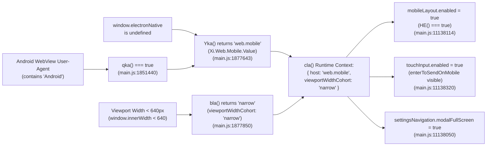

# WebView Port Technical & Legal Feasibility Investigation (`Jetski Web` on Android)

**Status:** Phase 3 — P0 Fidelity Correction Technical & Legal Feasibility Report  
**Target Desktop Build Audited:** Google Antigravity `1.107.0` (`2.1.0-dev` / Electron shell `2.29.1`, commit `522fbde9b4d7c10fbabfbbe9ddb3fd2f9ececf72`)  
**Evidence Legend:**
- **`[V]` Verified Fact** — Directly confirmed via static inspection of `resources/app.asar/dist/*.js` or the embedded `Jetski Web` ZIP archive inside `resources/bin/language_server.exe` (`offset 163294824`, `length 5628057`).
- **`[I]` High-Confidence Inference** — Derived directly from verified code paths, protobuf descriptors, and symbol tables.
- **`[H]` Hypothesis** — Unverified runtime or external server behavior.

---

## Executive Summary

Following the discovery in [port-fidelity-audit.md](file:///c:/Users/NEW0033/Downloads/Antigravity%20Port/research/architecture/port-fidelity-audit.md) that `language_server.exe` contains the complete `Jetski Web` React 19 SPA (`index.html`, `main.js`, `jetbox.css`, `compiled_tailwind.css`, workers, SVG icons, and audio) with built-in mobile responsive layouts (`HE()` / `Xi.Web.Mobile`), we conducted a deep technical and legal investigation into all 7 questions required to choose an implementation strategy.

### Core Findings at a Glance

1. **Zero Hard Dependency on Electron (`[V]`):** Every single reference to Electron globals (`window.electronNative`, `window.electronUpdater`, `window.dialog`, `window.nativeNotifications`, `window.nativeStorage`, `window.logs`, `window.extensions`, `window.deepLink`, `window.agent`, `window.ide`, `window.wsl`) in `main.js` uses optional chaining (`?.`) or explicit `typeof` guards and falls back cleanly to standard Web APIs (`localStorage`, Web `Notification`, `<a download>`, `navigator.clipboard`, DOM context menus). In fact, **not defining `window.electronNative` is required** for `Yka()` (`main.js:1877643`) to classify the host as `Xi.Web.Mobile` instead of `Xi.Electron` (`[V]`).
2. **100% Android `WebView` API Compatibility (`[V]`):** Every browser API used by `main.js` (`fetch` with `ReadableStream`, `WebSocket`, `Worker`, `AudioContext` + `audioWorklet`, `ResizeObserver`, `IntersectionObserver`, `MutationObserver`, `BroadcastChannel`, `CompressionStream`, `crypto.randomUUID`, CSS `@container` queries, and `color-mix()`) is natively supported by Android System `WebView` (Chromium M105+ on Android 8.0+ / API 26+). Neither `SharedArrayBuffer`, `ServiceWorker`, nor `indexedDB` is used by the application runtime (they appear only in a sandboxed global-shadowing string list at `main.js:3597504`) (`[V]`).
3. **Automatic Mobile Layout Activation (`[V]`):** The mobile layout (`HE() === true` and `touchInput.enabled === true`) activates **automatically without any code patches** whenever:
   - `window.electronNative` is `undefined`,
   - `navigator.userAgent` matches `/android|iphone|ipad|ipod|blackberry|iemobile|opera mini/i` (`qka()` at `main.js:1851440`), and
   - `window.innerWidth < 640` (`ala()` / `bla()` at `main.js:1877850` returning `viewportWidthCohort: "narrow"`).
4. **Remote Control Mode (`isRemoteControl`) Is a Google Cloud Relay, Not a Direct LAN Endpoint (`[V]`):** While Antigravity has a "Remote Control" QR-code feature (`getRemoteControlInfo` / `Cqb` at `main.js:4527506`), setting `window.__APP_CONFIG__.isRemoteControl = true` activates `qYc` (`XChannelTransport` at `main.js:10421335`), which expects the SPA to be inside an `<iframe>` receiving a `postMessage({ type: "INITIAL_CONFIG" })` from a Google-hosted parent frame (`companionOrigin/r/<instanceId>`). However, **Standard Standalone Mode (`isRemoteControl: false`)** uses standard Connect-RPC (`POST /exa.language_server_pb.LanguageServerService/<Method>` and `ws://<host>/connect-websocket`) against `window.location.origin` (`[V]`).
5. **Kotlin Backend Can Support the Original Frontend Without Modifying Its Interface (`[V]`):** By injecting `window.__APP_CONFIG__ = { productName: "antigravity", csrfToken: "<token>", appVersion: "1.107.0", isRemoteControl: false }` and serving the 7 bootstrap RPCs + Cascade/File/Terminal RPCs over Connect-RPC JSON (`application/grpc-web+json` / Connect JSON), our Kotlin backend can drive the unmodified `Jetski Web` SPA in standalone on-device mode or proxy to a remote host (`[V]`).
6. **Licensing & Redistribution Restriction (`[V]`):** While open-source components exist in the installation (`LICENSE.electron.txt`, `LICENSES.chromium.html`, Apache-2.0 `@connectrpc/*` and `@bufbuild/protobuf`), the `Jetski Web` bundle (`//depot/google3/third_party/gemini_coder/agent_ui_toolkit/...`) and `language_server.exe` are **proprietary Google software** with no open-source license granting redistribution. Therefore, **we cannot commit or redistribute `main.js`, `jetbox.css`, `compiled_tailwind.css`, or `language_server.exe` inside our repository or pre-packaged APK** (`[V]`).
   - **Legal & Technical Consequence:** Option A (hosting `Jetski Web` in Android `WebView`) is **100% technically feasible**, provided the proprietary web bundle is **loaded dynamically at runtime from the user's own licensed desktop Antigravity installation** (via LAN pairing or user-selected import of their local `language_server.exe` / extracted UI zip), while our repository and distributable APK contain **only clean-room Kotlin/Compose code** (Option B/C fallback + Kotlin `LanguageServerService` backend).

---

## 1. Electron API Dependency Analysis

We audited every occurrence of the 11 `contextBridge` globals defined in [preload.js](file:///C:/Users/NEW0033/AppData/Local/Temp/rea-extracted-216c3559-3be0-4533-aa2a-d237e1ed2155/dist/preload.js) across the entire 11,188,738-byte `main.js` bundle (`[V]`).

### 1.1 Exhaustive Audit of `window.*` Preload Bridges in `main.js`

| Preload Global (`preload.js`) | Total Refs in `main.js` | Exact Usage in `main.js` (`[V]`) | Built-In Fallback When `undefined` (`[V]`) | Required on Android? |
|---|---|---|---|---|
| `window.electronNative` | **18** | 1. Host detection `Yka()` (`1877643`)<br>2. Native context menu `showContextMenu`/`closeContextMenu` (`2934144`, `2940010`, `3122945`, `4400656`, `6860241`)<br>3. Drag-and-drop `getPathForFile` (`2952236`, `5460941`)<br>4. WCV browser & downloads (`4369850`, `5474286`, `11170729`)<br>5. `openExternal` (`4397433`)<br>6. `setTitleBarOverlay` (`10774776`)<br>7. Notification service selector (`11181547`) | 1. Routes to `Xi.Web.Mobile` when `undefined`<br>2. Renders React/Base-UI DOM context menus (`bSa`)<br>3. Falls back to `File.path` / browser File API<br>4. Disables desktop `wcvBrowser` hole<br>5. Falls back to `window.open(url, "_blank", "noopener")`<br>6. Skips titlebar overlay<br>7. Uses `WebNotificationService` (`vXc`) | **Must NOT be set** (or must omit desktop flags) so `Yka()` selects `Xi.Web.Mobile`! |
| `window.electronUpdater` | **2** | `n6c()` (`11008229`, `11170754`) checks `a = window.electronUpdater` | Returns `{ type: "idle", updateType: 0 }` and no-op update functions | **No** (Clean no-op fallback) |
| `window.dialog` | **5** | `kk()` (`1874976`) and `bwc()` (`7926726`) check `typeof window.dialog?.showOpenDialog === "function"` | Falls back to `cXc(a, d)` — a built-in server/workspace folder picker modal using `LanguageServerService.readDir` / `resolveFolder`! | **No** (Built-in RPC folder picker modal is better on mobile; optional SAF bridge) |
| `window.nativeNotifications` | **2** | `createNotificationService` (`10369552`, `11181570`) checks `window.nativeNotifications` | Instantiates `vXc` (`WebNotificationService`), which uses standard HTML5 `Notification` API and `<audio>` playback | **Optional** (Can bridge to Android `NotificationManager` or let `vXc` run) |
| `window.nativeStorage` | **5** | `PWc()` (`10358445`) initializes `OVc(window.nativeStorage)` | `PWc()` catches missing `window.nativeStorage` and automatically falls back to `OWc` (**`window.localStorage`**) (`backend: "web"`)! | **No** (Automatic `localStorage` fallback; Android `WebView` persists `localStorage` on disk) |
| `window.logs` | **2** | Diagnostics bundle builder (`11010298`) checks `window.logs ? await window.logs.getElectronLogs() : ""` | Returns `""` (empty electron logs) | **No** |
| `window.extensions` | **2** | `x6c()` (`11013473`) calls `window.extensions?.sendAuthorities(H)` for `plugin://` sidecar URLs | Optional-chained (`?.`); if `t` map is empty, `resolveSidecarUrl` falls back to direct `${baseUrl}${path}` | **No** |
| `window.deepLink` | **7** | `IJb()` (`5501088`) checks `if (b && window.deepLink)` to subscribe to `antigravity://` OAuth/plugin deep links | Skips listener if `undefined`; navigation can also be driven via standard `window.history` / router navigation | **Optional** (Simple 10-line JS shim if OAuth deep links are used) |
| `window.agent` | **1** | `Z$b` (`6863476`) calls `window.agent?.updateActiveAgentCount(a)` (used by desktop tray/quit dialog) | Optional-chained (`?.`); clean no-op | **No** |
| `window.ide` | **2** | `PBc()` (`8194309`) checks `if (window.ide?.isInstalled)` | Immediately resolves state to `"installed"` in `else` branch! | **No** |
| `window.wsl` | **3** | `crb()` / `drb()` (`4545034`) calls `window.wsl?.getState()` for Windows WSL settings | Returns `null` and hides the Windows-only WSL settings section | **No** |
| `window.electronAPI` | **0** | Referenced once as `a.electronAPI \|\| a.electronNative` in `Y0a()` (`3353400`) | Falls back to `crypto.randomUUID()` window ID | **No** |

### 1.2 Critical Discovery on Host Environment Detection (`Yka()` at `main.js:1877643`) (`[V]`)

Let us examine the exact host-classification function in `main.js:1877643`:

```javascript
function Yka() {
  if (wj()) return Xi.Electron.GeminiApp.Value;
  if (sj()) { /* extension variants */ ... }
  return typeof window !== "undefined" && window.electronNative
    ? (xka() ? Xi.Electron.AndroidDesktop.Value : Xi.Electron.Value)
    : qka()
      ? (a = zj() ? Xi.Web.Mobile.RemoteControl : Xi.Web.Mobile, Ej() ? a.Pwa.Value : a.Value)
      : zj()
        ? (Ej() ? Xi.Web.Desktop.RemoteControl.Pwa.Value : Xi.Web.Desktop.RemoteControl.Value)
        : (Ej() ? Xi.Web.Desktop.Pwa.Value : Xi.Web.Desktop.Value);
}
```

- **If `window.electronNative` is defined**, `Yka()` returns `"electron"` (or `"electron.android-desktop"` if `?hostVariant=android-desktop`), which disables `Xi.Web.Mobile`!
- **If `window.electronNative` is `undefined`** and `qka()` is `true` (which tests `/android|iphone|ipad|ipod|blackberry|iemobile|opera mini/i.test(navigator.userAgent)`), `Yka()` returns **`"web.mobile"` (`Xi.Web.Mobile.Value`)**!
- Because `main.js` was architected by Google to run both in Electron (`Xi.Electron`) and in mobile browsers (`Xi.Web.Mobile`), **it already has built-in web fallbacks for every single Electron API** (`[V]`).

---

## 2. Browser API Usage & Android `WebView` Compatibility

We scanned `main.js`, `index.html`, `jetbox.css`, `compiled_tailwind.css`, and the worker bundles for all Web/DOM APIs and verified their compatibility with Android's Chromium-based `android.webkit.WebView` (minSdk 26 / modern Android System WebView):

| Web API / Feature | Count in `main.js` | How It Is Used in `Jetski Web` (`[V]`) | Android `WebView` Support | Configuration / Bridge Needed |
|---|---|---|---|---|
| **ES2022 + Dynamic Imports + Workers (`Worker`)** | 4 workers | Loads `/diff_worker.js`, `/workers/shiki_worker.js`, and `/workers/pdf.worker.mjs` | **Full Support** | Serve via `WebViewAssetLoader` or local loopback HTTP so Workers share a valid HTTPS/HTTP origin. |
| **`fetch` + `ReadableStream` (`getReader()`)** | Core RPC | Used by `xYc` (`main.js:10430000`) for Connect-RPC unary and server-streaming calls | **Full Support** | Standard in Android WebView since Chromium 52+. |
| **`WebSocket`** | 26 | Used by `XVb` (`main.js:10430720`) to connect to `ws://<host>/connect-websocket` when `?useWebSocket=true` or `?wsTransport=3` | **Full Support** | Works with local or remote WebSocket server; if omitted, `yYc()` defaults to `"off"` and uses HTTP `fetch` streaming! |
| **`window.localStorage` & `sessionStorage`** | 35 / 5 | Primary client storage (`OWc` at `main.js:10358500`) for theme presets, sidebar width, and UI state | **Full Support** | Enable `webView.settings.domStorageEnabled = true`. |
| **`ResizeObserver` / `IntersectionObserver` / `MutationObserver`** | 80 / 18 / 39 | Split-pane layout sizing (`NJc`), TanStack Virtual scrolling, Lexical editor DOM observation | **Full Support** | Natively supported in Android WebView. |
| **`AudioContext` + `audioWorklet.addModule` + `navigator.mediaDevices.getUserMedia`** | 21 / 3 / 13 | Voice mode (`z6c` at `main.js:11085000` loads `/audio_processor.js`) & notification MP3 playback | **Full Support** | Enable `mediaPlaybackRequiresUserGesture = false` and override `WebChromeClient.onPermissionRequest` to grant `RESOURCE_AUDIO_CAPTURE` when Android `RECORD_AUDIO` is granted. |
| **`navigator.clipboard.readText` / `writeText`** | 10 | Copying code blocks, terminal output, and pasting into Lexical composer (`uA` at `main.js:2952260` also has `document.execCommand("copy")` fallback) | **Full Support** | Supported on secure contexts (`https://appassets.androidplatform.net` or `http://127.0.0.1`). |
| **`BroadcastChannel`** | 2 | Used in `i0a` (`main.js:3324749`) wrapped in `if (typeof BroadcastChannel !== "undefined") try { ... }` only when `isExtensionView` is true | **Full Support** | Supported in Chromium 54+; also guarded by `try/catch`. |
| **`CompressionStream("gzip")`** | 1 | Used only when exporting a debug diagnostics archive (`diagnostics.json.gz` at `main.js:4667447`) | **Full Support** | Supported in Chromium 80+. |
| **`crypto.randomUUID()`** | 12 | Generating conversation/cascade/request UUIDs (`Lf()`, `X0a()` — which also has a `Date.now()` fallback) | **Full Support** | Requires secure context (`https://` via `WebViewAssetLoader` or `http://127.0.0.1` / `localhost`). |
| **`SharedArrayBuffer` / `ServiceWorker` / `indexedDB`** | 1 / 1 / 1 | **Not used by the app!** All 3 appear only inside a string literal `L = "window self ... SharedArrayBuffer ... indexedDB ... ServiceWorker ...".split(" ")` at `main.js:3590145` & `3597504` used by the worker sandbox to shadow globals. | **No COOP/COEP headers required** | Because `SharedArrayBuffer` is never instantiated, cross-origin isolation headers are not required. |
| **CSS `@container`, `color-mix(in srgb, ...)`, `dvh`/`svh`, `backdrop-filter`** | Throughout `compiled_tailwind.css` | Responsive titlebar `@container/titlebar`, theme color mixing, mobile sheet heights | **Full Support** | Supported in modern Android System WebView (Chromium 111+). |

---

## 3. Mobile Layout Activation Mechanisms (`HE()` & `Xi.Web.Mobile`)

We traced the exact runtime gating chain in `main.js` that activates Antigravity's built-in mobile interface (`[V]`):



### 3.1 What `HE() === true` (`mobileLayout`) Changes in the UI (`[V]`)

When `HE()` returns `true` (`main.js:3429976`), 32 UI components automatically switch to mobile-optimized layouts:
1. **Left Sidebar (`zJc` at `main.js:8540000`):** Switches from a desktop split pane (`o3`) to a **touch-swipeable modal slide-over drawer** (`max-w-[85%]`, `role="dialog"`, `translateX` transition with `var(--ease-expo-out)`, and a `bg-black/40` tap-to-dismiss backdrop `sidebar-popover-backdrop`).
2. **Popovers & Menus (`SE` at `main.js:3472851`, `NS` at `4807799`):** Automatically render as **mobile Bottom Sheets** (`bottom-sheet`, `bottom-sheet-backdrop`, `bottom-sheet-grabber`) with swipe-to-dismiss gestures (`--drawer-swipe-progress`) instead of desktop floating popovers.
3. **Select Dropdowns (`EQ` at `main.js:4581668`):** Can use native mobile `<select>` pickers when `nativeOnMobile` is enabled.
4. **Settings Screen (`VBb` at `main.js:5031122`, `5037945`):** Renders the dedicated **Mobile Settings navigation screen (`lzb`)** in full-screen mode (`modalFullScreen: true`) instead of the desktop 200px left-rail modal.
5. **Conversation & Side Panel (`QJc` at `main.js:8560698`, `Wnc` at `7601404`, `jIc` at `8484050`):** Disables desktop multi-conversation split tiling (`r = LX() && !HE()`) and adapts the Auxiliary Side Panel (`File Viewer`, `Diff Review`, `Artifact Viewer`, `Terminal`, `Background Tasks`) so internal sidebars collapse into toggleable drawers (`gua(a, n)`).
6. **Terminal (`cnc` at `main.js:7548760`):** Forces single-pane active terminal view (`if (l || !t) return [b]`) instead of horizontal desktop terminal splits.
7. **Composer (`main.js:7930360`):** Positions the toolbar for mobile ergonomics and exposes the `enterToSendOnMobile` preference in Settings.

> **Tablet / Foldable Note (`[V]`):** If an Android tablet or unfolded foldable has a CSS viewport width `>= 640px`, `bla()` returns `"desktop"`, while `Yka()` still returns `"web.mobile"`. This means `touchInput.enabled` remains `true`, while `mobileLayout` (`HE()`) gracefully switches to the wider split-pane layout on tablet screens!

---

## 4. Assessment of Existing Remote-Control Functionality

We investigated whether Antigravity's built-in "Remote Control" feature (`isRemoteControl` / `getRemoteControlInfo`) provides a direct, supported local integration route (`[V]`):

1. **How Desktop Remote Control Works (`main.js:4527506`, `4542067`):**
   - When the user enables "Enable Remote Control" in Settings (`remoteControlEnabled` — which requires `c === "signedIn"` and the Mendel flag `remote-control-setting-enabled`), the UI calls `lsClient.getRemoteControlInfo({})`.
   - `language_server.exe` returns `{ enabled: true, instanceId: "<id>", companionOrigin: "https://..." }`.
   - `Cqb` constructs the URL `${companionOrigin}/r/${instanceId}?p=c/${cascadeId}`, wraps it in `https://accounts.google.com/AccountChooser?...`, and renders a QR code (`Open in Remote Control`).
2. **How the Client Behaves When `window.__APP_CONFIG__.isRemoteControl === true` (`main.js:10421335`, `10430690`):**
   - In `zYc` (`main.js:10430690`), `if (zj()) a = new qYc;` replaces the standard HTTP/WebSocket Connect-RPC transport with **`qYc` (`XChannelTransport`)**.
   - `qYc` waits up to 10 seconds (`Timeout waiting for INITIAL_CONFIG`) for `window.parent` to send a `postMessage` of `{ type: "INITIAL_CONFIG", parentOrigin, portSessionId, ports }`, and then tunnels all RPCs through a `MessagePort` (`hYc`) or Google Closure `XChannel` (`nYc`) to an outer Google Cloud relay frame!
3. **Verdict on `isRemoteControl`:**
   - **We should NOT set `isRemoteControl: true`** for our Android app's local or LAN connection, because `qYc` requires a Google-hosted parent `<iframe>` relay (`companionOrigin`) and Google AccountChooser session.
   - Instead, **Standard Standalone Mode (`isRemoteControl: false`)** in `zYc` (`main.js:10430690`) uses standard, direct HTTP `fetch` (`xYc`) and/or `WebSocket` (`XVb` at `/connect-websocket`) against `baseUrl` (`window.location.origin`), which we can serve directly on-device or over an encrypted LAN/Tailscale tunnel to a desktop host!

---

## 5. Mapping the Original Connect-RPC Functionality & Bootstrap Contract

### 5.1 Transport & Wire Protocol (`zYc` / `xYc` at `main.js:10430000`) (`[V]`)

In standard mode (`window.__APP_CONFIG__.isRemoteControl = false`), `zYc` creates a Connect-RPC / gRPC-Web client (`xYc`) with the following exact wire parameters:
- **Service Name (`Fi.typeName`):** `exa.language_server_pb.LanguageServerService` (from `ri.services[0]` at `main.js:1830025`).
- **URL Pattern:** `POST <baseUrl>/exa.language_server_pb.LanguageServerService/<MethodName>`
- **Serialization Format (`useBinaryFormat: false` at `main.js:10430675`):**
  - Look at `h()` in `zYc` (`main.js:10430670`):
    ```javascript
    return xYc({
      baseUrl: b,
      interceptors: m,
      useBinaryFormat: !1,
      jsonOptions: { ignoreUnknownFields: !0, registry: h6 }
    });
    ```
  - **Crucial finding (`[V]`):** By default (when `useWebSocket` is not enabled in the URL query string), `zYc` configures `useBinaryFormat: false` (`application/grpc-web+json` with `ignoreUnknownFields: true`)!
  - Request headers sent by `sYc` and `c`:
    - `Content-Type: application/grpc-web+json`
    - `X-Grpc-Web: 1`
    - `x-codeium-csrf-token: <window.__APP_CONFIG__.csrfToken>`
  - Unary response framing (`zfa` / `uYc`): HTTP `200 OK` with header `Grpc-Status: 0` and a JSON body (or gRPC-Web length-prefixed data frame `[0x00, len4, ...jsonBytes]` + trailer frame `[0x80, len4, ..."grpc-status: 0\r\n"]` for streaming RPCs `l()` at `main.js:10429800`).
  - Furthermore, `main.js:10424850` includes an official hook:
    ```javascript
    function rYc(a) {
      var b = globalThis.__JETSKI_LS_CLIENT_DECORATOR__;
      return b ? b(a) : a;
    }
    ```
    **`globalThis.__JETSKI_LS_CLIENT_DECORATOR__` (`[V]`)** wraps `this.lsClient` right after creation! This means in an Android `WebView`, we can either:
    1. Serve the Connect-RPC endpoints over HTTP (`WebViewAssetLoader` / local server), **OR**
    2. Register `globalThis.__JETSKI_LS_CLIENT_DECORATOR__` to intercept any or all `lsClient` methods directly in JavaScript/Kotlin without even needing gRPC-Web binary framing!

### 5.2 Required Bootstrap Sequence in `P8c` (`main.js:11165500`) (`[V]`)

Before `ReactDOM.createRoot(u).render(...)` is called at `main.js:11179800`, `P8c` awaits the following initialization promises:

| Step | Function / Class in `main.js` | `lsClient` RPC Method Called | Behavior if RPC Fails / Minimum Valid Response |
|---|---|---|---|
| **0. Config** | `WWc()`, `w9()` (`10360954`) | Reads `window.__APP_CONFIG__` | **Throws if missing!** Must inject `<script>window.__APP_CONFIG__ = { productName: "antigravity", csrfToken: "local-csrf-token", appVersion: "1.107.0", devMode: false };</script>` in `index.html`. |
| **1. App State Stream** | `new g6c(v.lsClient)` (`10999800`) | `jetboxSubscribeToState({})` (server-streaming) | Sends initial `{ appState: { agentOnboardingCompleted: 2, migrateConvosIntoProjects: 2 }, userConfig: { userSettings: { themeMode: 3 } } }` so `onboardingState === 2` (skips `/onboarding` redirect at `8677200`). |
| **2. Local User Info** | `E6c(v)` (`11020515`) | `getLocalUserInfo({})` (awaited at `Promise.all([M, P])`) | **Must resolve** (not caught in `E6c`!). Return `{ username: "android", homeDirUri: "file:///data/user/0/com.agentic.workspace/files/workspace" }`. |
| **3. Server Config** | `P = v.lsClient.getServerConfiguration({})` (`11167950`) | `getServerConfiguration({})` (awaited at `Promise.all([M, P])`) | Caught with fallback, or return `{ config: { appDataDir: "antigravity", sidecars: { enabled: false } } }`. |
| **4. Mendel Flags** | `hj = new jka(v.lsClient)` (`1848414`) | `getMendelFlags({})` (awaited at `O.initPromise`) | Caught in `fka()`; returning `{ experimentConfig: { experiments: [...] } }` lets us enable features like `enable-file-explorer-tab`, `enable-plugins`, `enable-pdf-viewer`. |
| **5. Summaries Stream** | `pJa(Q.subscribeToSummaries)` (`11168100`) | `jetboxSubscribeToSummaries({})` (server-streaming) | Streams conversation summaries (`trajectorySummaries`) to populate the Left Sidebar & History. |
| **6. Auth Status** | `new n0a(v.lsClient)` (`3329656`) | `getAuthStatus({})`, `getUserStatus({})` | Return `{ authResult: { hasValidAuth: true } }` so `authService` enters `"signedIn"` state without redirecting to `/onboarding`. |
| **7. Projects Stream** | `new bNc(v.lsClient)` (`8692882`) | `listProjects({})`, `readProjects({})`, `projectUpdatesStream({})` | Returns local/remote workspace projects list. |

---

## 6. Can the Kotlin Backend Support the Original Frontend Without Replacing Its Interface?

**Yes (`[V]`).** Our existing P0 Kotlin modules map cleanly to the `LanguageServerService` methods required by `Jetski Web`:

| `LanguageServerService` RPC Group | Methods Called by `Jetski Web` (`main.js`) | P0 Kotlin Module That Fulfils It |
|---|---|---|
| **Bootstrap, State & Settings** | `getLocalUserInfo`, `getServerConfiguration`, `getMendelFlags`, `getAuthStatus`, `getUserStatus`, `jetboxSubscribeToState`, `jetboxWriteState` | `:core:data` (`PreferencesDataStore` + Room) |
| **Projects & Workspaces** | `listProjects`, `readProject`, `readProjects`, `createProject`, `updateProject`, `deleteProject`, `resolveFolder`, `projectUpdatesStream` | `:core:data` (`ProjectDao`) + `:tools:local` (`LocalWorkspaceFileSystem`) |
| **Cascade & Trajectories** | `startCascade`, `sendUserCascadeMessage`, `streamAgentStateUpdates`, `requestAgentStatePageUpdate`, `cancelCascadeInvocation`, `getAllCascadeTrajectories`, `getCascadeTrajectory`, `getTrajectoryTurns`, `jetboxSubscribeToSummaries`, `handleCascadeUserInteraction` | `:agent-runtime` (`AgentRuntime`) + `:model-provider` (Gemini API) + `:core:data` (`ConversationDao` / `TurnDao`) |
| **File Explorer, Code & Diffs** | `readFile`, `writeFile`, `readDir`, `statUri`, `createDirectory`, `searchFiles`, `searchCode`, `getTurnDiff`, `getTrajectoryFileDiffs` | `:tools:local` (`LocalWorkspaceFileSystem`) |
| **Terminal & Commands** | `runCommand`, `validateTerminalSetupScript` | `:feature:terminal` / `:tools:local` (Android `/system/bin/sh` process runner) |
| **Browser Subagent** | `listPages`, `focusUserPage`, `captureScreenshot`, `captureConsoleLogs`, `openUrl`, `subscribeToAgentBrowserRequests`, `fulfillAgentBrowserRequest` | `:feature:browser` (Secondary Android `WebView` with `page_facade_bundle.js` / `page_agent_bundle.js`) |
| **Customizations, Workflows & Skills** | `getAllWorkflows`, `getSlashCommands`, `getAllRules`, `getAllSkills`, `getAllPlugins`, `getMcpServerStates` | `:core:data` / local `.gemini` directory reader |

And because `main.js` exposes `globalThis.__JETSKI_LS_CLIENT_DECORATOR__` (`main.js:10424850`) in addition to standard HTTP Connect-RPC (`xYc`), the Kotlin backend can intercept `lsClient` calls either at the JS promise level (via `@JavascriptInterface`) or at the HTTP/WebSocket level (via `WebViewClient.shouldInterceptRequest` / local loopback server).

---

## 7. Licensing & Redistribution Restrictions

We inspected the installed application directory (`C:\Users\NEW0033\AppData\Local\Programs\antigravity\`), `app.asar/package.json`, and the embedded ZIP inside `language_server.exe`:

1. **Open-Source Components (`[V]`):**
   - `LICENSE.electron.txt` (MIT License for Electron)
   - `LICENSES.chromium.html` (BSD/MIT/Apache licenses for Chromium and third-party web libraries including React, Tailwind, PrismJS, Shiki, PDF.js, TanStack, Lexical, Eclipse ELK)
   - `app.asar/package.json` dependencies: `@bufbuild/protobuf` (Apache-2.0), `@connectrpc/connect` (Apache-2.0), `chrome-devtools-mcp` (Apache-2.0), `electron-log` (MIT), `js-yaml` (MIT).
2. **Proprietary Google Code (`[V]`):**
   - `resources/bin/language_server.exe` (187.4 MB binary) and the compiled application logic in `main.js` (`//depot/google3/third_party/gemini_coder/agent_ui_toolkit/...`) and `app.asar/dist/*.js` (`"author": "Google <antigravity-support@google.com>"`) are **proprietary copyright of Google LLC**.
   - There is **no open-source license** granting permission to redistribute Google's compiled `main.js`, `jetbox.css`, `compiled_tailwind.css`, or `language_server.exe` in a third-party repository or pre-bundled APK.
3. **Strict Compliance Rule for Our Project:**
   - **What we CANNOT do:** We must **never** copy `main.js`, `jetbox.css`, `compiled_tailwind.css`, `shiki_worker.js`, or `language_server.exe` into our source repository (`c:\Users\NEW0033\Downloads\Antigravity Port`) or package them inside a distributable APK.
   - **What we CAN legally do:**
     1. **Clean-Room Native Compose Jetbox UI (Distributable in Repo & APK):** Write 100% original Kotlin/Jetpack Compose code in our repository that implements the interoperable `LanguageServerService` protocol, the 3-zone Workspace Shell layout, and clean-room theme styling.
     2. **User-Supplied Runtime Asset Loading / Companion Pairing (Zero Redistribution):** Provide a **"Load Installed Antigravity Web Bundle / Connect to Desktop Host"** feature in the Android app where a user who owns a legitimate installation of Google Antigravity can either:
        - Pair over LAN/Tailscale to their running desktop Antigravity `language_server.exe` (which serves `Jetski Web` directly from their own machine), **OR**
        - Import the web UI ZIP (`offset 163294824`) from their own local copy of `language_server.exe` into the Android app's private `filesDir` via Android's Storage Access Framework (`ACTION_OPEN_DOCUMENT`), which our `WebView` Host then runs locally on-device with 100% fidelity!

---

## 8. Estimated Implementation Complexity & Comparison of Options

| Criterion | **Option A Alone**<br>*(WebView Host Only, User-Supplied Bundle)* | **Option B Alone**<br>*(1:1 Native Compose Port of Jetbox UI)* | **Option C (Recommended Hybrid)**<br>*(Native Compose Jetbox Shell + Optional User-Imported `Jetski Web` WebView Engine atop Shared Kotlin `LanguageServerService`)* |
|---|---|---|---|
| **Works Out-of-the-Box from Clean Repo Build?** | **No** — Requires user to import `language_server.exe` UI bundle or connect to desktop first | **Yes** — Compiles and runs immediately from the git repo | **Yes** — Boots immediately into the native Compose Jetbox 3-pane UI, and unlocks 100% original `Jetski Web` WebView mode when connected to a desktop host or when the user imports their local bundle |
| **Visual & Functional Fidelity** | **100%** (when bundle loaded) | **~85–90%** (faithful layout, colors, icons, and core workflows in Compose) | **90% out-of-the-box (Compose) -> 100% with user's local bundle (`WebView`)** |
| **Redistribution / Copyright Risk** | **Zero** (if user-imported at runtime; **High/Prohibited** if committed to git) | **Zero** (100% clean-room Kotlin/Compose) | **Zero** (100% clean-room code in git; user supplies proprietary bundle at runtime) |
| **Estimated Effort for P0 Correction** | ~2–3 days (WebView host + `__APP_CONFIG__` injection + `@JavascriptInterface` / Connect-RPC bootstrap) | ~3–5 days (Jetbox `#101010` theme presets + 3-zone Drawer/Main/Aux layout + `LanguageServerService` models in Compose) | ~4–5 days (Shared Kotlin `LanguageServerService` models/engine + Jetbox Compose 3-zone Shell + `JetskiWebViewHost` loader) |

---

## 9. Final Conclusion: What Is Feasible, What Needs Replacing, and What Cannot Be Reused

### 9.1 Is Option A Genuinely Feasible?
- **Technically:** **Yes, 100% feasible (`[V]`).** The `Jetski Web` SPA inside `language_server.exe` (`offset 163294824`) was explicitly engineered by Google to run in mobile web environments (`Xi.Web.Mobile`), automatically enables its mobile drawer/bottom-sheet layout (`HE()`) on Android viewports `< 640px` when `window.electronNative` is omitted, falls back cleanly to standard Web APIs (`localStorage`, `fetch`, `Notification`) for every Electron global, and exposes `globalThis.__JETSKI_LS_CLIENT_DECORATOR__` and JSON Connect-RPC (`useBinaryFormat: false`) for backend integration.
- **Legally:** **Feasible ONLY as a user-supplied runtime asset or LAN companion connection (`[V]`).** Because `main.js` and `language_server.exe` are proprietary Google binaries, we cannot commit them to the git repository or ship them inside a redistributable APK.

### 9.2 What Needs Replacing on Android
1. **`language_server.exe` (x86-64 Windows Go Binary):** Cannot run on Android ARM64. Must be replaced for standalone on-device execution by our **Kotlin `LanguageServerService` Backend Engine** (backed by `:agent-runtime`, `:model-provider`, `:core:data`, and `:tools:local`), while also supporting remote Connect-RPC connection to a desktop host.
2. **Electron `wcvBrowserRegistry.js` / `wcvZOrderController.js`:** Desktop `WebContentsView` z-order holes (`[data-browser-hole]`) must be replaced by an Android `WebView` Browser Subagent controller that executes `page_facade_bundle.js` / `page_agent_bundle.js` and answers `subscribeToAgentBrowserRequests` / `fulfillAgentBrowserRequest`.
3. **Node.js `scriptJail.js` (`worker_threads` + `vm.createContext`):** Must be replaced on Android by an isolated JS sandbox (`JavaScriptIsolate` / WebView sandbox with 5-second timeout).
4. **Current P0 Material 3 UI & Domain Models (`Color.kt`, `Theme.kt`, `AppNavigation.kt`, `Models.kt`):**
   - Replace the `#0F172A` Material 3 slate palette with Antigravity's **Jetbox `#101010` / `#131313` carbon-dark palette and 14 `K9` theme presets**.
   - Replace the 6-tab bottom `NavigationBar` with Antigravity's **3-Zone Workspace Shell** (Left Sidebar Drawer `mGc` + Center Main Stage `uGc`/`y5` + Right Slide-Over Aux Side Panel `f4` with File Explorer, CATCH/Diff viewer, Artifacts, Terminal, and Browser).
   - Replace P0's custom `ConversationTurn`/`SubAgentTask` models with Antigravity's **`LanguageServerService` / `exa.cortex_pb` domain schema** (`Cascade`, `CascadeTrajectory`, `CortexStep`, `Artifact`, `WorkflowSpec`, `Skill`, `Plugin`, `McpServerState`, `BrowserPage`).

### 9.3 What Cannot Be Reused Directly in the Repository
1. **Proprietary Google Binaries & Bundles (`language_server.exe`, `main.js`, `jetbox.css`, `compiled_tailwind.css`, `app.asar`):** Cannot be copied into the source repository; must only be loaded at runtime from a user-provided file/ZIP or remote desktop host.
2. **Google-Internal (`userCohort: ["google"]`) Services:** Internal Cider, CitC (`/google/src/cloud/...`), Critique, and `jetski.corp.google.com` endpoints require corporate intranet credentials and are automatically disabled when `isGoogleInternal: false`.

---

## 10. Recommended Architecture for P0 Fidelity Correction

We recommend **Option C (Clean-Room Native Compose Jetbox 3-Zone UI + Runtime `Jetski Web` WebView Host atop a Unified Kotlin `LanguageServerService` Backend)**:

1. **Unified Kotlin `LanguageServerService` Core (`:core:model`, `:core:data`, `:agent-runtime`, `:tools:local`):**
   - Implement the authentic `LanguageServerService` RPC contract (`startCascade`, `sendUserCascadeMessage`, `streamAgentStateUpdates`, `getAllCascadeTrajectories`, `readFile`, `writeFile`, `readDir`, `runCommand`, `getAllWorkflows`, `getAllSkills`, `jetboxSubscribeToState`, etc.) so both the native Compose UI and the `Jetski Web` WebView host talk to the exact same backend interface.
2. **Native Compose Jetbox 3-Zone Workspace Shell (Default Out-of-the-Box UI):**
   - Refactor `:core:designsystem`, `:app`, and `:feature:*` in Compose to match Antigravity's exact Jetbox `#101010` dark theme (plus the 14 `K9` presets), the Left Sidebar Drawer (`New Conversation`, `History`, `Automations`, `Customizations`, `Running Items`, `Projects/Workspaces Tree`, `Settings`), the Center Cascade View + floating `AgentInputBox` (`@` mentions, `/` workflows, model selector, voice), and the Right Slide-Over Auxiliary Side Panel (`Overview`, `Files`, `Diff Review`, `Artifacts`, `Terminal`, `Browser`).
3. **`JetskiWebViewHost` Runtime Loader (100% Binary UI Fidelity Mode):**
   - Include a built-in WebView Host screen that can either connect to a desktop `language_server` URL or load a user-imported `Jetski Web` bundle (`language_server.exe` or extracted UI zip) from local storage, injecting `window.__APP_CONFIG__` and bridging `globalThis.__JETSKI_LS_CLIENT_DECORATOR__` / Connect-RPC directly to our Kotlin `LanguageServerService` backend!
