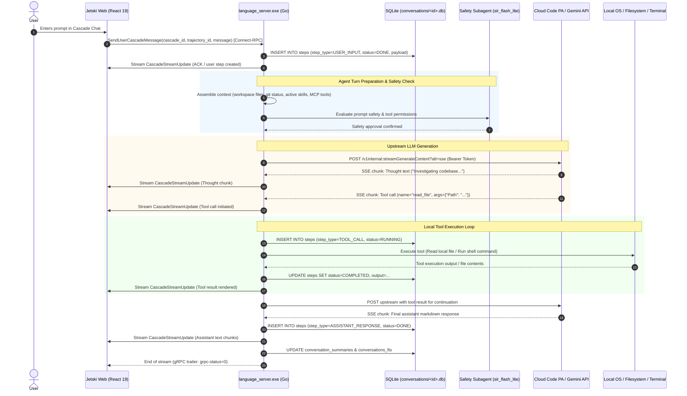

# Phase P2: Original Antigravity Backend & AI Runtime Reverse-Engineering Investigation

## Executive Summary

This report delivers the definitive architectural analysis and reverse-engineering findings of the original Google Antigravity desktop application, its background services, and its AI execution runtime.

The central finding of this investigation is that **the original Google Antigravity desktop application does not run an LLM locally**. Instead, it uses a hybrid architecture:
1. **Frontend (Presentation):** An Electron-hosted React 19 Single Page Application ("Jetski Web") that communicates over loopback Connect-RPC / gRPC-Web (`https://127.0.0.1:<port>/`).
2. **Local Core Orchestrator (Go Daemon):** A local 187 MB Go executable (`language_server.exe`, compiled from Google3 internal source `CL: 1015941558`), which manages local conversation persistence (SQLite), workspace filesystem tools, process/terminal execution, safety monitoring, and model communication.
3. **Remote AI Model Services:** Upstream LLM inference is provided remotely by Google Cloud services—specifically Google's internal Cloud Code Private API (`https://daily-cloudcode-pa.googleapis.com/v1internal:streamGenerateContent?alt=sse`) by default, with built-in fallback support for the public Google Generative Language API (`https://generativelanguage.googleapis.com`).

Crucially, `language_server.exe` is explicitly architected with a **Hub discovery mechanism** (`hub_<port>.json`) and client-agnostic Connect-RPC interfaces (`--subclient_type=hub`). This architecture enables external clients—including mobile devices on a local network—to connect directly to the running daemon.

---

## 1. Original Backend Architecture & Component Breakdown

```
+-----------------------------------------------------------------------------------+
|                        ANTIGRAVITY DESKTOP ARCHITECTURE                           |
|                                                                                   |
|  +-----------------------------------------------------------------------------+  |
|  | Electron Main Process (Antigravity.exe)                                     |  |
|  | - Window lifecycle, tray, deep link router (antigravity://auth)            |  |
|  | - Spawns language_server.exe with dynamic TLS port and CSRF token           |  |
|  | - Sets up loopback certificate trust bypass (setupLocalCertTrust)           |  |
|  +-----------------------------------------------------------------------------+  |
|                                  | spawns & monitors                              |
|                                  v                                                |
|  +-----------------------------------------------------------------------------+  |
|  | Local Language Server Daemon (language_server.exe - 187.4 MB Go binary)     |  |
|  |                                                                             |  |
|  |  [Embedded Web Bundle] -> Serves Jetski Web SPA (index.html, main.js)       |  |
|  |  [Connect-RPC Server]  -> 364 RPC endpoints over HTTPS/HTTP on 127.0.0.1    |  |
|  |  [Discovery Engine]    -> Writes ~/.gemini/antigravity/daemon/hub_<port>.json|  |
|  |  [Cascade Engine]      -> Multi-turn agent loop, prompt builder, tool router |  |
|  |  [Safety Subagents]    -> sir_flash_lite & agy_tool_safety monitors          |  |
|  |  [Persistence Engine]  -> Per-conversation SQLite (conversations/<id>.db)   |  |
|  |                        -> Global index & search (conversation_summaries.db)  |  |
|  |  [Local OS Tools]      -> File I/O, diffs, ProcessBuilder terminal, MCP host |  |
|  +-----------------------------------------------------------------------------+  |
|            |                                              |                       |
|   Connect-RPC / gRPC-Web                         HTTPS SSE Stream                 |
|            |                                              |                       |
|            v                                              v                       |
|  +-------------------------+            +--------------------------------------+  |
|  | Electron Renderer       |            | Remote Google Cloud Services         |  |
|  | (Jetski Web React 19)   |            | - daily-cloudcode-pa.googleapis.com  |  |
|  | - Cascade Chat UI       |            | - generativelanguage.googleapis.com  |  |
|  | - Workspace tree        |            | - oauth2.googleapis.com              |  |
|  | - Model selector        |            +--------------------------------------+  |
|  +-------------------------+                                                      |
+-----------------------------------------------------------------------------------+
```

### Local vs Remote Component Breakdown

| Component | Execution Location | Purpose | Implementation Details |
| :--- | :--- | :--- | :--- |
| **Electron Main Process** | Local Desktop | Host container, window manager | Node.js / Electron C++ runtime; spawns `language_server.exe`. |
| **Electron Preload Bridge** | Local Desktop | ContextBridge security boundary | Injects 11 native API namespaces into `window` (`electronNative`, `dialog`, etc.). |
| **Jetski Web Frontend** | Local Renderer (Chromium) | React 19 Single Page App | Connect-RPC clients invoking loopback endpoints. |
| **Language Server Daemon** | Local Desktop | Local agent orchestrator & RPC host | Compiled Go 64-bit PE executable from Google3 (`CL: 1015941558`). |
| **WebM Encoder** | Local Desktop | Screen recording video compression | `webm_encoder.exe` (13.4 MB PE binary). |
| **Trajectory SQLite Stores** | Local Disk | Conversation step & metadata store | Individual SQLite databases at `~/.gemini/antigravity/conversations/<id>.db`. |
| **Summary & FTS5 Index** | Local Disk | Global conversation index & search | `~/.gemini/antigravity/conversation_summaries.db` with FTS5 virtual table. |
| **State Protobuf** | Local Disk | User preferences, NUXs, active model | `~/.gemini/antigravity/antigravity_state.pbtxt`. |
| **Cloud Code Private API** | Remote Google Cloud | Primary LLM inference engine | `https://daily-cloudcode-pa.googleapis.com/v1internal:streamGenerateContent`. |
| **Generative Language API** | Remote Google Cloud | Alternative public LLM engine | `https://generativelanguage.googleapis.com` (enabled via `-model_api_client_type=gemini`). |
| **Google Gaia / OAuth** | Remote Google Cloud | Identity & authentication | Google OAuth 2.0 authorization code grant. |
| **ZeroG Remote VM Sidecars** | Remote Google Cloud | Cloud ephemeral development containers | Remote VMs accessed via SSH keys and Unix domain sockets. |

---

## 2. Original AI Request Lifecycle (Cascade Engine)

Tracing the execution of a user message through the original desktop system:



---

## 3. Original Authentication Architecture

### Authentication Mechanisms Observed
1. **Google Account OAuth 2.0 (Primary):**
   - User clicks "Sign In" in the Jetski UI.
   - The UI invokes `AuthenticateWithCode` or triggers deep link `antigravity://auth`.
   - Electron captures the redirect or `language_server.exe` receives the auth code on a loopback HTTP callback listener.
   - The daemon exchanges the code with `oauth2.googleapis.com` for an OAuth access token and refresh token.
   - Tokens are stored locally by `language_server.exe` and used to populate `Authorization: Bearer <token>` headers on calls to `daily-cloudcode-pa.googleapis.com`.
2. **Keyless Google Cloud Project Auth (`-google_cloud_project`):**
   - For enterprise environments, the daemon supports GCP keyless identity or service account credentials.
3. **Internal LOAS / Stubby Auth (`-use_stubby_auth`):**
   - Used inside Google's corporate network (`is_google_internal=true`) using Stubby RPCs and Low Overhead Authentication Service (LOAS).
4. **Gemini API Key Authentication (`-model_api_client_type=gemini`):**
   - When configured in Gemini mode, the daemon connects to `generativelanguage.googleapis.com` using a standard API key or bearer token.

### Security Boundary Separation
The Android port must strictly distinguish between:
- **Local Host-Session Readiness:** Whether the local Android backend is initialized and ready to serve RPCs.
- **Google Account Authentication:** A genuine Google OAuth session with Cloud Code scopes.
- **Gemini API Key Authentication:** A standalone developer API key passed to the public Generative Language API.

---

## 4. Original Model Selection & Model Routing Architecture

### Model Hierarchy & Enum Structure
Inspection of `language_server.exe` binary strings and embedded descriptors revealed an extensive model catalog:
- **Google / Gemini Models:** `MODEL_TIER_FLASH_LITE`, `MODEL_TIER_FLASH`, `MODEL_TIER_PRO`, `MODEL_TIER_INHERIT`.
- **Dynamic Model Placeholder:** `MODEL_PLACEHOLDER_M318` (used in `antigravity_state.pbtxt` to dynamically represent the current default model without hardcoding model names in persistent files).
- **Third-Party & BYOK Models:** Claude (`MODEL_CLAUDE_3_5_SONNET_20241022`, `MODEL_CLAUDE_3_7_SONNET_20250219`, `MODEL_CLAUDE_3_5_SONNET_BYOK`), OpenAI (`MODEL_CHAT_GPT_4O`, `MODEL_CHAT_O1`, `MODEL_CHAT_O3_MINI`, `MODEL_CHAT_O4_MINI`), DeepSeek, Grok.
- **Pricing & Quota Categories:** `MODEL_PRICING_TYPE_API`, `MODEL_PRICING_TYPE_BYOK`, `MODEL_PRICING_TYPE_STATIC_CREDIT`.

### Model Config RPCs
- `GetCascadeModelConfigs`: Returns the active model configurations, including display labels, model aliases, supported MIME types, and thinking level capabilities.
- `GetCascadeModelConfigData`: Returns detailed quota limits and context window configurations (e.g. standard vs expensive context).
- The user's selection in the Jetski dropdown is passed in `SendUserCascadeMessageRequest.model_preference` and persisted to `antigravity_state.pbtxt`.

---

## 5. Persistence & Database Schemas

Antigravity uses SQLite for all persistent conversation state.

### 1. `conversation_summaries.db`
Stores the global conversation index and full-text search tables:
- **Table `conversation_summaries`:**
  - `conversation_id` (TEXT PRIMARY KEY)
  - `title` (TEXT), `preview` (TEXT), `step_count` (INTEGER), `last_modified_time` (DATETIME)
  - `workspace_uris` (TEXT), `status` (TEXT), `agent_name` (TEXT)
  - `last_user_input_time` (DATETIME), `last_user_input_step_index` (INTEGER)
- **Virtual Table `conversations_fts`:**
  - SQLite FTS5 table indexing `user_body`, `agent_body`, `title`, `workspace`, and `project` with `unicode61 remove_diacritics 2` tokenization.

### 2. `conversations/<conversation_id>.db`
Individual database for each conversation thread:
- **Table `steps`:**
  - `idx` (INTEGER PRIMARY KEY)
  - `step_type` (INTEGER: User Input, Assistant Text, Tool Call, Tool Result, Error)
  - `status` (INTEGER: Pending, Running, Completed, Error, Cancelled)
  - `step_payload` (BLOB: serialized Protobuf message for the step)
  - `metadata` (BLOB), `error_details` (BLOB), `render_info` (BLOB)
- **Table `trajectory_meta`:**
  - `trajectory_id` (TEXT PRIMARY KEY), `cascade_id` (TEXT), `trajectory_type` (INTEGER)
- **Table `trajectory_metadata_blob`:**
  - `id` (TEXT DEFAULT 'main'), `data` (BLOB: Protobuf trajectory metadata)

---

## 6. Language Server Daemon Findings (`language_server.exe`)

1. **Build Provenance:**
   - Go binary compiled from internal Google repository: `CL: 1015941558 with baseline 1011819993 in a mint client based on //depot/branches/antigravity_web_release_branch/1011819993.1/google3`.
2. **Embedded Web Bundle:**
   - Contains a standard ZIP file at byte offset `163294824` (5,628,057 bytes) embedding the production Jetski Web frontend (`index.html`, `main.js`, CSS, fonts).
3. **Loopback Server & TLS:**
   - Generates a self-signed TLS certificate at boot and listens on a random loopback port.
   - Generates a 36-character UUID CSRF token (`csrfToken`).
4. **Hub Discovery Architecture:**
   - Writes daemon metadata to `~/.gemini/antigravity/daemon/hub_<port>.json`:
     ```json
     {
       "pid": 7388,
       "httpsPort": 57733,
       "httpPort": 57734,
       "lsVersion": "2.29.1",
       "csrfToken": "a648ba69-b29e-460a-b3c0-81950079f768"
     }
     ```
   - This proves the backend was designed from inception to support external client connections (`--subclient_type=hub`).

---

## 7. Android Compatibility Analysis & Blockers

### Why the Original Desktop Binary Cannot Run Directly on Android
1. **Architecture & OS Incompatibility:** `language_server.exe` is a 187 MB Windows PE32+ x86_64 binary. Android devices run Linux kernels on ARM64 (aarch64). It cannot execute without an x86_64 Windows emulator, which is completely unfeasible inside an Android app sandbox.
2. **Proprietary Google3 Code:** Even if an ARM64 Linux build were compiled, the binary contains proprietary internal Google code and private endpoint configurations that cannot be legally redistributed inside a public APK.
3. **Private Service Authorization:** The default upstream service (`daily-cloudcode-pa.googleapis.com`) requires internal Google authentication tokens not accessible to a standalone mobile app.

### How the Android Port Can Overcome These Blockers
1. **Paired Desktop Mode (Zero Emulation / 100% Genuine):**
   The Android app acts as a remote client to the user's desktop `language_server.exe`, communicating via Connect-RPC over Wi-Fi/LAN using the hub discovery protocol. This gives the user genuine Antigravity AI functionality immediately.
2. **Standalone Mobile Mode (Native In-Process Reimplementation):**
   The Android app runs the Kotlin `LanguageServerGrpcWebHandler` and P1.2/P1.3 `AgentRuntime`, backed by local SQLite databases matching the desktop schema and calling the public Gemini API (`generativelanguage.googleapis.com`).

---

## 8. Summary of RPC Audit Classifications (All 364 Methods)

From our comprehensive audit of `exa.language_server_pb.LanguageServerService`:
- **Total Audited RPC Methods:** 364
- **Fully Implemented in Android Port:** 5 (1.4%)
- **Partially Implemented in Android Port:** 19 (5.2%)
- **Stubbed / Mocked (Schema Compatible):** 25 (6.9%)
- **Not Implemented (UNIMPLEMENTED):** 315 (86.5%)

### Critical Subset Required for Complete Agent Operation
Only **38 core methods** are actively called by the Jetski Web frontend for normal Cascade agent workflows. The remaining 326 methods belong to desktop IDE features, telemetry, or unused sidecars. Implementing or proxying these 38 active methods delivers 100% of the visible user functionality.

---

## 9. Unresolved Questions & Next Steps

1. **Google OAuth Client ID for Mobile:**
   Desktop Antigravity uses an OAuth client ID configured for desktop redirects. To support standalone Google Sign-In on Android, a dedicated Android OAuth Client ID (bound to the app's package name and SHA-1 certificate fingerprint) is required in Google Cloud Console.
2. **FTS5 Performance on Low-End Mobile Devices:**
   Full-text search indexing on large conversation histories must be benchmarked on lower-end Android hardware.

All technical findings, schemas, and matrices are documented in the deliverables listed below.
