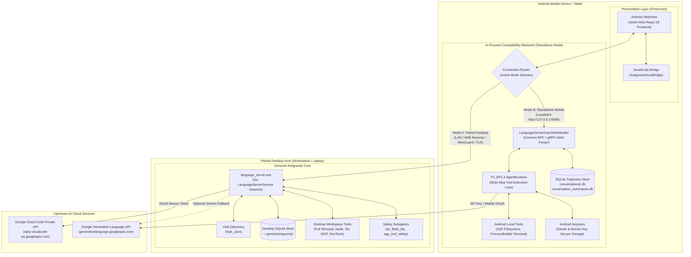

# Phase P2: Recommended Architecture for Antigravity Android AI Port

## Executive Architecture Summary

The primary objective of this project is to **make the original Antigravity AI agent work inside the Android port** while preserving the original Jetski Web React frontend, the original Cascade user experience, conversation history, and backend communication contracts.

Our reverse-engineering investigation revealed two decisive architectural realities:
1. **The Original Desktop AI Core (`language_server.exe`)** is a 187 MB Windows x86_64 PE binary compiled from Google3 (`CL: 1015941558`). It cannot execute natively on Android ARM64 devices without emulation, and its default cloud backend (`daily-cloudcode-pa.googleapis.com`) is a Google-internal service requiring private authorization.
2. **The Original Antigravity Architecture is Explicitly Designed for Hub/Client Separation**:
   `language_server.exe` includes flags `--persistent_mode`, `--subclient_type=hub`, and an automated discovery file mechanism (`hub_<port>.json`), allowing external clients (IDEs, CLIs, and remote frontends) to connect directly to `LanguageServerService` over TLS/HTTP with CSRF token authentication. Furthermore, `language_server.exe` also supports the public Gemini API via `-model_api_client_type=gemini`.

Based on these discoveries, we recommend the **Dual-Mode Hybrid Architecture**:
- **Primary / Fidelity Target (Paired Desktop Mode):** Connects the Android Jetski Web frontend directly to the user's running desktop `language_server.exe` instance. This achieves 100% genuine Antigravity AI functionality, including original Cloud Code models, safety monitors (`sir_flash_lite`, `agy_tool_safety`), full desktop terminal tools, and git workspace integration.
- **Secondary / Mobile Target (Standalone Mobile Compatibility Mode):** Runs an in-process Kotlin backend in Android that implements the exact `LanguageServerService` RPC contracts and exact SQLite storage schemas (`conversations/<id>.db` and `conversation_summaries.db`), routing agent planning and tool execution through the P1.2/P1.3 engine and the public Gemini API (`generativelanguage.googleapis.com`).

---

## Architecture Diagram

---

## Component Breakdown & Classification

### 1. Components Directly Preserved (No Architectural Changes)
- **Jetski Web React Frontend:** The complete web bundle (`index.html`, `main.js`, CSS, assets) is preserved unmodified. It operates inside Android WebView with the mobile-responsive viewport fixes established in P0.6.
- **Connect-RPC / gRPC-Web Protocol Framing:** The frontend's wire communication format (`application/grpc-web+proto` and Connect JSON) remains identical. The backend parses and emits binary frames (`0x00` data, `0x80` trailers) cleanly.
- **Protobuf Message Schemas:** All 364 RPC contracts and data structures in `exa.language_server_pb` and `exa.codeium_common_pb` remain the single source of truth.

### 2. Components Running Directly on Android
- **Android WebView Host:** Hosts the Jetski SPA, managing lifecycle, back navigation, keyboard adjustments, and asset serving.
- **Android SQLite Trajectory & Summary Store:** Android's native SQLite engine hosts the exact tables (`steps`, `trajectory_meta`, `conversation_summaries`, `conversations_fts`).
- **Android Keystore:** Manages secure storage of API credentials, refresh tokens, and pairing secrets with hardware-backed encryption.

### 3. Components Requiring Android Adaptations
- **Electron Preload Bridge:** Replaced by `AntigravityHostBridge` via `@JavascriptInterface` and injected JavaScript shims providing `window.electronNative`, `window.dialog`, `window.nativeNotifications`, and `window.agent`.
- **Workspace Filesystem:** Adapted to Android's Scoped Storage and Storage Access Framework (SAF), permitting file operations in app-specific storage or user-selected directories.
- **Terminal Execution:** Adapted from desktop shells (`powershell.exe`) to Android's Linux environment using `ProcessBuilder` with bundled utilities (toybox/busybox).
- **gRPC-Web Streaming Transport:** Adapted to use unbuffered `PipedInputStream` pipelines to deliver immediate token-by-token streaming updates to Android WebView without HTTP response buffering.

### 4. Components Requiring External Connection or Alternative Integration
- **`language_server.exe` (Windows x86_64 Binary):** Cannot run on Android ARM64. In Paired Mode, runs on the user's desktop workstation. In Standalone Mode, replaced by the Kotlin compatibility layer.
- **Cloud Code Private API (`daily-cloudcode-pa.googleapis.com`):** In Paired Mode, accessed via the desktop daemon using desktop credentials. In Standalone Mode, replaced by public Gemini API (`generativelanguage.googleapis.com`) or Google Cloud Vertex AI.
- **ZeroG VM Sidecars & Remote Environments:** Relayed through the desktop daemon when paired; disabled or stubbed when standalone.

---

## Core System Architecture Details

### Authentication Architecture
- **Desktop Paired Mode:**
  - Android client connects to the desktop daemon using the secret CSRF token read from `hub_<port>.json`.
  - All upstream authentication is handled transparently by `language_server.exe` using the desktop user's signed-in Google account.
  - No credentials or OAuth secrets are stored on the mobile device.
- **Standalone Mobile Mode:**
  - Google Sign-In or OAuth 2.0 PKCE flow via Android Chrome Custom Tabs.
  - Refresh tokens stored in `AndroidKeyStore` via `EncryptedSharedPreferences`.
  - Gemini API keys validated and stored independently in Keystore, clearly separated from Google Account sessions.

### Model Selection & Routing Architecture
- **Dynamic Model Catalog:**
  `GetCascadeModelConfigs` dynamically serves the available models:
  - In Paired Mode: Relays the desktop daemon's full model catalog (including Claude 3.7 Sonnet, GPT-4o, Gemini 2.5/3.0 Pro, Flash-Lite).
  - In Standalone Mode: Returns model tier configurations matching public Gemini models:
    - `MODEL_TIER_FLASH_LITE` -> `gemini-3.5-flash-lite` (with `thinkingLevel: "LOW"`)
    - `MODEL_TIER_FLASH` -> `gemini-2.5-flash` or `gemini-3.8-flash`
    - `MODEL_TIER_PRO` -> `gemini-2.5-pro`
- **UI State Preservation:**
  The user's active model choice is persisted in `antigravity_state.pbtxt` (`last_selected_agent_model`), preserving the exact desktop onboarding and selection behavior.

### Cascade Agent Execution Loop
- **In Paired Mode:**
  `SendUserCascadeMessage` forwards directly to `language_server.exe`. The genuine Go agent orchestrator runs safety checks (`sir_flash_lite`, `agy_tool_safety`), invokes Cloud Code PA, executes desktop tools, and streams results back over gRPC-Web.
- **In Standalone Mode:**
  `LanguageServerGrpcWebHandler` routes `SendUserCascadeMessage` to `AgentRuntime.kt`:
  1. Writes user message step to Android SQLite `steps` table (`conversations/<id>.db`).
  2. Dispatches prompt and registered tools to `GeminiModelProvider.kt`.
  3. Parses incoming SSE stream, writes thought and markdown chunks to SQLite, and streams `CascadeStreamUpdate` to WebView.
  4. Executes tool calls via `LocalWorkspaceFileTool` and `LocalCommandExecutionTool`.
  5. Returns tool output to Gemini and continues until turn completion.
  6. Finalizes step in SQLite and updates `conversation_summaries.db` and FTS5 search index.

---

## Evaluation and Ranking of Implementation Approaches

| Rank | Approach | AI Fidelity | Portability | Legal / Distributable | Technical Feasibility | Complexity |
| :--- | :--- | :--- | :--- | :--- | :--- | :--- |
| **1 (Recommended)** | **Dual-Mode Hybrid Architecture** | **100% (Paired) / 85% (Standalone)** | **Universal (LAN + Standalone)** | **100% Clean / Distributable** | **High (Builds on P1.2/P1.3 + Hub discovery)** | **Moderate** |
| 2 | Paired Desktop Exclusive | 100% (Genuine Desktop) | Restricted (Requires Desktop) | 100% Clean | Very High (Simple network relay) | Low |
| 3 | Standalone Native Reimplementation | ~85% (Approximates CCPA) | High (Fully Independent) | 100% Clean | Moderate (Requires complete RPC parity) | High |
| 4 | Binary Emulation (Box64/Wine on Android) | 0% (Crash / Incompatible) | Zero | Unviable / License Violation | Unfeasible (PE32+ on ARM64 Android) | Extreme |

### Justification for Rank 1 (Hybrid Mode)
1. **Preserves Original AI Completely:** When at their desk or on Wi-Fi, the user gets the identical Google Antigravity experience powered by their desktop daemon.
2. **Never Leaves User Blocked:** When away from the desktop, the app remains fully functional using the Kotlin compatibility engine and Gemini API.
3. **Strict Cleanroom Compliance:** The APK distributes only open/clean code without proprietary x86_64 binaries or unauthorized credential extractors.
4. **Leverages Built-in Infrastructure:** `language_server.exe` was explicitly built with Hub support; we are using its intended multi-client design.
