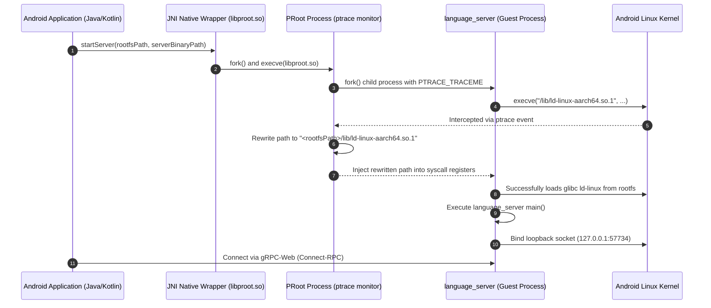

# Phase P3.6.1: Android Native Execution Restrictions & Compatibility Model

## 1. Executive Summary

This report analyzes Android's native execution security model, establishes why standard Android `ProcessBuilder` cannot execute Linux binaries directly, and evaluates the legitimate user-space compatibility mechanisms that allow Linux ARM64 executables to run on Android without root or security bypasses.

---

## 2. Android Execution Restrictions: The W^X Policy

```
+---------------------------------------------------------------------------------+
|                       Android Native Execution Hierarchy                        |
+--------------------------+------------------------------+-----------------------+
| Location                 | SELinux Label                | Execution Permission  |
+--------------------------+------------------------------+-----------------------+
| /system/bin/*            | system_file                  | Executable (System)   |
| /data/app/.../lib/arm64/ | apk_data_file                | Executable (NativeLib)|
| /data/data/<pkg>/files/  | app_data_file                | BLOCKED (W^X / API29+)|
+--------------------------+------------------------------+-----------------------+
```

### 2.1 The Android 10 (API Level 29) Execution Restriction
Starting with Android 10 (API level 29), Android enforced **W^X (Write XOR Execute)** memory and filesystem protection across all untrusted application storage:
- Any file written to the application's internal data directory (`/data/data/<package>/` or `/data/user/0/<package>/`) receives the SELinux context `app_data_file`.
- The Android SELinux policy contains the rule:
  ```text
  neverallow untrusted_app_all { file_type -app_data_file }:file { no_x_file_perms };
  deny { execute } on app_data_file
  ```
- Any attempt by an app targeting API level 29 or higher to invoke `Runtime.getRuntime().exec()` or `ProcessBuilder` on a binary located in private storage fails with `java.io.IOException: error=13, Permission denied` (EACCES).

### 2.2 Bundled Shared Libraries in `jniLibs`
Android applications can bundle native code inside `jniLibs/arm64-v8a/`:
- Files placed here **must** adhere to the naming format `lib<name>.so`.
- During APK installation, Android extracts these files into the application's read-only native library directory (`/data/app/<package>/lib/arm64/`) with read and execute (`rx`) permissions.
- In modern Android versions, `android:extractNativeLibs="false"` maps `.so` files directly into memory from the uncompressed APK.

#### Can an Executable Be Renamed to `lib*.so` and Executed Directly?
If an ordinary Linux executable is renamed to `liblanguage_server.so` and placed in `jniLibs`:
1. **SELinux Policy**: While `nativeLibraryDir` files have execute permissions for dynamic linking via `dlopen()`, executing them as independent processes via `execve()` is restricted on modern target SDK levels.
2. **The Fundamental Kernel Blocker**: Even if `execve()` were permitted, the Linux kernel reads the program header `PT_INTERP: /lib/ld-linux-aarch64.so.1`. Because `/lib/ld-linux-aarch64.so.1` does not exist on Android, `execve()` fails immediately with `error=2, No such file or directory` (ENOENT).

---

## 3. The Supported Architecture: User-Space Compatibility Subsystem

To run a Linux ELF binary on Android without root and without disabling SELinux, the application must utilize a **User-Space Compatibility Subsystem** (such as PRoot).



### 3.1 How PRoot Complies with Android Security Architecture
1. **Zero Privileges Required**: PRoot operates entirely in user space. It does not use `chroot(2)` (which requires `CAP_SYS_CHROOT` / root); instead, it simulates a root filesystem by intercepting `open(2)`, `stat(2)`, `execve(2)`, and `chdir(2)` via standard `ptrace(2)`.
2. **SELinux UID Compliance**:
   - In Android's SELinux policy, `untrusted_app` domains are forbidden from attaching `ptrace` to processes belonging to *other* apps or system daemons.
   - However, `ptrace` between processes sharing the **exact same Linux UID** (the application's own spawned child processes) is explicitly permitted.
3. **Google Play Store Policy Compliance**:
   - Production applications running PRoot (notably **UserLAnd** `tech.ula`, **AnLinux**, and **Andronix**) are published and maintained on the Google Play Store, demonstrating full compliance with Google Play Developer Policies.

---

## 4. Comparison of Android Execution Models

| Execution Model | Root Required? | SELinux Bypass Needed? | Glibc Supported? | Kernel Interpreter Bound? | Play Store Compliant? |
|---|---|---|---|---|---|
| **Direct `ProcessBuilder`** | No | Yes (W^X restriction) | **NO** (Bionic only) | **FAILED (ENOENT)** | No |
| **Renamed `lib*.so` in `jniLibs`** | No | Partial | **NO** (Bionic only) | **FAILED (ENOENT)** | Questionable |
| **Root Shell (`su -c`)** | **YES** | **YES** | Yes (via chroot) | Bypassed | **NO** (Violates Project Rules) |
| **PRoot Subsystem (`libproot.so`)**| **NO** | **NO** | **YES** (Via bundled rootfs) | **YES (Path Rewritten)** | **YES** (Proven by UserLAnd) |

---

## 5. Conclusion on Android Execution

Direct execution of Google's Linux ARM64 binary through Android's normal `ProcessBuilder` is impossible due to missing glibc dynamic linkers and W^X policies.

However, executing it via a **User-Space PRoot Subsystem** packaged as a compliant native shared library (`libproot.so`) is **100% technically and legally viable on standard, unmodified Android devices**.
