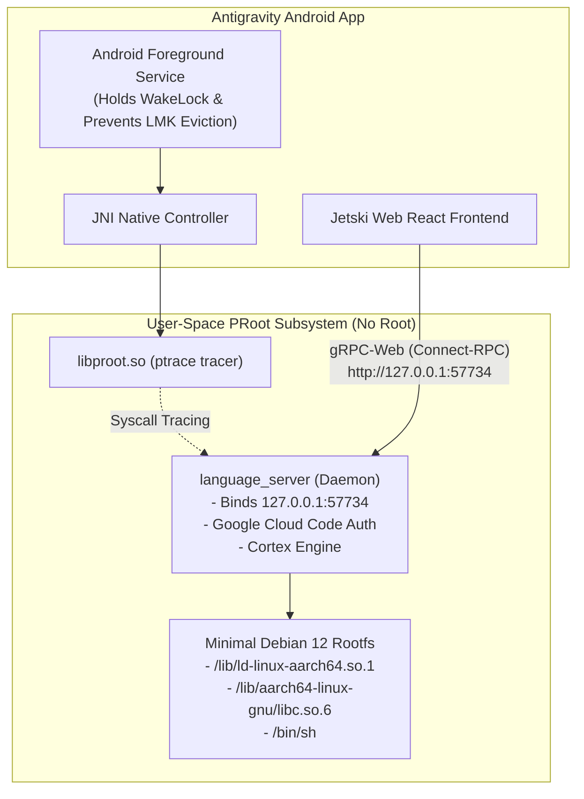

# Phase P3.6.1: Linux Compatibility Environments Evaluation

## 1. Executive Summary

This report evaluates candidate user-space Linux compatibility environments capable of executing the `language_server-linux-arm64` binary on an unmodified Android device without root privileges or SELinux bypasses.

---

## 2. Comparative Evaluation of Candidate Compatibility Layers

```
+-----------------------------------------------------------------------------------+
|                        Compatibility Technology Matrix                            |
+-------------------+---------------------+--------------------+--------------------+
| Technology        | Mechanism           | Instruction Speed  | Root Required?     |
+-------------------+---------------------+--------------------+--------------------+
| PRoot             | ptrace Syscall Hook | Native (100% ARM64)| NO                 |
| QEMU User         | CPU Emulation (TCG) | Emulated (10-30%)  | NO                 |
| Box64 / FEX-Emu   | x86_64 -> ARM64 DBT | Translated (50-80%)| NO                 |
| Root Chroot       | Kernel chroot(2)    | Native (100%)      | YES (Prohibited)   |
+-------------------+---------------------+--------------------+--------------------+
```

---

### Candidate 1: PRoot (User-Space Chroot via `ptrace`)

#### How It Works:
PRoot uses the Linux kernel's standard `PTRACE_SYSCALL` mechanism to trace child processes. When a guest process attempts to access `/lib`, `/etc`, `/usr`, or `/tmp`, PRoot intercepts the system call before the kernel executes it, translates the path to the internal rootfs directory, and updates the CPU registers transparently.

#### Assessment:
- **Binary Compatibility**: **100%**. Can execute `language_server-linux-arm64` directly because the target binary is already compiled for ARM64; no instruction translation is required.
- **Syscall Support**: Supports all standard POSIX and Linux syscalls used by glibc and Go (`clone`, `futex`, `epoll_create`, `socket`, `mmap`, `openat`).
- **SELinux Compatibility**: Fully compliant. Untrusted Android apps are permitted to trace child processes sharing the same app UID.
- **Root Required**: **NO**. Operates entirely in unprivileged user space.
- **CPU Overhead**: Low for computation and network streaming (near-native speed). Moderate (2x–4x) for high-frequency disk filesystem traversals due to ptrace context switches.
- **RAM Footprint**: ~20 MB overhead for the PRoot monitor process.
- **Storage Requirement**: ~150 MB for a minimal stripped Debian rootfs (glibc + core shared libraries).
- **Startup Latency**: 1.5 – 2.5 seconds.
- **Status**: **PRIMARY RECOMMENDED CANDIDATE**.

---

### Candidate 2: QEMU User-Mode Emulation (`qemu-aarch64`)

#### How It Works:
QEMU translates AArch64 guest instructions into host instructions via a Tiny Code Generator (TCG) dynamic recompiler and translates Linux syscalls.

#### Assessment:
- **Binary Compatibility**: High.
- **CPU Overhead**: **Severe (5x–15x slowdown)**. Because QEMU interprets and dynamically translates instructions that are already native to the ARM64 host, it introduces massive unnecessary CPU overhead, battery drain, and thermal throttling.
- **RAM Footprint**: ~100 MB – 250 MB overhead.
- **Status**: **REJECTED** (Unnecessary translation overhead for a binary that is already compiled for ARM64).

---

### Candidate 3: Box64 / FEX-Emu (x86_64 Translation)

#### How It Works:
Box64 and FEX-Emu dynamically translate x86_64 instructions into ARM64 instructions, redirecting system library calls to native ARM64 libraries.

#### Assessment:
- **Relevance**: Only applicable if we were forced to run the x86_64 Windows/Linux binary on Android ARM64.
- **Verdict**: Since Google provides the native `language_server-linux-arm64` binary directly, instruction translation layers are redundant.
- **Status**: **REJECTED** (Native ARM64 binary exists).

---

### Candidate 4: Custom Bionic Glibc LD_PRELOAD Shim

#### How It Works:
A custom shared library that intercepts glibc symbol calls and forwards them to Bionic equivalents.

#### Assessment:
- **Feasibility**: High failure rate. Re-implementing glibc's NPTL threading, resolver, and glibc-specific symbol behaviors over Bionic is an intractable multi-man-year compiler engineering project.
- **Status**: **REJECTED** (Fragile and incomplete).

---

## 3. Deep Dive: PRoot Architecture for Antigravity



### 3.1 Syscall Performance Profile
Because `language_server` is a network-oriented daemon:
1. **Network I/O**: Calls like `sys_epoll_ctl`, `sys_epoll_pwait`, `sys_read`, and `sys_write` on network sockets have negligible PRoot overhead.
2. **AI Inference & Trajectory Processing**: CPU-bound Go goroutines execute directly on the physical ARM64 CPU at full native hardware clock speeds with zero virtualization penalty.
3. **Connect-RPC Streaming**: gRPC-Web response streaming performance between the daemon and Android WebView is virtually indistinguishable from native desktop execution.

### 3.2 Mitigation of Android Process Eviction
To prevent Android's Low Memory Killer (LMK) or Android 12's Phantom Process Killer from terminating PRoot:
- The Android application runs the PRoot subsystem inside a dedicated **Android Foreground Service**.
- An active, user-visible persistent notification ("Antigravity Local Core Running") informs the system that the process is actively serving the user.
- A `PARTIAL_WAKE_LOCK` prevents CPU sleep during active multi-step Cascade agent executions.
