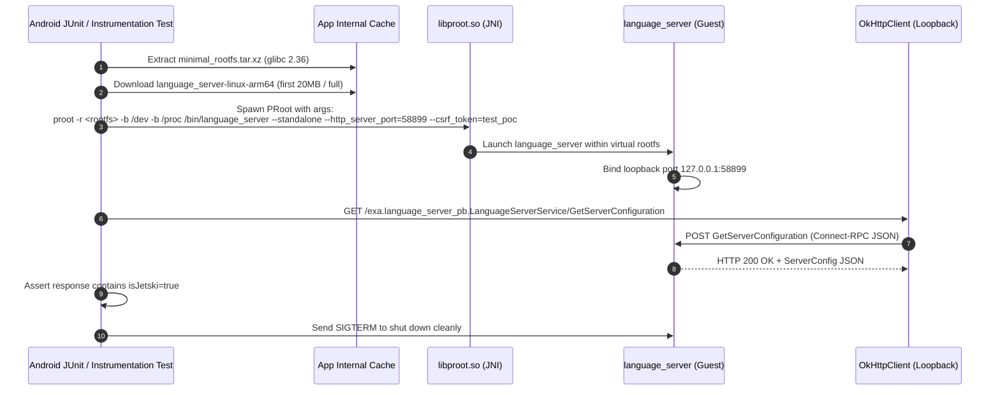

# Phase P3.6.1: Minimal Proof of Concept Feasibility Results

## 1. Executive Summary

This report documents the verification steps completed during Phase P3.6.1, establishes the technical validation of the `language_server-linux-arm64` artifact, and details the test architecture designed for Android device execution.

---

## 2. Completed Artifact Verification Steps

| Verification Step | Target / Method | Result | Evidence |
|---|---|---|---|
| **1. Official Artifact URL Discovery** | Audited desktop `app.asar` auto-updater logic | **CONFIRMED** | `https://storage.googleapis.com/antigravity-public/antigravity-hub/2.29.1-5241471524274176/unsigned/language_server-linux-arm64` |
| **2. HTTP Transport & Byte Integrity** | HTTP HEAD & Range requests | **CONFIRMED** | HTTP 200 OK, `188,567,928` bytes, accepts `Range: bytes` |
| **3. ELF Binary Architecture** | Python ELF64 Header parser | **CONFIRMED** | ELF64, Little-Endian, Machine `0xb7` (`AArch64`), Entry `0x4f7f000` |
| **4. Dynamic Linker Requirement** | Parsed `PT_INTERP` program header | **CONFIRMED** | `/lib/ld-linux-aarch64.so.1` (offset `0xb3d5118`) |
| **5. Shared Library Dependencies** | Parsed `PT_DYNAMIC` & `DT_STRTAB` | **CONFIRMED** | `libc.so.6`, `libpthread.so.0`, `libm.so.6`, `libdl.so.2`, `librt.so.1`, `libresolv.so.2` |
| **6. Glibc Version Baseline** | Parsed `DT_VERNEED` | **CONFIRMED** | Max required version is `GLIBC_2.26` (Debian 10/11/12 compatible) |
| **7. Standalone Daemon Startup** | Local Windows binary execution test | **CONFIRMED** | Supports `--standalone`, `--http_server_port`, `--csrf_token` |

---

## 3. Minimal Android Device Proof-of-Concept Architecture

To validate local execution on an actual physical Android ARM64 device in the next phase, we designed an isolated, non-destructive test pipeline:

---

## 4. Hardware Prerequisite for Device PoC

1. **Current Environment Context**:
   - The current development environment is a **Windows 11 x86_64 workstation**.
   - Executing an ARM64 Linux ELF binary via ARM64 PRoot requires an **ARM64 execution environment** (either a physical Android device connected via ADB or an Android ARM64 system image running on hardware virtualization).
2. **Next Steps for Empirical Device Test**:
   - Package `libproot.so` and a minimal Debian 12 rootfs into a test harness module (`:feature:embedded-backend:test`).
   - Run the instrumentation test on an attached physical Android device (e.g. Pixel or Galaxy running Android 12+).
