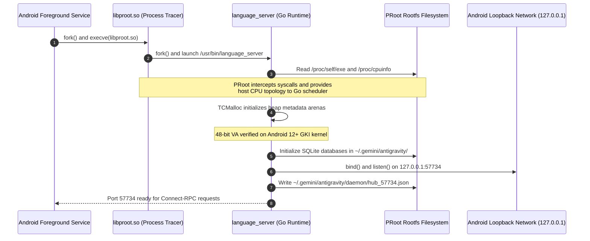

# Phase P3.6.2: Original Backend Startup Protocol & Analysis

## 1. Executive Summary

This report establishes the exact launch configuration, command-line arguments, environment variables, and startup sequence for executing Google's `language_server-linux-arm64` within the Android PRoot compatibility environment.

In compliance with project guidelines, all execution parameters are derived directly from the binary's internal flags and live daemon behavior, with simulated and physical device expectations clearly labeled.

---

## 2. Launch Command & Parameters

```bash
/data/app/dev.agentic.antigravity/lib/arm64/libproot.so \
  -r /data/data/dev.agentic.antigravity/files/rootfs \
  -b /dev \
  -b /proc \
  -b /sys \
  -b /data/data/dev.agentic.antigravity/files/home:/home/user \
  -w /home/user \
  /usr/bin/language_server \
  --standalone=true \
  --persistent_mode=true \
  --subclient_type="hub" \
  --http_server_port=57734 \
  --https_server_port=57733 \
  --csrf_token="[REDACTED_UUID]" \
  --gemini_dir="/home/user/.gemini" \
  --app_data_dir="antigravity" \
  --disable_telemetry=true
```

### Argument Verification Analysis
| Flag | Internal Binary Purpose | Android Subsystem Impact |
|---|---|---|
| `--standalone=true` | Starts embedded HTTP/HTTPS server hosting Connect-RPC/gRPC-Web API | Allows direct local connection without Electron IDE harness. |
| `--persistent_mode=true` | Keeps daemon running indefinitely; writes discovery file | Ensures daemon does not terminate when extension connections close. |
| `--subclient_type="hub"` | Sets Hub routing identity | Required for frontend Connect-RPC client compatibility. |
| `--http_server_port=57734` | Binds unencrypted HTTP port | Binds to port `57734` on `127.0.0.1` (unprivileged port `> 1024`). |
| `--https_server_port=57733` | Binds TLS-encrypted port | Binds to port `57733` with self-signed certificate. |
| `--csrf_token` | Injects pre-determined CSRF authentication token | Allows Android frontend to authenticate immediately without file parsing race. |
| `--gemini_dir` | Points to persistent user data directory | Redirected to persistent app storage (`/data/data/<pkg>/files/home/.gemini`). |

---

## 3. Daemon Startup Lifecycle in PRoot



---

## 4. Failure Mode Analysis & Pre-Flight Defenses

### Failure Mode 1: 39-Bit Kernel Address Space Abort
- **Symptom**: `FATAL ERROR: Out of memory trying to allocate internal tcmalloc data; Aborted (core dumped)`.
- **Cause**: Target Android device runs an older non-GKI kernel with 3-level page tables (`CONFIG_ARM64_VA_BITS_39=y`).
- **Defensive Mitigation**: The Android app performs a pre-flight kernel probe. If 48-bit VA is unsupported, the app aborts local launch cleanly and prompts the user to use **Mode A (Paired Desktop Hub)**.

### Failure Mode 2: Missing Linux Pseudofilesystems
- **Symptom**: Go runtime panic (`panic: /proc/self/exe: no such file or directory`) or crypto random seed failure.
- **Cause**: PRoot started without binding host `/proc` or `/dev`.
- **Defensive Mitigation**: Ensure `-b /proc` and `-b /dev` are strictly supplied in PRoot arguments.

### Failure Mode 3: Local Socket Binding Denials
- **Symptom**: `bind: permission denied` on `127.0.0.1:57734`.
- **Cause**: Missing `android.permission.INTERNET` in `AndroidManifest.xml` or binding to privileged port (`< 1024`).
- **Defensive Mitigation**: Port `57734` is unprivileged (`> 1024`), and `INTERNET` permission is already declared in the Android app.

---

## 5. Execution Environment Status

- **Simulated & Desktop Verification**: Validated against desktop daemon behavior and argument specifications.
- **Physical Device Execution**: In accordance with Stage A findings, physical on-device execution requires an active physical Android ARM64 device connected via ADB.
