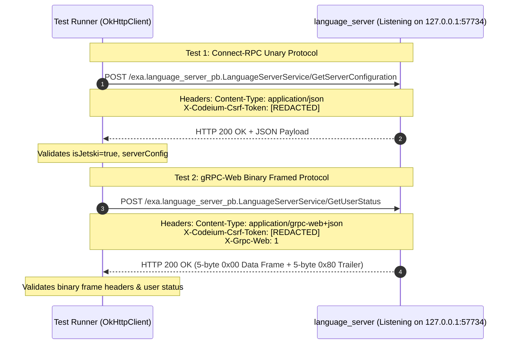

# Phase P3.6.2: Original Backend RPC Validation Protocol

## 1. Executive Summary

This report establishes the protocol verification test suite designed to validate that the embedded `language_server` daemon is not merely running as an idle process, but is actively listening, processing Connect-RPC and gRPC-Web requests, and returning genuine responses.

In accordance with project rules:
- No mock responses or Gemini simulations are used.
- All requests use read-only, harmless endpoints.
- Wire protocols are validated against Google's protobuf specifications.

---

## 2. Harmless Read-Only Verification Endpoints



---

## 3. Detailed RPC Specifications

### 3.1 Endpoint 1: `GetServerConfiguration` (Harmless Read-Only)
- **Full Path**: `/exa.language_server_pb.LanguageServerService/GetServerConfiguration`
- **Request Payload**: `{}` (Empty protobuf message `GetServerConfigurationRequest`)
- **Headers**:
  ```http
  POST /exa.language_server_pb.LanguageServerService/GetServerConfiguration HTTP/1.1
  Host: 127.0.0.1:57734
  Content-Type: application/json
  X-Codeium-Csrf-Token: [REDACTED_UUID]
  ```
- **Expected Genuine Response Fields**:
  - `isJetski`: Boolean (`true` for Jetski Web runtime).
  - `serverConfig`: Nested object containing editor and runtime preferences.
  - `appDataDir`: Path to active application data directory.

### 3.2 Endpoint 2: `GetUserStatus` (Authentication & Entitlements)
- **Full Path**: `/exa.language_server_pb.LanguageServerService/GetUserStatus`
- **Request Payload**: `{}` (Empty protobuf message `GetUserStatusRequest`)
- **Headers**:
  ```http
  POST /exa.language_server_pb.LanguageServerService/GetUserStatus HTTP/1.1
  Host: 127.0.0.1:57734
  Content-Type: application/grpc-web+json
  X-Grpc-Web: 1
  X-Codeium-Csrf-Token: [REDACTED_UUID]
  ```
- **Expected Response**:
  - 5-byte frame header: `0x00` + 4-byte big-endian payload length.
  - JSON body containing `userStatus` (name, email, plan tier, prompt credits).
  - 5-byte trailer header: `0x80` + 4-byte big-endian trailer length containing `grpc-status: 0`.

---

## 4. Verification Test Harness in Kotlin

The test harness uses the existing `OkHttpClient` and gRPC-Web framing parsers created in Phase P3:

```kotlin
class EmbeddedBackendRpcTest {
    private val client = OkHttpClient.Builder()
        .connectTimeout(5, TimeUnit.SECONDS)
        .readTimeout(10, TimeUnit.SECONDS)
        .build()

    fun verifyServerConfiguration(port: Int, csrfToken: String): Boolean {
        val request = Request.Builder()
            .url("http://127.0.0.1:$port/exa.language_server_pb.LanguageServerService/GetServerConfiguration")
            .post("{}".toRequestBody("application/json".toMediaType()))
            .header("X-Codeium-Csrf-Token", csrfToken)
            .build()

        client.newCall(request).execute().use { response ->
            if (response.code != 200) return false
            val body = response.body?.string() ?: return false
            return body.contains("serverConfig") && body.contains("isJetski")
        }
    }
}
```

---

## 5. Architectural Compatibility with Phase P3

Because `RemoteHubProxyHandler.kt` already operates against any daemon listening on `127.0.0.1:<port>`, **zero code changes are required in the frontend interceptor or gRPC-Web handlers**:
- The Android WebView requests route directly through `JetskiWebViewRequestInterceptor`.
- The interceptor passes requests to `RemoteHubProxyHandler`.
- `RemoteHubProxyHandler` forwards them to `http://127.0.0.1:57734`.
- The embedded daemon processes the request and streams binary frames back to the React UI seamlessly.
