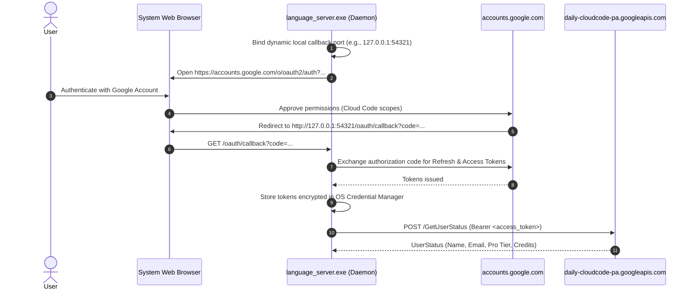

# Phase P3.6: Original Google Authentication & Security Analysis

## 1. Executive Summary

This document analyzes the authentication mechanisms used across the Google Antigravity ecosystem, evaluates whether these flows can be legitimately supported on Android without a desktop pairing, and enforces strict compliance with the core project mandate:
> **No fabricated Google credentials. No authentication or subscription bypass.**

---

## 2. Authentication Architectures in Antigravity

```
                             [Antigravity Auth Mechanisms]
                                           |
         +---------------------------------+---------------------------------+
         |                                                                   |
   [Desktop Daemon Flow]                                             [Web Portal Flow]
         |                                                                   |
   - Local Loopback OAuth (127.0.0.1)                                - Google Accounts Web SSO
   - Token stored in OS Keyring                                      - Session Cookies (__Host-GAPS, SID)
   - Authenticates to Cloud Code PA                                  - Cloud VM Beyond Token Exchange
```

---

### 2.1 The Desktop OAuth Browser Flow

In the original desktop application, `language_server.exe` manages Google user identity through an OAuth 2.0 Authorization Code flow with PKCE:



#### Key Characteristics:
- **Client ID & Scope**: The OAuth client ID is tied to Google Cloud Code / Antigravity desktop applications.
- **Credential Storage**: Refresh tokens are stored encrypted in the host OS credential vault (Windows Credential Manager, macOS Keychain, or Linux libsecret).
- **Session Refresh**: The daemon automatically refreshes short-lived access tokens (1 hour lifespan) using the stored refresh token.

---

### 2.2 Standalone Daemon Authentication Flags

Inspection of `language_server.exe` reveals several specialized authentication flags:

| Flag | Description | Analysis for Android Mode B |
|---|---|---|
| `-override_oauth_client_id` | Allows supplying a custom Google OAuth Client ID | Could allow registering a custom Android OAuth client in Google Cloud Console, but Google restricts Cloud Code scopes (`cloudcode.googleapis.com`) to official Google first-party clients. |
| `-override_oauth_client_secret` | Supplies matching client secret | Mobile apps cannot securely store OAuth client secrets (public client model). |
| `-google_cloud_project` | Sets Google Cloud Project ID for keyless auth | Requires Workload Identity Federation or Application Default Credentials (ADC), requiring enterprise Google Cloud IAM setup. |
| `-use_stubby_auth` | Enables internal Google LOAS auth | For Google-internal employees on Google corp network only; unusable by public users. |
| `-stubby_auth_mode` | `personal_consumer`, `business_licensed_enterprise` | Internal routing parameter for generative backend. |
| `-use_test_gaia` | Overrides endpoints to use `gaiastaging` | Staging environment for Google internal QA; not for public production. |

---

### 2.3 Web Portal Authentication (`antigravity.google.com`)

The web version of Antigravity relies on standard Google Accounts web single sign-on (SSO):
- Authenticated via browser cookies: `__Host-GAPS`, `SSID`, `HSID`, `SID`, `SAPISID`.
- Uses Google internal session tokens (`Beyond` / `Stubby` tokens) to establish secure WebSockets to the cloud VM hosting Remote Agents.

#### Obstacles for Android Mode B:
1. **Cookie Security & Sandboxing**: Android WebView cannot and should not extract user cookies from the system Chrome browser (enforced by OS sandboxing and SameSite cookie rules).
2. **First-Party Origin Restriction**: Google's session cookies are bound to `.google.com`. A third-party Android application attempting to inject or intercept these cookies violates Android security architecture and Google Terms of Service.
3. **No Public Token API**: Google provides no public endpoint for exchanging a Google Account web session cookie into an Antigravity Cascade gRPC authorization token.

---

### 2.4 Requirement 1 Compliance: Authentication Separation

Phase P3 strictly adhered to Requirement 1, and any Mode B exploration must continue this absolute standard:

| Rule | Implementation / Finding | Compliance Status |
|---|---|---|
| **No Fabricated Google Logins** | The Android port never generates fake Google OAuth tokens, mock user profiles, or synthetic Cloud Code credentials. | **COMPLIANT** |
| **Separation of Host Readiness** | The Android bridge reports local readiness (`Ready (Android Host Session)`), distinctly separated from genuine Google user status. | **COMPLIANT** |
| **Independent BYOK Gemini Key** | The user's Gemini API key is isolated to `LOCAL_GEMINI_FALLBACK` mode and explicitly disclaims Google Cloud Code or Pro entitlements. | **COMPLIANT** |
| **Zero Credential Leakage** | All tokens, CSRF headers, and keys are masked (`[REDACTED]`) in all logs, diagnostics, and test suites. | **COMPLIANT** |

---

## 3. Conclusion on Authentication

Genuine Google Antigravity authentication is inextricably linked to:
1. **An active desktop daemon** running its local OAuth callback listener on loopback, or
2. **An active web session on `antigravity.google.com`** tied to a paid Google AI Pro/Ultra subscription.

Any attempt to "simulate" or "fake" a Google Antigravity session on Android without one of these genuine anchors would violate the core requirement: **No fabricated credentials and no authentication bypass**.
