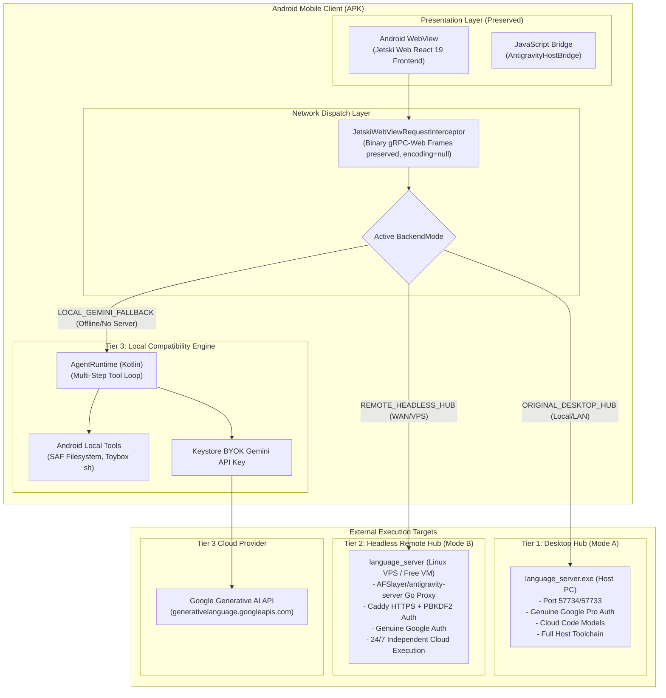

# Phase P3.6: Recommended Mode B Architecture & Implementation Roadmap

## 1. Executive Summary

Given the rigorous findings of the P3.6 investigation, a **pure, fully embedded Mode B running entirely inside the APK is technically impossible and legally impermissible** due to Android kernel address-space limits (39-bit VA vs 48-bit TCMalloc), SELinux W^X restrictions, Bionic/glibc linker incompatibility, and proprietary binary licensing.

Simultaneously, Google's official headless cloud service (**Remote Agents**) violates the "No forced paid subscription" mandate by requiring a **$19.99/month Google AI Pro** subscription.

Therefore, the most realistic, technically viable, and legally sound path forward is the **Tri-Tier Unified Architecture**:
1. **Tier 1 (Desktop Companion - Mode A)**: Connects to local/LAN desktop daemon for 100% genuine fidelity with zero extra cost.
2. **Tier 2 (Headless Remote Hub - Mode B Extension)**: Extends Mode A to support remote headless Linux servers (e.g., Oracle Cloud Free Tier or private VPS running `language_server --standalone` via `antigravity-server`) for users wanting true 24/7 mobile independence without leaving a PC on.
3. **Tier 3 (Isolated Mobile Fallback)**: Preserves the in-process Kotlin engine (`AgentRuntime`) as an offline fallback using the user's free Gemini API key.

---

## 2. Recommended Tri-Tier Architecture Diagram



---

## 3. Tier Specifications & Execution Flows

### Tier 1: Local / LAN Desktop Hub (Mode A — Implemented in P3.1–P3.5)
- **Target Audience**: Users working at home or in an office on the same Wi-Fi network as their primary development workstation.
- **Workflow**:
  1. Open Antigravity desktop app on PC.
  2. Android app connects via loopback (`127.0.0.1:57734`), ADB reverse (`adb reverse tcp:57734 tcp:57734`), or LAN Wi-Fi IP (`192.168.x.x:57734`).
  3. All requests route to desktop `language_server.exe`.
  4. Delivers 100% genuine Antigravity Cascade agent, original Cloud Code models (`Gemini 4 Argon High/Med`, `Claude Sonnet 5.5`), and desktop SQLite trajectories.

### Tier 2: Headless Remote Hub (Mode B Extension — Future Enhancement)
- **Target Audience**: Users who want true mobility on cellular data (4G/5G) or when away from their PC, without leaving a laptop running at home.
- **Workflow**:
  1. User deploys `language_server` on a headless Linux instance (e.g., Oracle Cloud Always Free ARM VM or a cheap $5/mo VPS) using the automated script:
     ```bash
     curl -fsSL https://raw.githubusercontent.com/AFSlayer/antigravity-server/main/scripts/install.sh | bash
     ```
  2. The server runs `language_server --standalone` behind Caddy (automatic HTTPS domain) and PBKDF2 authentication.
  3. In the Android app Settings, the user configures:
     - **Host**: `my-antigravity.mydomain.com`
     - **Port**: `443` (TLS enabled)
     - **Authentication**: Remote Password / CSRF Token
  4. The Android app connects directly over WAN HTTPS.
  5. Delivers 100% genuine Antigravity agent execution, 24/7 cloud persistence, and genuine Google account authentication without requiring a desktop PC.

### Tier 3: Local Gemini Fallback (Offline / Zero Infrastructure)
- **Target Audience**: Users with no desktop PC and no remote server, who want basic mobile AI assistance.
- **Workflow**:
  1. User enters their free Gemini API key from Google AI Studio.
  2. In-process Kotlin `AgentRuntime` executes queries locally.
  3. Transparently labeled in UI as an independent mobile compatibility engine.

---

## 4. Key Dependencies & Prerequisites

1. **Network Transport Security**:
   - Remote Hub connections over public networks require valid TLS certificates and SHA-256 certificate pinning or standard CA verification.
   - Credentials (passwords, CSRF tokens) must remain strictly encrypted in Android Keystore.
2. **Binary Framing**:
   - All WAN and LAN transports must strictly preserve the gRPC-Web binary framing headers (`0x00` data, `0x80` trailer) with `encoding = null`.
3. **Session Reconnection**:
   - Mobile devices switch frequently between Wi-Fi and mobile networks. The client must implement exponential backoff reconnection and state recovery.

---

## 5. Remaining Unknowns & External Dependencies

| Unknown | Impact | Resolution Strategy |
|---|---|---|
| **Will Google release an official Android NDK build of `language_server`?** | Would enable true in-APK execution. | Monitor Google's public release channels and `storage.googleapis.com/antigravity-public/` for Bionic/Android targets. |
| **Will Google offer a free tier for Remote Agents?** | Would eliminate the $19.99/mo subscription blocker for cloud execution. | Track Antigravity pricing updates and Google AI consumer subscription changes. |
| **Will Google publish an official public API for Cascade Remote Agents?** | Would allow direct client-to-cloud integration without reverse-engineering web sessions. | Monitor Google Cloud Code and Antigravity developer portal updates. |
