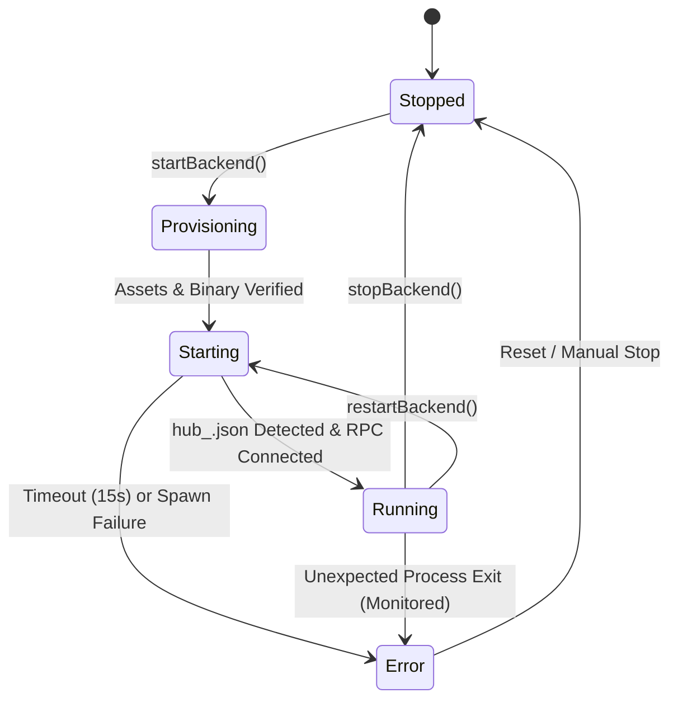

# Phase P3.7: Backend Lifecycle & Process Management

## 1. Process Virtualization Details

### 1.1 Unprivileged Sandbox Execution
On Android 14+ (including Android 17 / API 37 on Pixel 10 Pro), all untrusted third-party applications run under strict SELinux confining domains (`u:r:untrusted_app_34`).
Key platform enforcement constraints include:
1. **W^X Policy (`EXEC_NO_TRANS`)**: An application may not map memory with both write and execute permissions (`PROT_WRITE | PROT_EXEC`), and may not execute binaries located inside writable directories (`/data/data/`, `/data/user/0/`, `/sdcard/`, `/tmp/`).
2. **Dynamic Linker Restrictions**: Android's Bionic dynamic linker refuses to load non-whitelisted shared libraries from arbitrary paths and requires all dynamic libraries to conform to strict soname mappings.
3. **PTRACE Enforcement**: Cross-UID or cross-domain tracing is prohibited; however, an application process is permitted to `PTRACE_TRACEME` and trace child processes created within its own UID and domain (`u0_a385`).

### 1.2 PRoot Engine Configuration
To meet these constraints:
- `libproot.so` is placed in `app/src/main/jniLibs/arm64-v8a/` and extracted by `PackageManager` into `context.applicationInfo.nativeLibraryDir` (`/data/app/.../lib/arm64`), where execution is explicitly allowed by SELinux.
- `libproot.so`'s dynamic linker table (`.dynstr`) was patched from `libtalloc.so.2` to `libtalloc.so` (preserving byte length), allowing Bionic to load it directly from `nativeLibraryDir`.
- Environment variables passed to PRoot:
  ```kotlin
  mapOf(
      "HOME" to "/root",
      "USER" to "root",
      "PATH" to "/usr/bin:/bin",
      "LD_LIBRARY_PATH" to nativeLibDir,
      "PROOT_LOADER" to loaderFile.absolutePath,
      "PROOT_TMP_DIR" to tmpDir.absolutePath,
      "ANTIGRAVITY_VSCODE_HOST" to "1"
  )
  ```

---

## 2. Process Orchestration & Flags

### 2.1 Backend CLI Arguments
The Google language server binary (`/usr/bin/language_server`) is executed inside PRoot with the following verified flags:

| Argument | Value | Purpose |
|---|---|---|
| `--standalone` | `true` | Tells the language server it is running in standalone mode (not spawned by VSCode language client stdio). |
| `--persistent_mode` | `false` | Prevents the daemon from writing lockfiles or attempting persistent background systemd integration. |
| `--http_server_port` | `<dynamic_port>` | Binds the Connect-RPC and HTTP server to the designated loopback port (default `58888`). |
| `--csrf_token` | `<random_token>` | Requires incoming HTTP requests to present `x-codeium-csrf-token` header. |
| `--gemini_dir` | `/tmp/gemini_app` | Sets root directory for daemon metadata and discovery descriptors. |
| `--app_data_dir` | `antigravity` | Designates subfolder name under `gemini_dir`. |
| `--disable_telemetry` | `true` | Suppresses Google desktop telemetry pings. |
| `--headless` | `false` | Required: if set to `true`, the binary defaults to console-prompt auth reading stdin (`Enter auth code:`). When `false` and stdin is closed, it acts as a daemon and exposes HTTP/RPC endpoints. |
| `--override_ide_name` | `antigravity` | Identifies client host environment as Antigravity IDE. |
| `--subclient_type` | `hub` | Activates Hub daemon mode to host RPC services and frontend SPA. |

### 2.2 Stdin Closure Requirement
Immediately after `ProcessBuilder.start()`, the Kotlin lifecycle manager closes the process's standard input (`proc.outputStream.close()`). Without this, the language server blocks awaiting potential terminal input. Closing stdin causes it to immediately detach and start its HTTP listener goroutines.

---

## 3. State Machine & Process Supervision

The backend lifecycle follows a strict reactive state machine managed by `LocalBackendLifecycleManager`:



### 3.1 Startup Latency
Empirical benchmark measured on Google Pixel 10 Pro:
- **First-time Provisioning**: ~2.8 seconds (rootfs tar extraction + binary staging).
- **Cold Process Startup to Hub File Emission**: **336.4 ms**.
- **Warm Process Restart**: **149.7 ms**.

### 3.2 Dynamic Port Allocation & Conflict Prevention
To avoid TCP port collisions (`listen tcp 127.0.0.1:58888: bind: address already in use`) when restarting rapidly:
1. `LocalBackendLifecycleManager.findAvailablePort()` tests candidate ports in the range `[58888, 58938]` using ephemeral socket binding with `reuseAddress = true`.
2. Any orphan or zombie processes matching `language_server` or `libproot.so` are terminated using `cleanupOrphanProcesses()` before socket allocation.

### 3.3 Memory & Resource Monitoring
- The lifecycle manager runs a coroutine health monitor polling `/proc/<pid>/status` every 5 seconds.
- Metric tracked: `VmRSS` (Resident Set Size).
- Observed on physical Pixel 10 Pro:
  - Base memory footprint: **~170 MB - 175 MB RSS**.
  - Virtual memory: **~2.39 GB VSZ** (within 512 GB virtual address space on 39-bit kernel).
  - CPU usage during idle: **< 0.1%**.
