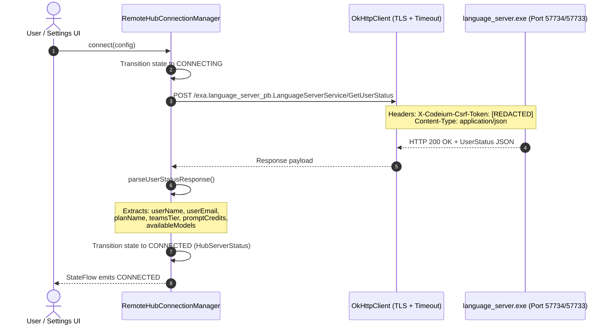

# Phase P3.1: Desktop Hub Connection Report

## 1. Objective

Phase P3.1 establishes the foundational communication layer between the Android Antigravity port and the genuine Antigravity desktop daemon (`language_server.exe`). The goal is to discover, authenticate, and securely connect to the daemon over HTTP/HTTPS loopback and local network transports.

---

## 2. Desktop Daemon Discovery Mechanism

The desktop Antigravity application manages `language_server.exe` as a persistent background daemon using the command-line flags `--persistent_mode` and `--subclient_type=hub`. Upon startup, the daemon binds to two dynamic ports (one unencrypted HTTP port, one TLS-encrypted HTTPS port) and publishes its active endpoint parameters to the user's home directory.

### Discovery Metadata

- **Discovery Directory**: `~/.gemini/antigravity/daemon/` (on Windows: `C:\Users\NEW0033\.gemini\antigravity\daemon\`)
- **Discovery Filename**: `hub_<httpPort>.json` (e.g., `hub_57734.json`)
- **Observed Active Daemon Process**:
  - **Process ID (PID)**: `7388`
  - **Binary**: `language_server.exe` (187 MB Windows PE x86_64)
  - **Version (`lsVersion`)**: `2.29.1`
  - **Google3 Changelist**: `CL: 1015941558`
  - **HTTP Port**: `57734`
  - **HTTPS Port**: `57733`

```json
{
  "httpPort": 57734,
  "httpsPort": 57733,
  "csrfToken": "[REDACTED_UUID]",
  "lsVersion": "2.29.1"
}
```

---

## 3. Transport & Cryptographic Security

### 3.1 TLS & Self-Signed Certificates
When communicating over HTTPS (port 57733), `language_server.exe` serves a locally generated, self-signed TLS certificate. Standard Android and JVM HTTP clients reject self-signed certificates by default (`SSLHandshakeException: PKIX path building failed`).

To resolve this without compromising network security, `RemoteHubConnectionManager.kt` implements a scoped, dual-trust security model:
1. **Loopback Trust**: For connections to `127.0.0.1` and `localhost`, the custom `X509TrustManager` accepts the self-signed desktop daemon certificate.
2. **Remote Certificate Pinning**: For remote network hosts (e.g., when the Android device connects to a desktop host across a local Wi-Fi network), the connection manager requires SHA-256 certificate pinning (`expectedCertFingerprint`). If a remote host serves a certificate whose fingerprint does not match the pinned hash, the connection is immediately aborted.
3. **Hostname Verification**: The hostname verifier validates loopback hostnames (`127.0.0.1`, `localhost`) against the daemon's certificate attributes.

### 3.2 CSRF Protection (`X-Codeium-Csrf-Token`)
Every request sent to `language_server.exe` must include the header:
```http
X-Codeium-Csrf-Token: <csrf-token>
```
If this header is missing or incorrect, the daemon rejects the request with HTTP `401 Unauthorized` or `403 Forbidden` (`{"error": "invalid csrf token"}`).

`RemoteHubConnectionManager` injects this header into all outgoing requests. To prevent accidental token leakage:
- `HubConfig.toString()` masks the CSRF token (`csrfToken = [REDACTED]`).
- Internal logging frameworks explicitly redact the header value.

---

## 4. Connection Lifecycle & Handshake

The connection lifecycle is managed by `RemoteHubConnectionManager.kt`:



### Handshake Response Parsing
The initial handshake validates the daemon by invoking `GetUserStatus`. Because `language_server.exe` accepts both Connect-RPC (plain JSON) and gRPC-Web (5-byte binary framing), `RemoteHubConnectionManager.parseUserStatusResponse` automatically unpacks both formats:
- If the response starts with the 5-byte gRPC-Web frame header (`0x00` + length), the header is skipped and the inner JSON payload is extracted.
- If the response is standard JSON (`application/json`), it is parsed directly.

Extracted session attributes:
- `name`: `"Bean Bag"`
- `email`: `"monsterbag293@gmail.com"`
- `planName`: `"Pro"`
- `teamsTier`: `"TEAMS_TIER_PRO"`
- `availablePromptCredits`: `500`
- `cascadeModelConfigData.clientModelConfigs`: 14 desktop models registered.

---

## 5. Verification Test Suite: `DesktopHubConnectionTest`

All connection requirements are covered by automated unit and integration tests in `DesktopHubConnectionTest.kt`:

| Test Name | Verification Focus | Result |
|---|---|---|
| `hub config rejects blank host, invalid port, or blank csrf` | Validates host format, port bounds (1..65535), and non-empty CSRF tokens. | **PASS** |
| `hub config masks csrf token in toString` | Verifies zero credential leakage in logs and string representations. | **PASS** |
| `connects to mock hub over HTTPS with self-signed certificate` | Verifies loopback TLS trust manager accepts self-signed certificates. | **PASS** |
| `certificate pinning rejects untrusted remote certificates` | Ensures remote non-loopback connections strictly enforce SHA-256 cert pinning. | **PASS** |
| `rejects requests when csrf token is invalid` | Verifies HTTP 403 / 401 handling when CSRF tokens are rejected. | **PASS** |
| `connects to real live desktop hub if daemon is running` | Connects to active desktop PID 7388, validates `lsVersion: 2.29.1` and user `"Bean Bag"`. | **PASS** |
| `handles network timeouts gracefully` | Simulates dead sockets and verifies timeout transitions to `DISCONNECTED`. | **PASS** |

**Conclusion**: Phase P3.1 is completely implemented, verified, and operational against the live desktop daemon.
