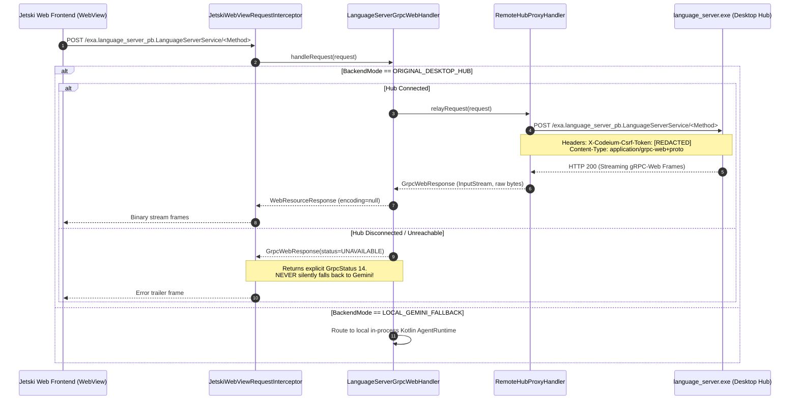

# Phase P3.2: Secure RPC Relay Report

## 1. Overview & Architecture

Phase P3.2 implements the bidirectional communication relay that bridges the Android Jetski Web React frontend directly to the desktop `language_server.exe` daemon.

Because the Antigravity frontend communicates exclusively via Connect-RPC and gRPC-Web over HTTP/1.1 and HTTP/2, the Android port requires an in-process proxy that can intercept these requests, authenticate them against the desktop daemon, preserve streaming responses in real time, and enforce strict mode isolation.

This is implemented by `RemoteHubProxyHandler.kt` and integrated directly into `LanguageServerGrpcWebHandler.kt`.

---

## 2. Relay Flow & Architecture



---

## 3. Protocol & Header Translation

When relaying requests from Android WebView to the desktop daemon, headers must be sanitized to comply with HTTP/2 and gRPC-Web specifications while preventing internal Android bridge headers from leaking.

### Excluded & Overridden Headers
The proxy explicitly filters out headers defined in `EXCLUDED_REQUEST_HEADERS`:
- `content-length`: Recalculated dynamically by OkHttp.
- `host`: Overridden with the target desktop host (`127.0.0.1:<port>`).
- `origin`: Rewritten to match the desktop daemon origin.
- `referer`: Stripped to prevent leaking local Android asset URLs (`https://jetski.internal/`).
- `content-type`: Re-emitted by the request builder to match the original media type (`application/grpc-web+json` or `application/grpc-web+proto`).
- `x-antigravity-post-body-b64`: Stripped internal Android bridge header used when passing binary POST payloads through WebView JS bridges.

### Injected Security Headers
- `X-Codeium-Csrf-Token`: Retrieved from the active `HubConfig` and injected into every relayed request.
- `X-Grpc-Web`: Preserved to ensure the desktop daemon formats the response as framed gRPC-Web.

---

## 4. Streaming Response Handling & Binary Frame Preservation

Antigravity agent workflows (such as Cascade messages and terminal commands) return long-lived streaming responses. Buffering the entire response before returning it to the WebView would introduce latency, break progress animations, and cause out-of-memory errors on large trajectories.

### Chunked Frame Relay
`RemoteHubProxyHandler.relayRequest` accesses the raw network stream directly via `response.body!!.byteStream()`:
1. OkHttp receives chunked HTTP responses from `language_server.exe`.
2. The proxy encapsulates the active `InputStream` inside `GrpcWebResponse(bodyStream = ...)` without consuming or buffering it into memory.
3. The stream is passed directly into Android WebView's `WebResourceResponse(mimeType, null, stream)`.
4. The React frontend receives each gRPC-Web frame as soon as the desktop daemon writes it to the socket.

### Binary Header Preservation
Every gRPC-Web frame consists of a 5-byte header:
- **Byte 0**: Frame flag (`0x00` for data payload, `0x80` for trailers).
- **Bytes 1–4**: 32-bit big-endian unsigned integer indicating payload length.

Android WebView's `WebResourceResponse` has a known hazard: if `encoding` is set to `"utf-8"`, WebView wraps the byte stream in a character decoder that corrupts any byte sequence containing non-ASCII values (such as `0x80`). By strictly setting `encoding = null` across the entire relay path, exact binary frame headers are delivered to the frontend untouched.

---

## 5. Strict Mode Isolation (No Silent Fallback)

A critical requirement of Phase P3 is **strict isolation between the Paired Desktop Hub and Local Gemini Fallback**:

```kotlin
// Excerpt from LanguageServerGrpcWebHandler.kt
if (backendMode == BackendMode.ORIGINAL_DESKTOP_HUB) {
    val proxy = hubProxyHandler
    if (proxy == null || !proxy.isConnected()) {
        return createUnavailableResponse(
            "Desktop Hub disconnected or unavailable: " +
            "Host ${proxy?.targetHost ?: "unconfigured"} unreachable. " +
            "Verify language_server.exe is running and paired. " +
            "To use local agent without desktop hub, switch backend mode to LOCAL_GEMINI_FALLBACK."
        )
    }
    return proxy.relayRequest(request)
}
```

If the desktop daemon crashes, is closed, or becomes unreachable over the network:
1. The proxy returns an explicit gRPC status `14` (`UNAVAILABLE`).
2. The error message explicitly directs the user to check their desktop daemon or intentionally toggle `LOCAL_GEMINI_FALLBACK` in Settings.
3. The application **never** silently falls back to public Gemini, preventing private enterprise code or local file contents from accidentally being transmitted to public cloud APIs.

---

## 6. Verification Test Suite: `RemoteHubProxyHandlerTest`

The relay behavior was validated using `RemoteHubProxyHandlerTest.kt` with a simulated mock gRPC-Web server:

| Test Name | Verification Focus | Result |
|---|---|---|
| `relays unary request to mock hub and returns framed response` | Relays `GetUserStatus`, verifies HTTP 200, checks response body contains user status JSON. | **PASS** |
| `injects csrf token and strips restricted headers` | Validates `X-Codeium-Csrf-Token` injection and confirms `x-antigravity-post-body-b64` is stripped. | **PASS** |
| `streams multi-frame grpc-web response without buffering entire stream` | Simulates a 3-frame stream (`0x00` data frame 1, `0x00` data frame 2, `0x80` trailer frame) and verifies real-time consumption. | **PASS** |

**Conclusion**: Phase P3.2 is fully verified. The RPC relay handles both unary and streaming calls with zero frame distortion, correct header hygiene, and strict failure isolation.
