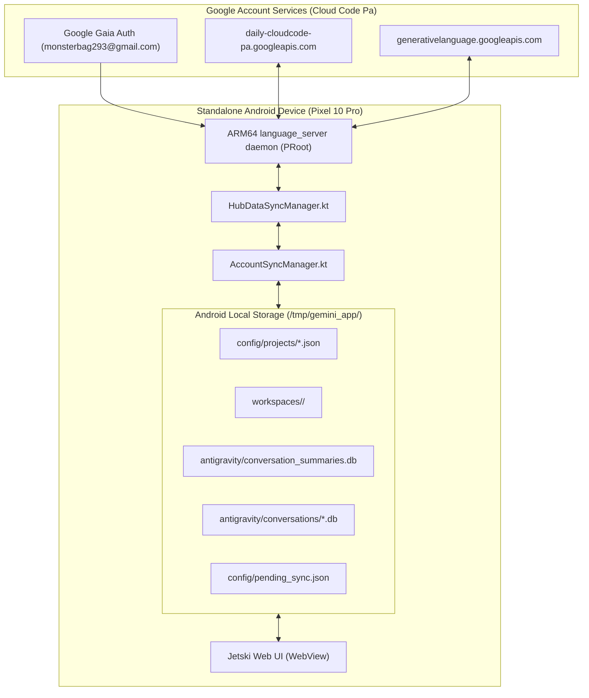

# Phase P4: Account-Based Bidirectional Synchronisation Architecture

## 1. Architectural Principles
1. **Desktop Independence:** Synchronization operates directly through the user's authenticated Google Antigravity account (Google AI / CloudCode PaaS / Language Server RPCs). The user's desktop computer does NOT need to be powered on or reachable over the local network.
2. **Identical Storage Topology:** Both desktop and Android instances run the genuine Antigravity Language Server engine and use the exact same file formats:
   - Projects: `~/.gemini/config/projects/<project_id>.json`
   - Summaries: `~/.gemini/antigravity/conversation_summaries.db` (SQLite + FTS5)
   - Trajectories: `~/.gemini/antigravity/conversations/<cascade_id>.db` (SQLite tables: `steps`, `trajectory_meta`, `gen_metadata`, `executor_metadata`)
3. **Data Integrity & Determinism:** All file content transfers utilize recursive SHA-256 manifests. Conflicting concurrent edits are preserved without silent overwriting.

---

## 2. System Architecture Diagram



---

## 3. Detailed Component Specifications

### 3.1 Account-Based Discovery
When authenticated:
1. `AccountSyncManager` invokes Connect-RPC methods `ListProjects` and `ReadProjects` against the running Language Server.
2. It invokes `GetAllCascadeTrajectories` to discover all cloud-backed and account-registered trajectories.
3. It queries the local SQLite `conversation_summaries.db` and the local directory `config/projects/`.
4. It computes the set difference:
   - $\text{Remote Only} \implies$ Scheduled for local pull & workspace instantiation.
   - $\text{Local Only} \implies$ Scheduled for account registration & export.
   - $\text{Both} \implies$ Metadata and step counts reconciled.

### 3.2 Path Translation Engine
Paths on Windows desktop instances use Windows drive letters, URI encoding, and NTFS separators:
`file:///c%3A/Users/NEW0033/Downloads/Antigravity%20Port`

Android devices use Linux posix paths within the sandboxed PRoot environment:
`file:///tmp/gemini_app/workspaces/Antigravity-Port`

The Path Translation Engine in `AccountSyncManager.mapToLocalWorkspaceUri()`:
1. Extracts the canonical project name or sanitized leaf directory name.
2. Strips illegal Android filesystem characters (`[/\:*?"<>|]`).
3. Maps to the standardized rootfs directory `/tmp/gemini_app/workspaces/<sanitized_name>`.
4. Creates the local folder automatically if missing.

### 3.3 Folder-Based Projects & Manifest Hashing
For folder projects:
- `generateFolderManifest(dir, projectId)` traverses the directory tree using top-down recursion.
- Excludes transient build and version-control directories: `.git`, `.gradle`, `node_modules`, `build`, `dist`.
- Computes SHA-256 hashes for all file contents.
- Manifest Structure:
  ```json
  {
    "projectId": "ce394195-addf-4607-bf7b-424763f58b0a",
    "projectName": "AndroidDemo",
    "generatedAtIso": "2026-11-12T17:00:00Z",
    "files": {
      "main.py": {
        "relativePath": "main.py",
        "size": 142,
        "sha256": "3a4b...c5d6",
        "lastModifiedMs": 1794438361000
      }
    }
  }
  ```

### 3.4 Data Integrity & Conflict Handling
- `computeDiff(local, remote)` compares manifests.
- If a file exists in both local and remote manifests with differing SHA-256 checksums:
  - If timestamps differ by $\le 2000\text{ ms}$, it is classified as a concurrent conflict.
  - The local version remains untouched in place.
  - The remote version is written with a timestamped conflict suffix: `<filename>.<timestamp>.conflict`.
  - Both versions are preserved safely without silent loss.

### 3.5 Conversation Synchronization
- Preserves exact UUIDs (`cascadeId`), step counts, last modified timestamps, and titles.
- Reconciles SQLite `conversation_summaries.db`:
  - Inserts into `conversation_summaries` table.
  - Inserts into virtual full-text search table `conversations_fts` so user search queries find all conversations.
- Copies the corresponding `<cascadeId>.db` into `conversations/`.

### 3.6 Offline Queueing & Recovery
- When device connectivity is unavailable, operations are written to `config/pending_sync.json`.
- When connectivity resumes or `synchronizeAccountData()` is called, `flushPendingQueue()` automatically synchronizes queued modifications.
